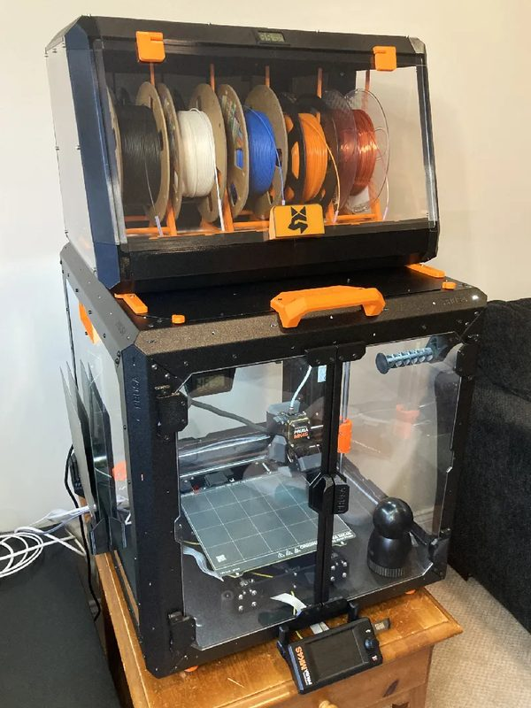
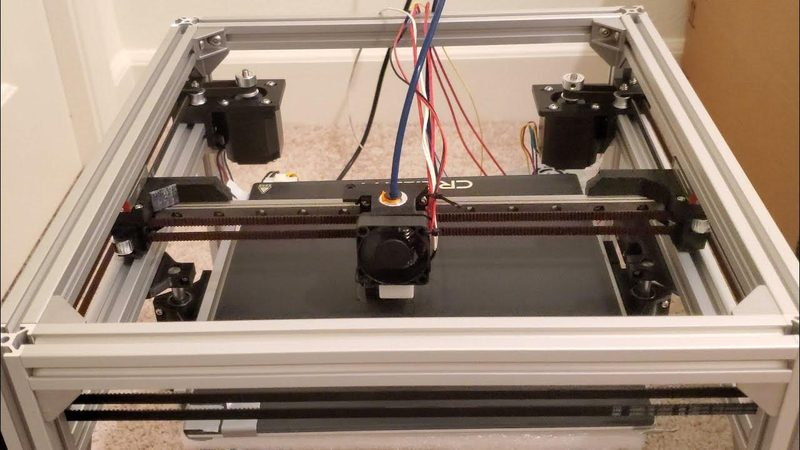

# FuseBox3

[Catalog row](../../README.md#fusebox3) · [Gallery](../../GALLERY.md)

| Field | Value |
| --- | --- |
| Section | Legacy designs |
| Project page | [https://github.com/alexyu132/fusebox3](https://github.com/alexyu132/fusebox3) |
| Author | Alex Yu |
| About | Midsize CoreXY using linear rails and a belt-driven Z; creator marks it under development. No update since 2024-02 and no active group. |
| Build volume (X×Y×Z) | 235×235×235 |
| Exterior (W×D×H) | 350×372×427 |
| Latest version | CAD [2024-02](https://github.com/alexyu132/fusebox3/commit/9c494a677b439fe6ca2699f7f0f0948dd96e7325) |
| Stars Likes Views |  [⏯️⁠5.2K](https://www.youtube.com/watch?v=BQQiwGdlbZI) [❤️⁠40](https://www.youtube.com/watch?v=BQQiwGdlbZI) |
| Links | [BOM](https://github.com/alexyu132/fusebox3/blob/master/documentation/BOM.md) [CAD](https://github.com/alexyu132/fusebox3/blob/master/fusebox3.skp) |
| Groups | — |

## Pictures (3)

<table>
<tr><td align="center" width="33%"></td><td align="center" width="33%"></td><td align="center" width="33%"></td></tr>
</table>
