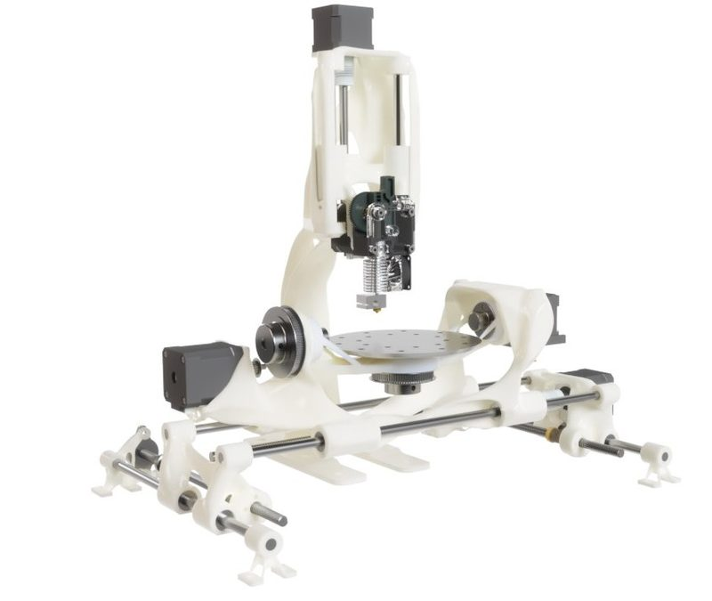
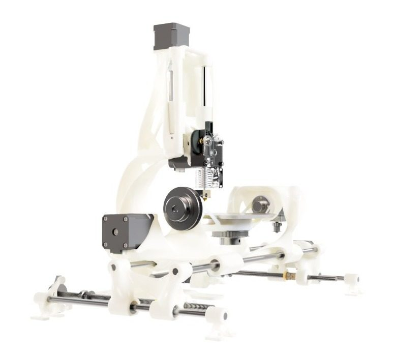
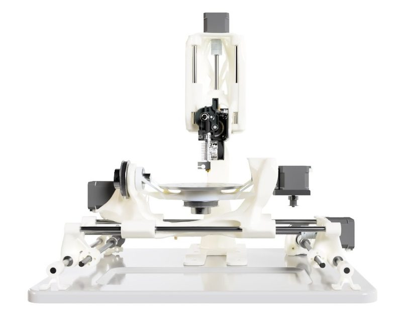
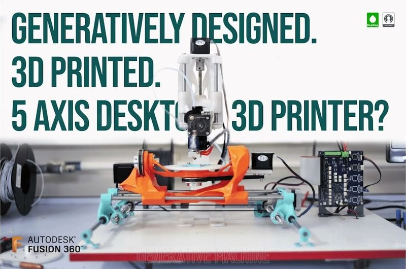
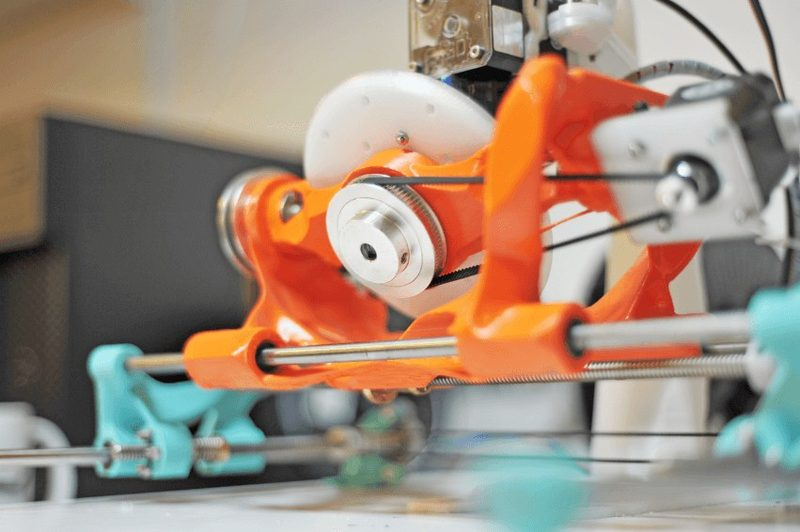
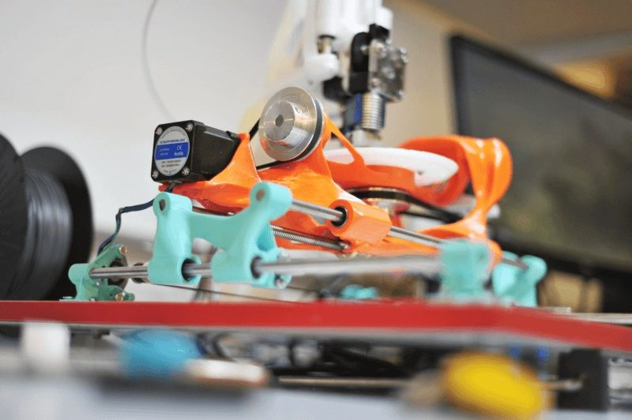
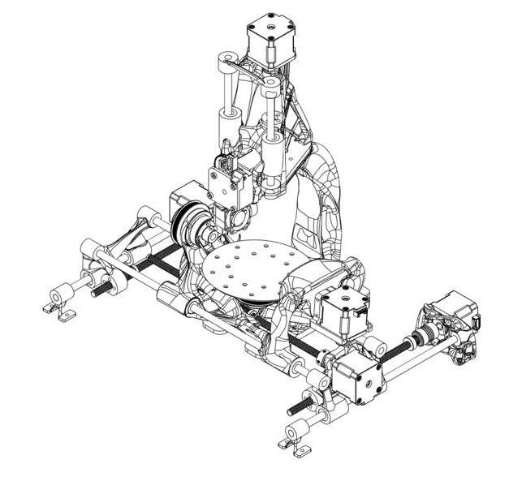

# Gen5X

[Catalog row](../../README.md#gen5x) · [Gallery](../../GALLERY.md)

| Field | Value |
| --- | --- |
| Section | 5-axis |
| Project page | [https://github.com/GenerativeMachine/Gen5X](https://github.com/GenerativeMachine/Gen5X) |
| Author | Ric Real / Generative Machine |
| About | Printed frame shaped by generative design in Fusion 360. A trunnion bed tilts and spins for five axes, on a Duet 2 with RepRapFirmware. The repo has STL files, a parts list, and a config. The Fusion 360 links no longer open, and the repo has no STEP files. |
| Build volume (X×Y×Z) | — |
| Exterior (W×D×H) | — |
| Latest version | Files [2023-01](https://github.com/GenerativeMachine/Gen5X/commit/f1ed07278acc3515e1f4db8dda1e63cf91b136a2) |
| Stars Likes Views |  [💙⁠147](https://www.thingiverse.com/thing:5840067) [⏯️⁠43K](https://www.youtube.com/watch?v=1nEVuf8HH0A) [❤️⁠517](https://www.youtube.com/watch?v=1nEVuf8HH0A) |
| Links | [STL](https://github.com/GenerativeMachine/Gen5X/tree/main/Gen5X%20V1%20STL%20Files) [BOM](https://github.com/GenerativeMachine/Gen5X/blob/main/Parts%20List%20and%20Assembly/Gen5X%20V1%20Parts%20list.pdf) [CAD](https://grabcad.com/library/gen5x-1) Fusion 360 [Config](https://github.com/GenerativeMachine/Gen5X/tree/main/Gen5X%20Firmware) [Video](https://www.youtube.com/watch?v=1nEVuf8HH0A) |
| Groups | — |
| License | [MIT (GitHub), CC BY 4.0 (Thingiverse)](https://github.com/GenerativeMachine/Gen5X/blob/main/LICENSE) |

## Pictures (7)

<table>
<tr><td align="center" width="33%"> Photo: <a href="https://hackaday.io/Ric.Real">Ric Real</a></td><td align="center" width="33%"> Photo: <a href="https://github.com/GenerativeMachine">Generative Machine</a></td><td align="center" width="33%"> Photo: <a href="https://hackaday.io/Ric.Real">Ric Real</a></td></tr>
<tr><td align="center" width="33%"> Photo: <a href="https://www.youtube.com/@generativemachine">Generative Machine</a></td><td align="center" width="33%"> Photo: <a href="https://hackaday.io/Ric.Real">Ric Real</a></td><td align="center" width="33%"> Photo: <a href="https://hackaday.io/Ric.Real">Ric Real</a></td></tr>
<tr><td align="center" width="33%"> Photo: unknown</td></tr>
</table>
