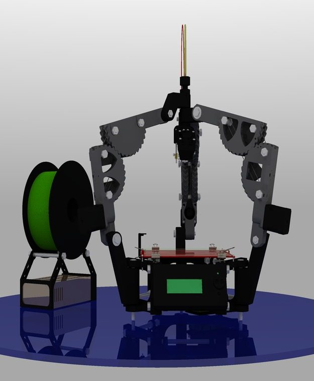
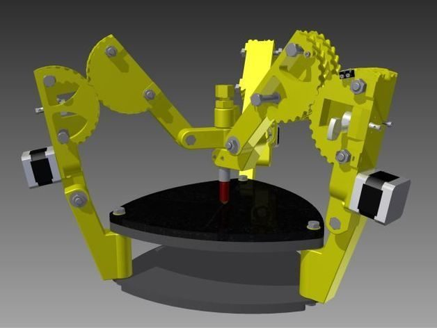
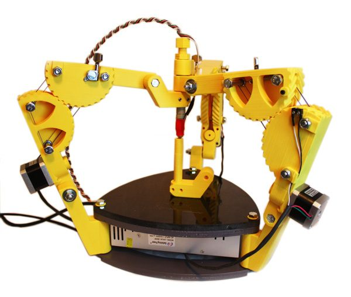
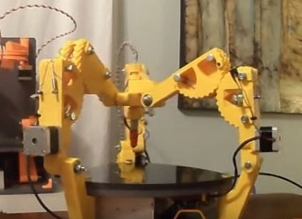
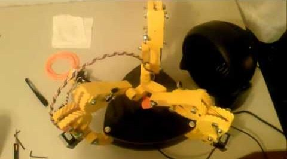
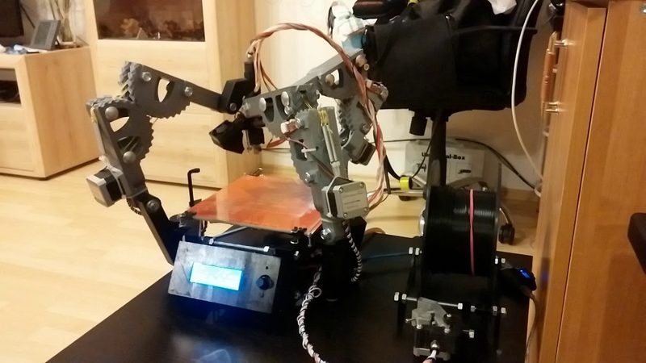
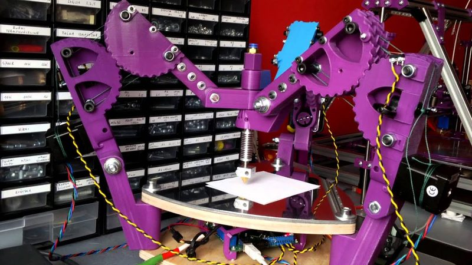

# GUS Simpson

[Catalog row](../../README.md#gus-simpson) · [Gallery](../../GALLERY.md)

| Field | Value |
| --- | --- |
| Section | Historical designs |
| Project page | [https://reprap.org/wiki/GUS_Simpson](https://reprap.org/wiki/GUS_Simpson) |
| Author | Simpson family |
| About | Experimental grounded delta prototype with an unusual arm layout. |
| Build volume (X×Y×Z) | — |
| Exterior (W×D×H) | — |
| Latest version | CAD [2014-01](https://github.com/NicholasSeward/ConceptFORGE/commit/3dcbc6ba5797609bff680bafbcaf4fe8c3eb378b) |
| Stars Likes Views | [⏯️⁠81.7K](https://www.youtube.com/watch?v=IEGTe1G2Gqs) [❤️⁠402](https://www.youtube.com/watch?v=IEGTe1G2Gqs) |
| Links | — |
| Groups | [Forum](https://reprap.org/forum/list.php?178) EN |

## Pictures (7)

<table>
<tr><td align="center" width="33%"></td><td align="center" width="33%"></td><td align="center" width="33%"></td></tr>
<tr><td align="center" width="33%"></td><td align="center" width="33%"></td><td align="center" width="33%"></td></tr>
<tr><td align="center" width="33%"></td></tr>
</table>
