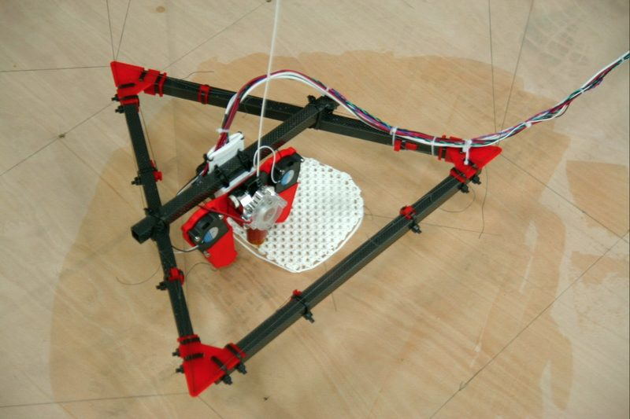
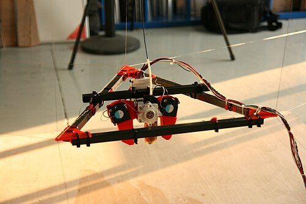
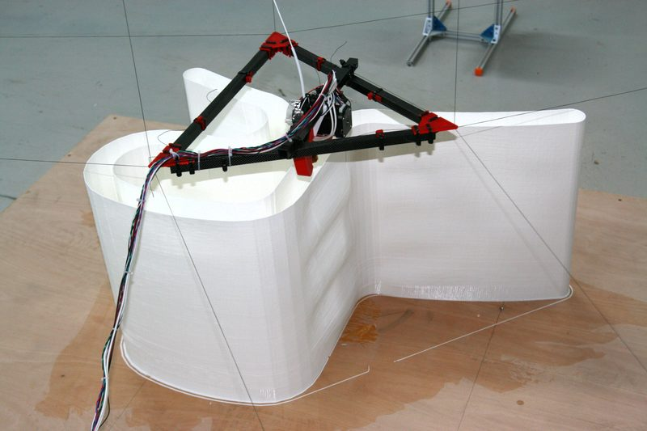
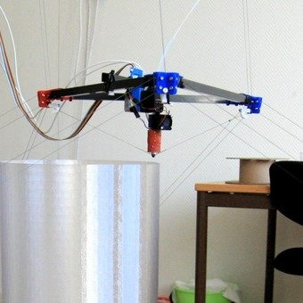
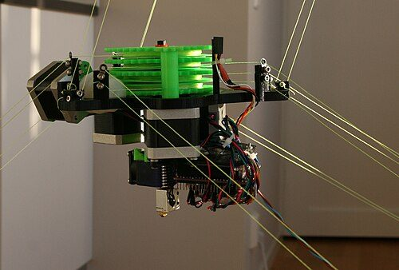
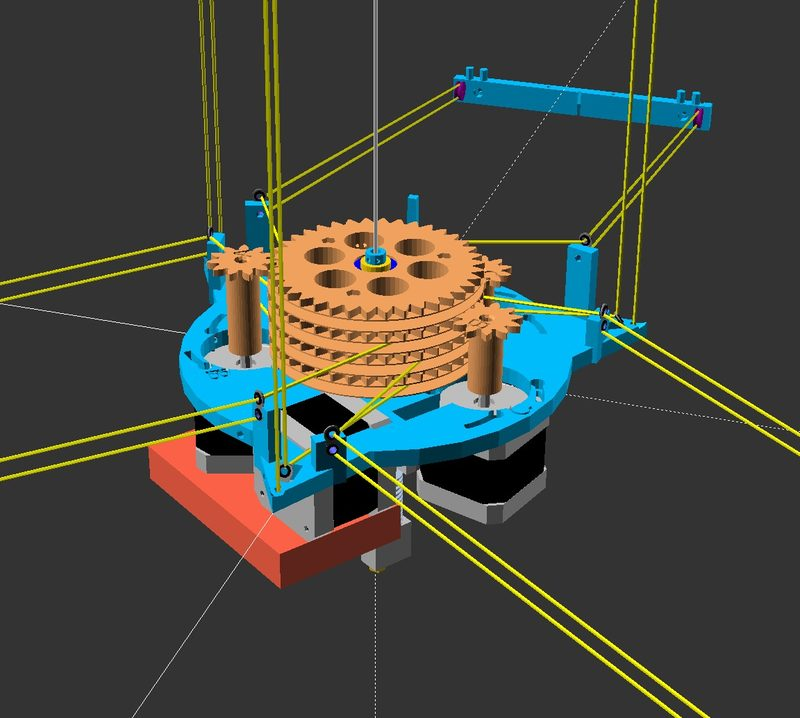

# Hangprinter

[Catalog row](../../README.md#hangprinter) · [Gallery](../../GALLERY.md)

| Field | Value |
| --- | --- |
| Section | Other motion systems |
| Project page | [https://github.com/tobbelobb/hangprinter](https://github.com/tobbelobb/hangprinter) |
| Author | Torbjørn Ludvigsen |
| About | Cable-suspended, frameless printer. HP4 is the current design, and the unfinished HP5 work is on the version_5 branch. |
| Build type | Cable-driven |
| Build volume (X×Y×Z) | configurable |
| Exterior (W×D×H) | — |
| Latest version | v4 [2023-06](https://github.com/tobbelobb/hangprinter/commit/9d2fabc9dbaa2ec646fc4daec0258aa1ea0a3e66) |
| Stars Likes Views |  [⏯️⁠88.5K](https://www.youtube.com/watch?v=ULJqLSTriRY) [❤️⁠615](https://www.youtube.com/watch?v=ULJqLSTriRY) |
| Links | [Files](https://github.com/tobbelobb/hangprinter) v4 [Manual](https://hangprinter.org/doc/v4/) v4 |
| Groups | [Facebook](https://www.facebook.com/groups/hangprinter) EN 1.1K [Discord](https://discord.gg/KAV7x3hgRX) EN 289 |
| License | [GPL-2.0](https://github.com/tobbelobb/hangprinter/blob/version_4/LICENSE) |

## Pictures (7)

<table>
<tr><td align="center" width="33%"></td><td align="center" width="33%"> Photo: <a href="https://github.com/tobbelobb">Torbjørn Ludvigsen</a></td><td align="center" width="33%"> Photo: <a href="https://github.com/tobbelobb">Torbjørn Ludvigsen</a></td></tr>
<tr><td align="center" width="33%"> Photo: <a href="https://github.com/tobbelobb">Torbjørn Ludvigsen</a></td><td align="center" width="33%"> Photo: <a href="https://github.com/tobbelobb">Torbjørn Ludvigsen</a></td><td align="center" width="33%"> Photo: <a href="https://github.com/tobbelobb">Torbjørn Ludvigsen</a></td></tr>
<tr><td align="center" width="33%"> Photo: <a href="https://github.com/tobbelobb">Torbjørn Ludvigsen</a></td></tr>
</table>

## Other homes of the files

- [GitLab](https://gitlab.com/tobben/hangprinter): full mirror of the repository with the same branches, OpenSCAD sources, STL, docs, and firmware. GPL-2.0.
- [hangprinter.org](https://hangprinter.org/): v3 and v4 docs, FAQ, and the project status. GPL-2.0 for the repository (FAQ).
- Wayback Machine: [latest snapshot](https://web.archive.org/web/20260218215213/https://github.com/tobbelobb/hangprinter), 2026-02-18.
