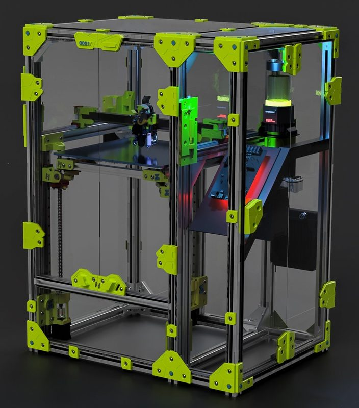
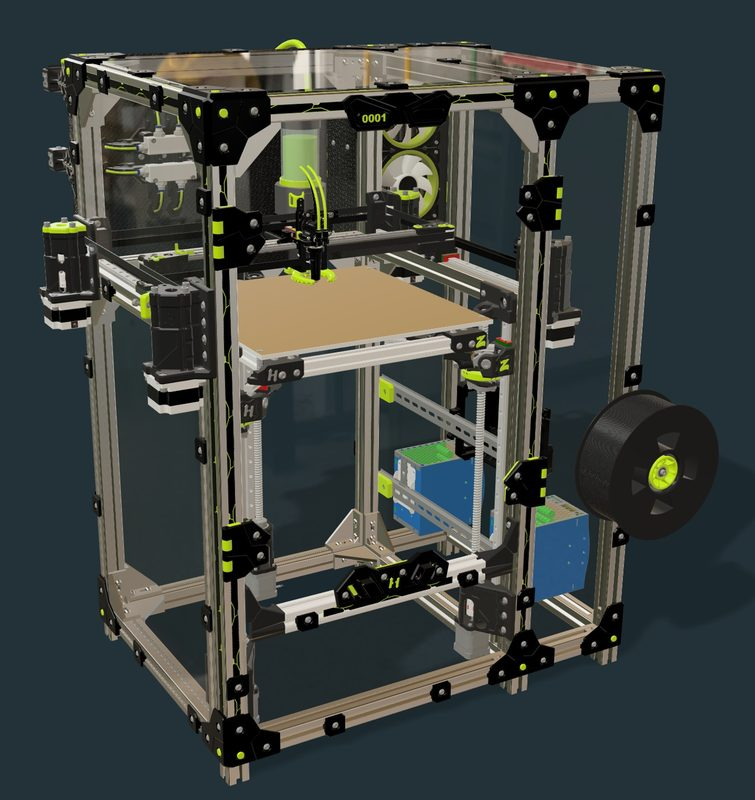
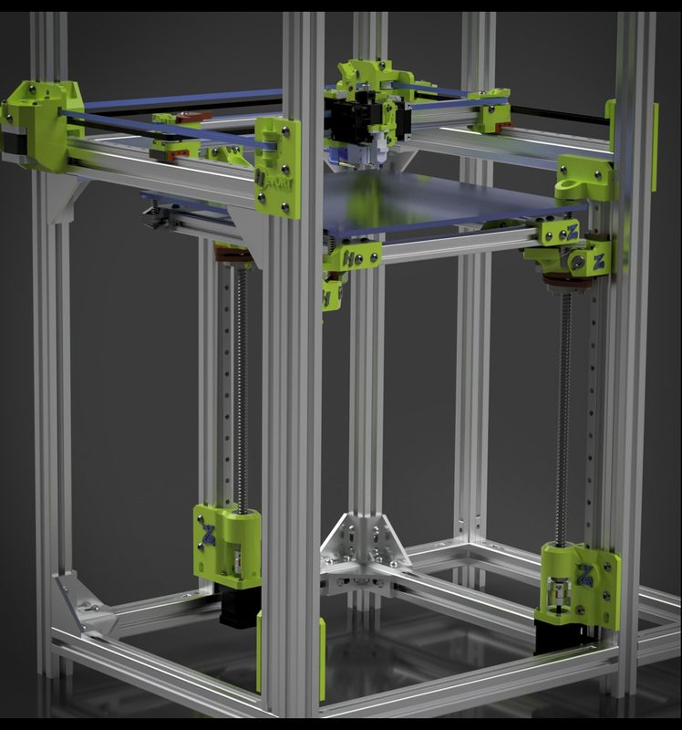
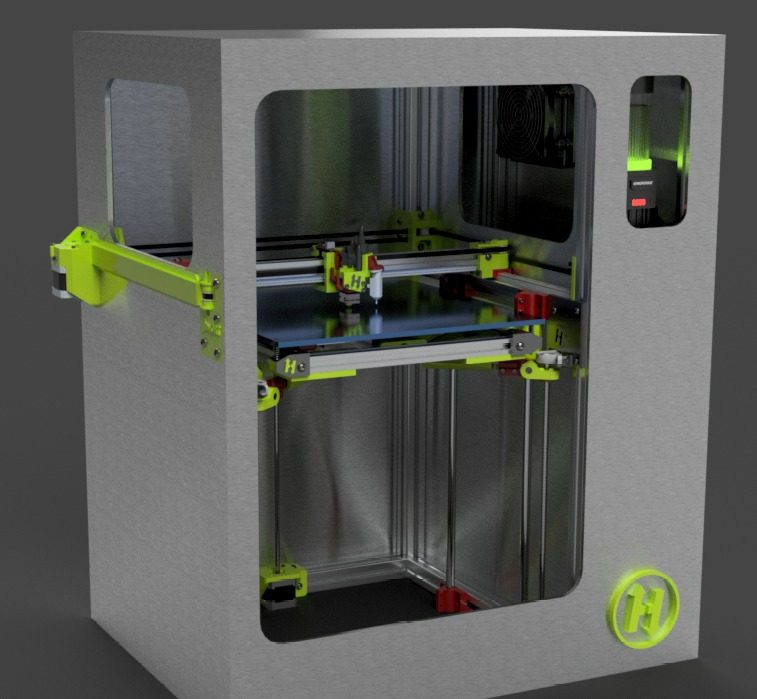
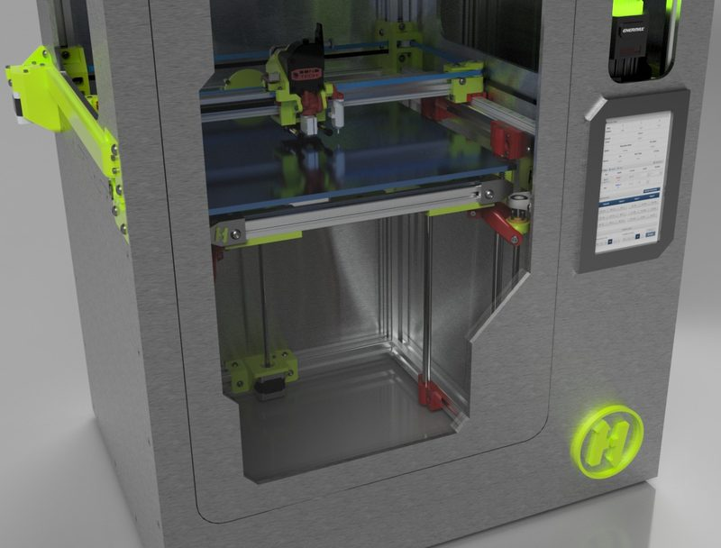
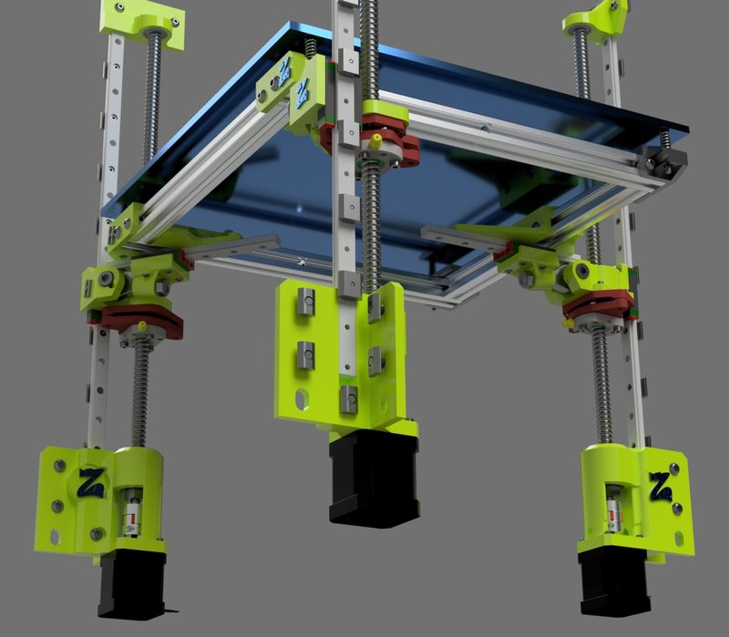
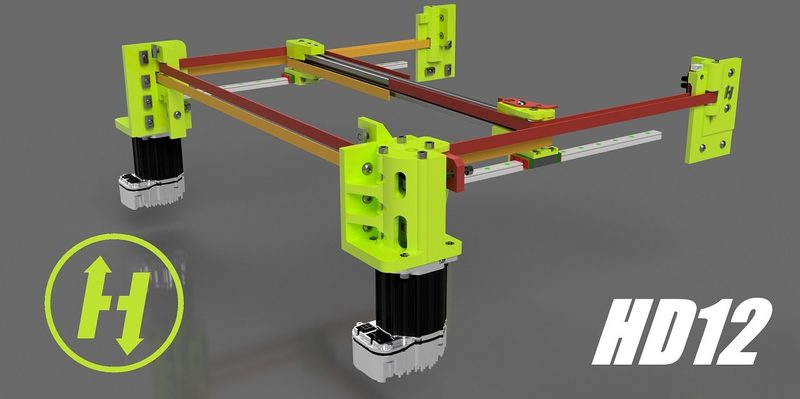
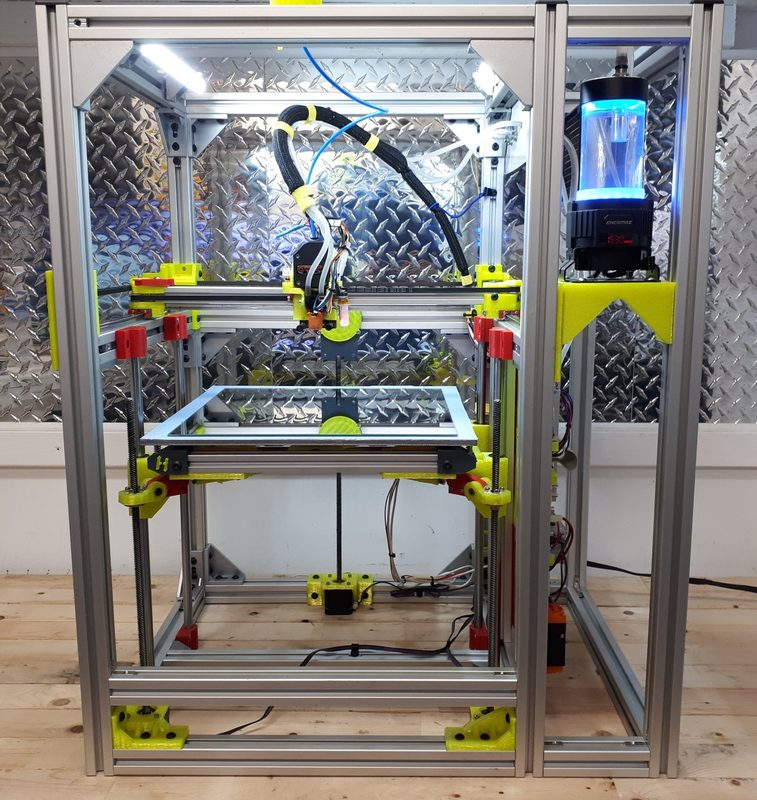
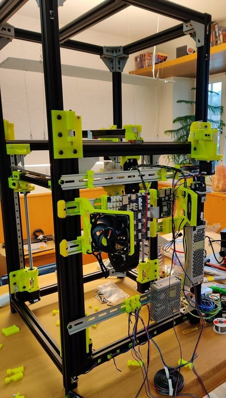
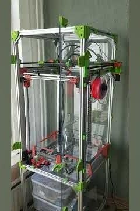

# HevORT

[Catalog row](../../README.md#hevort) · [Gallery](../../GALLERY.md)

| Field | Value |
| --- | --- |
| Section | Historical designs |
| Project page | [https://github.com/MirageC79/HevORT](https://github.com/MirageC79/HevORT) |
| Author | MirageC79 |
| About | Well-known large-format DIY CoreXY community design. The author seems inactive since 2024. |
| Build volume (X×Y×Z) | 315: 315×315×340 415: 415×415×440 |
| Exterior (W×D×H) | — |
| Latest version | ZR V2.6 [2024-09](https://github.com/MirageC79/HevORT/commit/c5fda5aa6289384b712de6a05a97f9e8f1eeac27) |
| Stars Likes Views |  [💙⁠925](https://www.thingiverse.com/thing:3532039) [⏯️⁠728K](https://www.youtube.com/watch?v=ibsBiALMMSE) [❤️⁠10.1K](https://www.youtube.com/watch?v=ibsBiALMMSE) |
| Links | [Manual](https://github.com/MirageC79/HevORT/tree/HEAD/docs) [BOM](https://github.com/MirageC79/HevORT/tree/HEAD/bom) |
| Groups | [Facebook](https://www.facebook.com/groups/hevort) EN 6.6K [Discord](https://discord.gg/nCYRQAZPWV) EN 3.8K |
| License | [CC BY-NC 4.0](https://github.com/MirageC79/HevORT/blob/master/LICENSE.md) |

## Pictures (10)

<table>
<tr><td align="center" width="33%"> Photo: <a href="https://github.com/MirageC79">MirageC79</a></td><td align="center" width="33%"> Photo: <a href="https://github.com/MirageC79">MirageC79</a></td><td align="center" width="33%"> Photo: <a href="https://www.thingiverse.com/MirageC">MirageC</a></td></tr>
<tr><td align="center" width="33%"> Photo: <a href="https://www.thingiverse.com/MirageC">MirageC</a></td><td align="center" width="33%"> Photo: <a href="https://www.thingiverse.com/MirageC">MirageC</a></td><td align="center" width="33%"> Photo: <a href="https://github.com/MirageC79">MirageC79</a></td></tr>
<tr><td align="center" width="33%"> Photo: <a href="https://github.com/MirageC79">MirageC79</a></td><td align="center" width="33%"> Photo: <a href="https://www.thingiverse.com/MirageC">MirageC</a></td><td align="center" width="33%"> Photo: <a href="https://www.printables.com/@Mike_wth_128018">Mike_wth</a></td></tr>
<tr><td align="center" width="33%"> Photo: <a href="https://www.youtube.com/@Ilja_85">My engineering noodles</a></td></tr>
</table>
