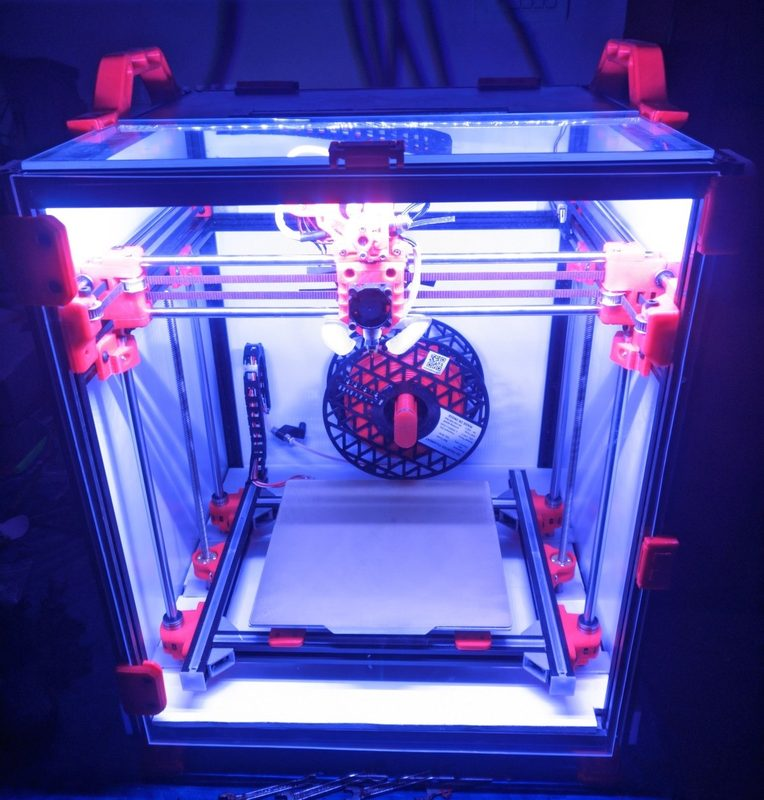
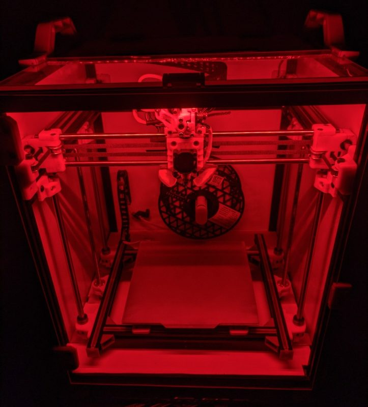
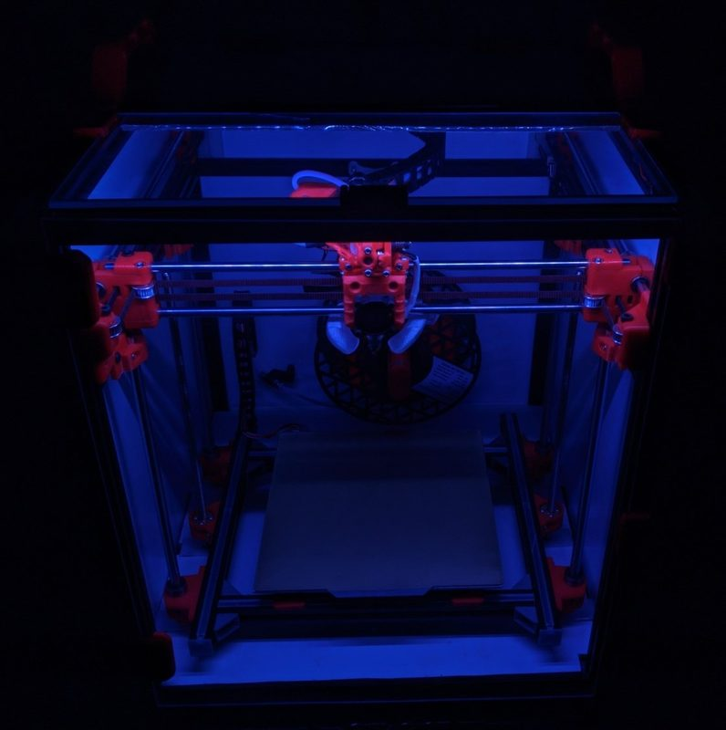
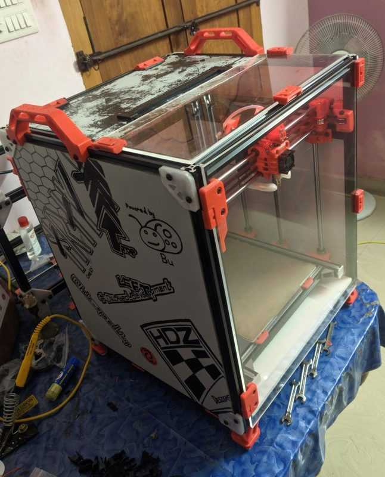
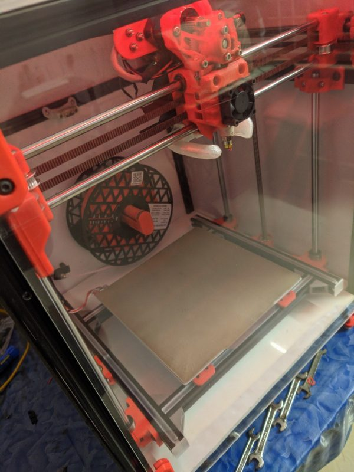
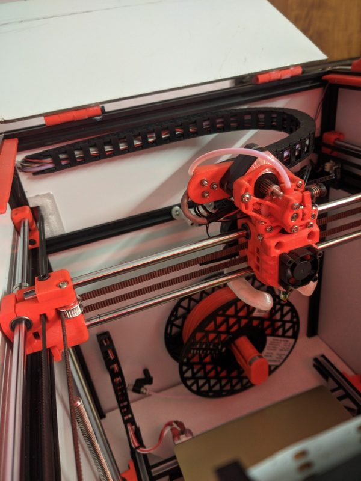

# Hræfn CoreXY

[Catalog row](../../README.md#hraefn-corexy) · [Gallery](../../GALLERY.md)

| Field | Value |
| --- | --- |
| Section | CoreXY · Medium (181–299 mm representative X/Y size) |
| Project page | [https://github.com/hdzdesigns/Hraefn-CoreXY](https://github.com/hdzdesigns/Hraefn-CoreXY) |
| Author | HDz Designs (Hamil Sunny) |
| About | Enclosed 2020-frame CoreXY on LM8UU and LM10UU rod bearings instead of linear rails. It takes an Ender-3 bed and offers a rigid bed or a triple-Z bed. |
| Build volume (X×Y×Z) | 235×235×? |
| Exterior (W×D×H) | — |
| Latest version | Alpha v3 [2024-03](https://github.com/hdzdesigns/Hraefn-CoreXY/commit/5252007cd1e9142d507dcfd57f085475d5a7cedb) |
| Stars Likes Views |  [🧡⁠77](https://www.printables.com/model/562263) [💚⁠37](https://makerworld.com/en/models/23983) [⏯️⁠961](https://www.youtube.com/watch?v=wAyZFrnYMr8) [❤️⁠9](https://www.youtube.com/watch?v=wAyZFrnYMr8) |
| Links | [STEP](https://github.com/hdzdesigns/Hraefn-CoreXY/blob/main/CAD/STEP/Hrafn_Alpha_v3_Final.STEP) Alpha v3 [CAD](https://github.com/hdzdesigns/Hraefn-CoreXY/tree/main/CAD/SLDASM) [STL](https://github.com/hdzdesigns/Hraefn-CoreXY/tree/main/3MF,STL/STL) [Video](https://www.youtube.com/watch?v=wAyZFrnYMr8) |
| Groups | [Discord](https://discord.gg/G8GmBVaxGY) EN 557 |
| License | [CC BY 4.0](https://www.printables.com/model/562263) |

## Pictures (7)

<table>
<tr><td align="center" width="33%"> Version: rigid bed variant (left) and triple-Z bed variant (right) Photo: <a href="https://www.printables.com/@HDZDesigns">HDz_designs</a></td><td align="center" width="33%"> Photo: <a href="https://www.printables.com/@HDZDesigns">HDz_designs</a></td><td align="center" width="33%"> Photo: <a href="https://www.printables.com/@HDZDesigns">HDz_designs</a></td></tr>
<tr><td align="center" width="33%"> Photo: <a href="https://www.printables.com/@HDZDesigns">HDz_designs</a></td><td align="center" width="33%"> Photo: <a href="https://www.printables.com/@HDZDesigns">HDz_designs</a></td><td align="center" width="33%"> Photo: <a href="https://www.printables.com/@HDZDesigns">HDz_designs</a></td></tr>
<tr><td align="center" width="33%"> Photo: <a href="https://www.printables.com/@HDZDesigns">HDz_designs</a></td></tr>
</table>
