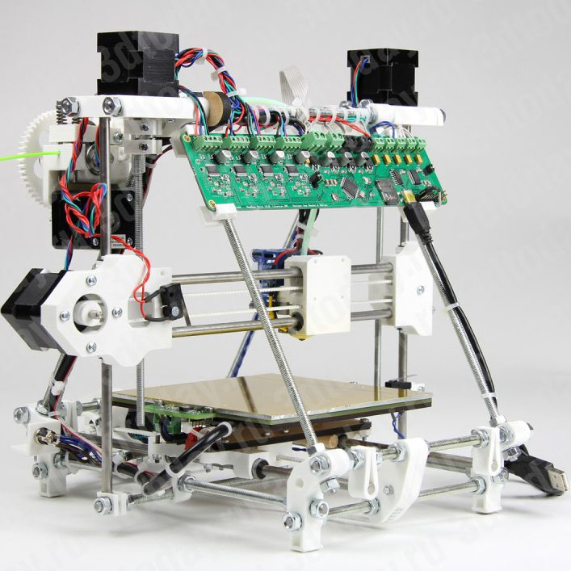
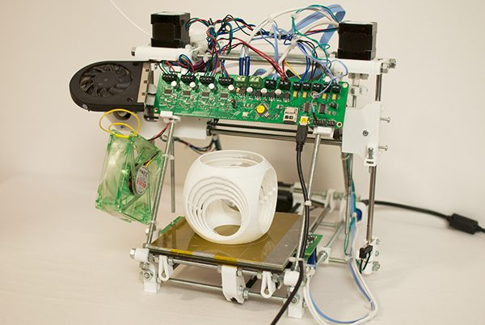
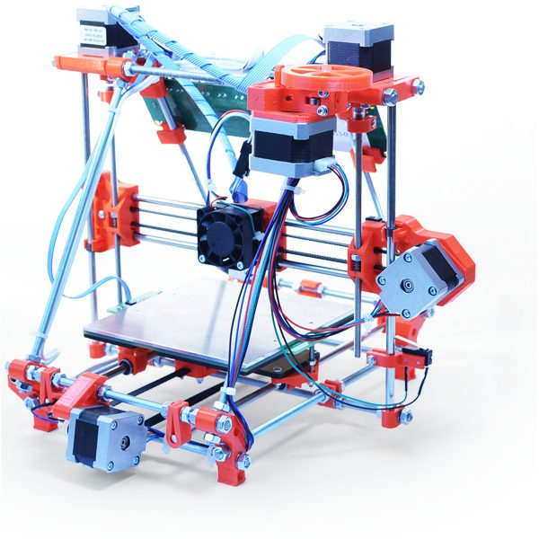
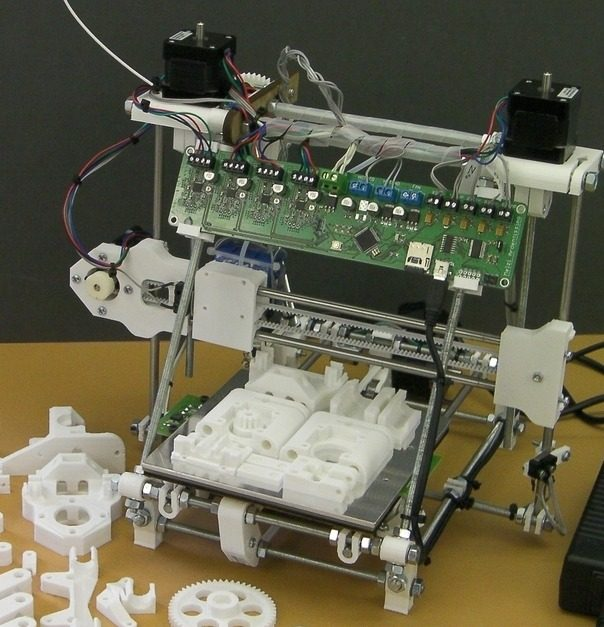
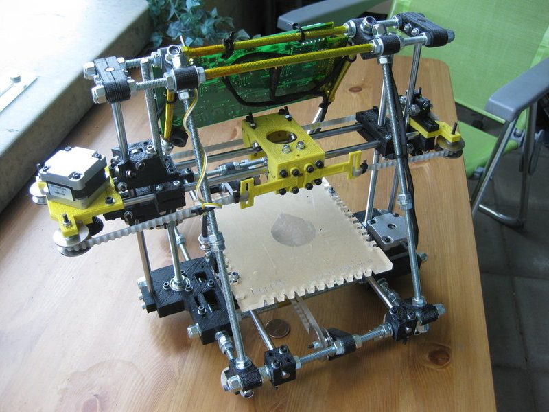

# Huxley

[Catalog row](../../README.md#huxley) · [Gallery](../../GALLERY.md)

| Field | Value |
| --- | --- |
| Section | Historical designs |
| Project page | [https://reprap.org/wiki/Huxley](https://reprap.org/wiki/Huxley) |
| Author | RepRap |
| About | Compact early Cartesian RepRap, and the first small RepRap. It began as the RepRap Mini Mendel, then came the RepRapPro Huxley kit and the dual-extruder RepRapPro Huxley Duo. |
| Build volume (X×Y×Z) | 140×140×110 |
| Exterior (W×D×H) | — |
| Latest version | Huxley Duo [2015-05](https://github.com/reprappro/huxley-duo/commit/48620590fb0521d3a84cc472c45d9e97e1f0a055) |
| Stars Likes Views | [💙⁠391](https://www.thingiverse.com/thing:16625) [⏯️⁠950](https://www.youtube.com/watch?v=qj9labKZU9g) [❤️⁠3](https://www.youtube.com/watch?v=qj9labKZU9g) |
| Links | [Files](https://github.com/reprappro/huxley-duo) Huxley Duo [Files](https://github.com/reprappro/Huxley) RepRapPro [Manual](https://reprapltd.com/reprappro/documentation/huxley/) RepRapPro [Files](https://svn.code.sf.net/p/reprap/code/trunk/huxley/) RepRap original |
| Groups | [Forum](https://reprap.org/forum/list.php?214) EN |
| License | [GPL-3.0 (Huxley Duo, GitHub README), GPL (RepRapPro Huxley, GitHub README), GPL-2.0 (Thingiverse)](https://github.com/reprappro/Huxley/blob/master/README) |

## Pictures (6)

<table>
<tr><td align="center" width="33%"> Photo: <a href="https://github.com/reprappro">RepRapPro</a></td><td align="center" width="33%"> Photo: <a href="https://github.com/reprappro">RepRapPro</a></td><td align="center" width="33%"> Photo: <a href="https://www.behance.net/matthew_buckland">Matthew Buckland</a></td></tr>
<tr><td align="center" width="33%"> Photo: <a href="https://reprapltd.com/reprappro/">RepRapPro</a></td><td align="center" width="33%"> Photo: <a href="https://www.thingiverse.com/adrian-bowyer">Adrian Bowyer</a></td><td align="center" width="33%"> Photo: <a href="https://reprap.org/wiki/User:Adrianbowyer">Adrian Bowyer</a></td></tr>
</table>

## Other homes of the files

- [Thingiverse](https://www.thingiverse.com/thing:16625): RepRapPro Huxley files as one ZIP, uploaded by Adrian Bowyer. GPL-2.0.
- [RepRap wiki, RepRapPro Huxley](https://reprap.org/wiki/RepRapPro_Huxley): kit page with links to docs and files.
- [emakershop.com manual PDF, Wayback copy](https://web.archive.org/web/20220518005153/https://emakershop.com/RepRapPro_Huxley_Instructions-2013-0314.pdf): RepRapPro Huxley assembly instructions from 2013-03. The live file is gone.
- Wayback Machine: [latest snapshot](https://web.archive.org/web/20260417022907/https://www.reprap.org/wiki/Huxley), 2026-04-17.
