# HyperCube Evolution

[Catalog row](../../README.md#hypercube-evolution) · [Gallery](../../GALLERY.md)

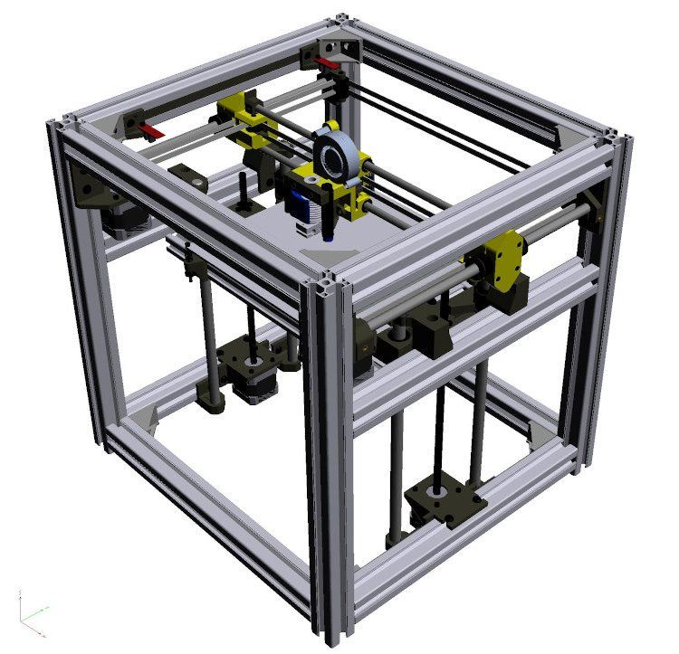

| Field | Value |
| --- | --- |
| Section | Historical designs |
| Project page | [https://www.thingiverse.com/thing:2254103](https://www.thingiverse.com/thing:2254103) |
| Author | SCOTT_3D |
| About | Aluminum-extrusion evolution of the HyperCube, and the most built DIY CoreXY before Voron. |
| Build volume (X×Y×Z) | 300×300×300 |
| Exterior (W×D×H) | 480×470×500 |
| Latest version | Log [2017-07](https://www.thingiverse.com/thing:2254103) |
| Stars Likes Views | [💙⁠11.9K](https://www.thingiverse.com/thing:2254103) [⏯️⁠362K](https://www.youtube.com/watch?v=1rctCsUGnX8) [❤️⁠2.3K](https://www.youtube.com/watch?v=1rctCsUGnX8) |
| Links | [Files](https://www.thingiverse.com/thing:2254103/files) |
| Groups | [Facebook](https://www.facebook.com/groups/Hypercubeevolution/) EN 14.8K inactive [Facebook](https://www.facebook.com/groups/1871049783171141/) EN 6.9K inactive [Facebook](https://www.facebook.com/groups/hevopro/) EN 3K inactive [Facebook](https://www.facebook.com/groups/HypercubeEvoDeutsch/) DE 2.1K inactive [Facebook](https://www.facebook.com/groups/139876176592778/) PT 2K inactive [Facebook](https://www.facebook.com/groups/hypercubeevolutionfr/) FR 1.6K inactive |

## Pictures (11)

<table>
<tr><td align="center" width="33%"> Photo: <a href="https://www.thingiverse.com/SCOTT_3D">SCOTT_3D</a></td><td align="center" width="33%"><a href="1-hypercube-evolution.jpg">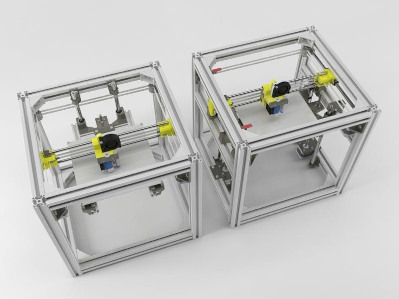</a> Photo: <a href="https://www.thingiverse.com/SCOTT_3D">SCOTT_3D</a></td><td align="center" width="33%"><a href="2-hypercube-evolution.jpg">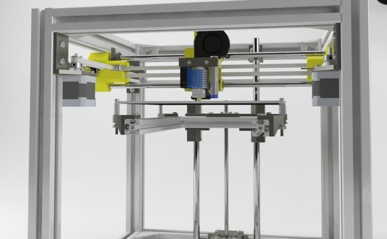</a> Photo: <a href="https://www.thingiverse.com/SCOTT_3D">SCOTT_3D</a></td></tr>
<tr><td align="center" width="33%"><a href="3-hypercube-evolution.jpg">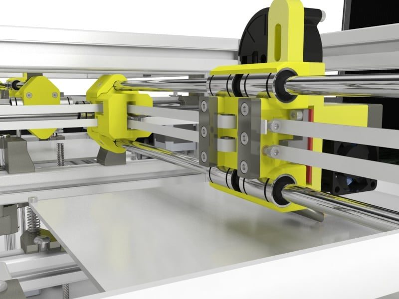</a> Photo: <a href="https://www.thingiverse.com/SCOTT_3D">SCOTT_3D</a></td><td align="center" width="33%"><a href="4-hypercube-evolution.jpg">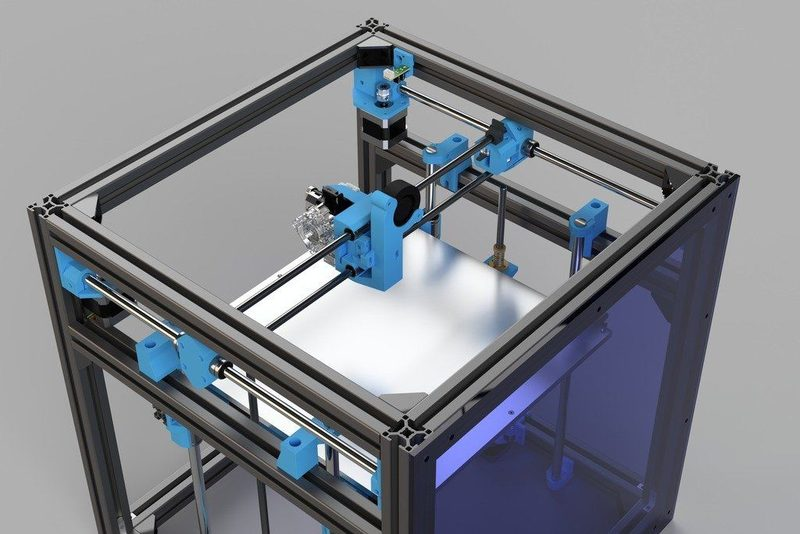</a> Photo: <a href="https://www.thingiverse.com/TunnelVision">TunnelVision</a></td><td align="center" width="33%"><a href="5-hypercube-evolution.jpg">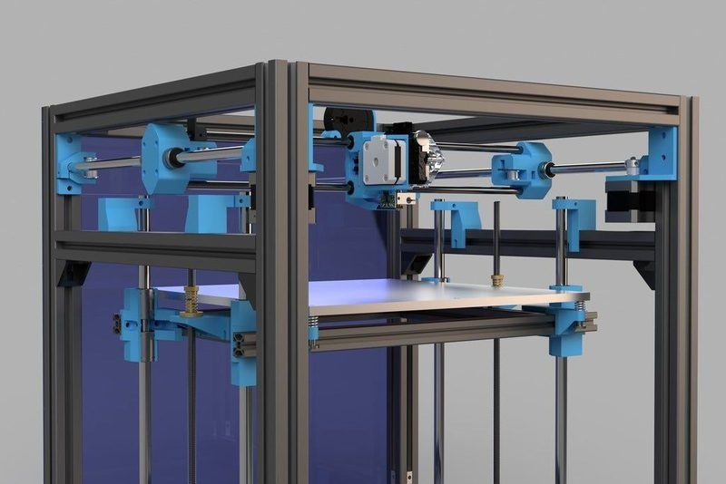</a> Photo: <a href="https://www.thingiverse.com/TunnelVision">TunnelVision</a></td></tr>
<tr><td align="center" width="33%"><a href="6-hypercube-evolution.jpg">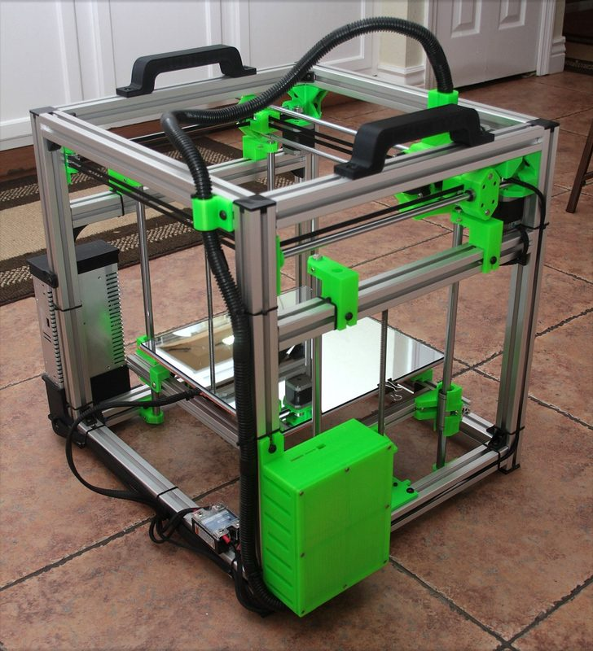</a></td><td align="center" width="33%"><a href="7-hypercube-evolution.jpg">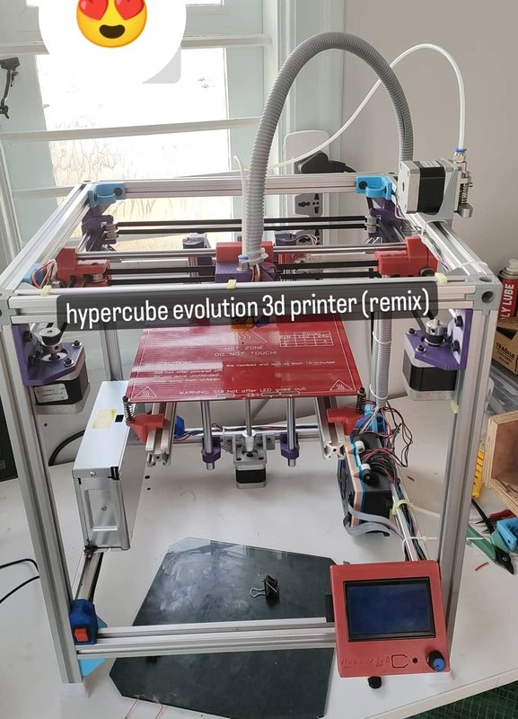</a> Photo: <a href="https://www.printables.com/@AakaarLab">Aakaar Lab</a></td><td align="center" width="33%"><a href="8-hypercube-evolution.jpg">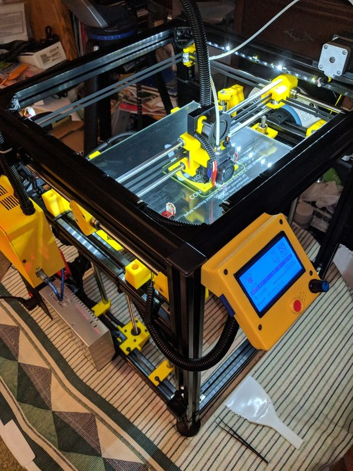</a> Photo: <a href="https://www.printables.com/@ArtieH_311835">ArtieH</a></td></tr>
<tr><td align="center" width="33%"><a href="9-hypercube-evolution.jpg">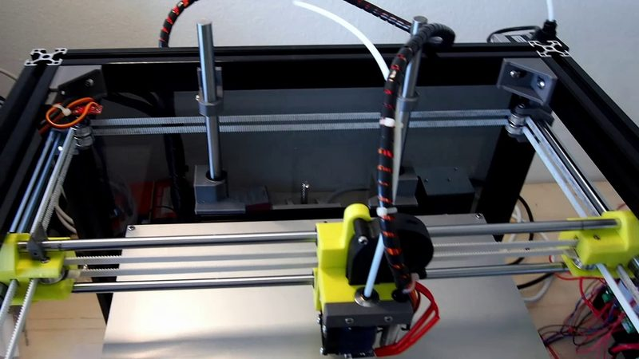</a> Photo: <a href="https://www.youtube.com/@scott3d506">Scott 3D</a></td><td align="center" width="33%"><a href="10-hypercube-evolution.jpg">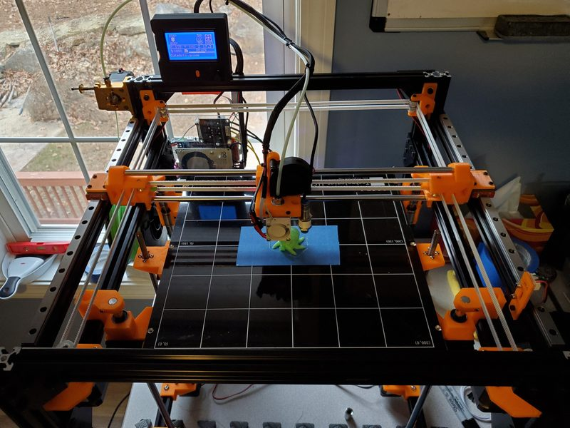</a> Photo: <a href="https://www.thingiverse.com/TunnelVision">TunnelVision</a></td></tr>
</table>
