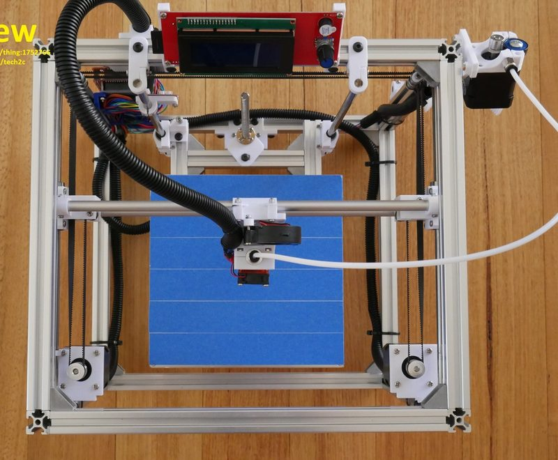
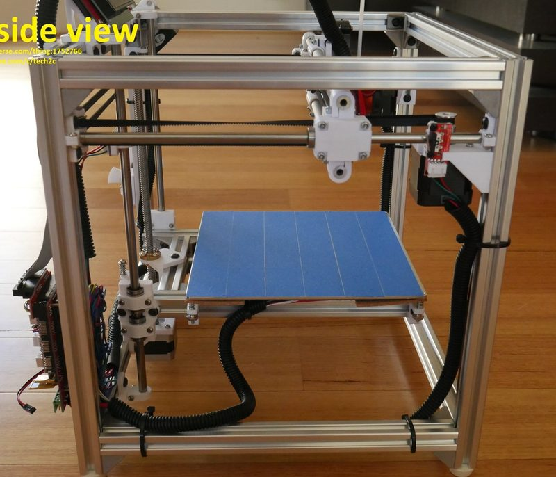
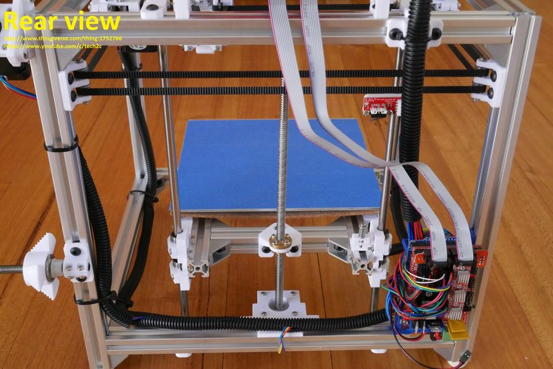
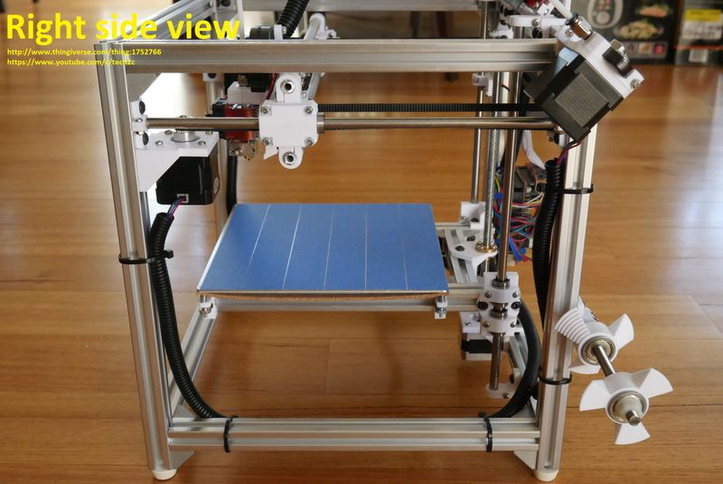
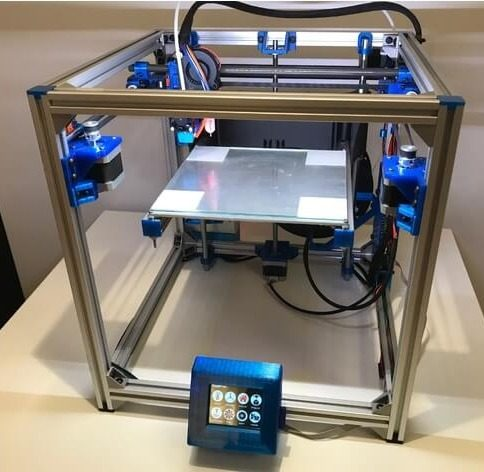
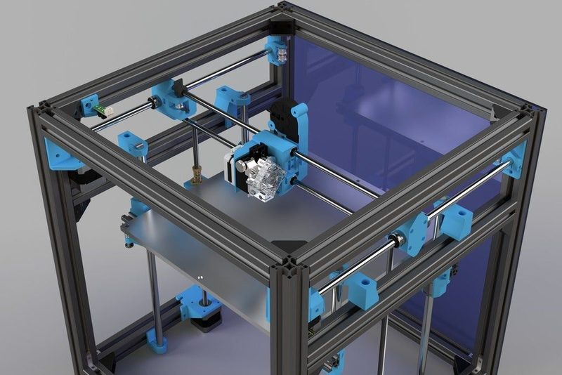

# HyperCube

[Catalog row](../../README.md#hypercube) · [Gallery](../../GALLERY.md)

| Field | Value |
| --- | --- |
| Section | Historical designs |
| Project page | [https://www.thingiverse.com/thing:1752766](https://www.thingiverse.com/thing:1752766) |
| Author | Tech2C |
| About | Influential extrusion-frame DIY CoreXY. Base and idea for many later cube builds. |
| Build volume (X×Y×Z) | 200×200×155 |
| Exterior (W×D×H) | 380×343×350 |
| Latest version | Log [2020-01](https://www.thingiverse.com/thing:1752766) |
| Stars Likes Views | [💙⁠15K](https://www.thingiverse.com/thing:1752766) [⏯️⁠280K](https://www.youtube.com/watch?v=xFt7vzweUiw) [❤️⁠2.2K](https://www.youtube.com/watch?v=xFt7vzweUiw) |
| Links | [Files](https://www.thingiverse.com/thing:1752766/files) |
| Groups | [Facebook](https://www.facebook.com/groups/1871049783171141/) EN 6.9K inactive [Facebook](https://www.facebook.com/groups/139876176592778/) PT 2K inactive [Facebook](https://www.facebook.com/groups/hypercubesupport/) EN 1.8K inactive |
| License | [CC BY-NC 3.0](https://web.archive.org/web/2019/https://www.thingiverse.com/thing:1752766) |

## Pictures (7)

<table>
<tr><td align="center" width="33%"> Photo: <a href="https://www.thingiverse.com/Tech2C">Tech2C</a></td><td align="center" width="33%"> Photo: <a href="https://www.thingiverse.com/Tech2C">Tech2C</a></td><td align="center" width="33%"> Photo: <a href="https://www.thingiverse.com/Tech2C">Tech2C</a></td></tr>
<tr><td align="center" width="33%"> Photo: <a href="https://www.thingiverse.com/Tech2C">Tech2C</a></td><td align="center" width="33%"> Photo: <a href="https://www.thingiverse.com/Tech2C">Tech2C</a></td><td align="center" width="33%"></td></tr>
<tr><td align="center" width="33%"> Photo: <a href="https://www.thingiverse.com/TunnelVision">TunnelVision</a></td></tr>
</table>
