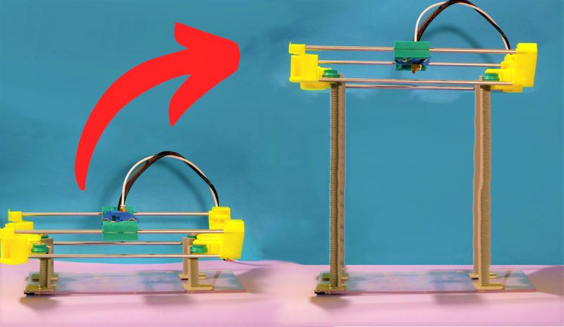
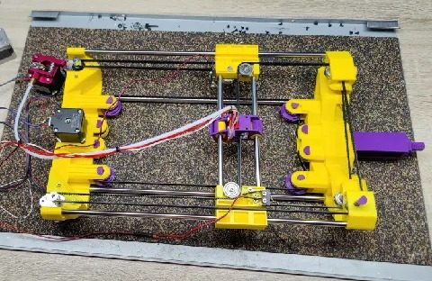

# Infini-Z

[Catalog row](../../README.md#infini-z) · [Gallery](../../GALLERY.md)

| Field | Value |
| --- | --- |
| Section | Concepts and prototypes |
| Project page | [https://projectquine.substack.com/p/the-first-infini-z](https://projectquine.substack.com/p/the-first-infini-z) |
| Author | SunShine / Andras |
| About | Experimental self-climbing Z axis. |
| Build type | Climbing Z |
| Build volume (X×Y×Z) | — |
| Exterior (W×D×H) | — |
| Latest version | Files [2023-12](https://www.printables.com/model/581766-infini-z-3d-printer) |
| Stars Likes Views | [💙⁠240](https://www.thingiverse.com/thing:6217366) [🧡⁠844](https://www.printables.com/model/581766) [💛⁠33](https://cults3d.com/en/3d-model/tool/infini-z-3d-printer) [⏯️⁠1.5M](https://www.youtube.com/watch?v=Ek_7tBOCcAI) [❤️⁠46K](https://www.youtube.com/watch?v=Ek_7tBOCcAI) |
| Links | [Files](https://cults3d.com/en/3d-model/tool/infini-z-3d-printer) |
| Groups | — |

## Pictures (3)

<table>
<tr><td align="center" width="33%"></td><td align="center" width="33%"></td><td align="center" width="33%"></td></tr>
</table>
