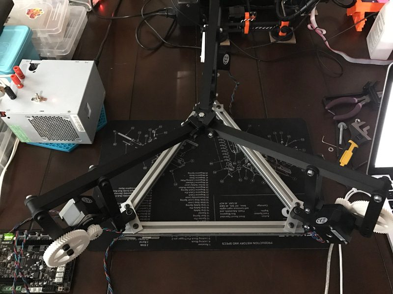
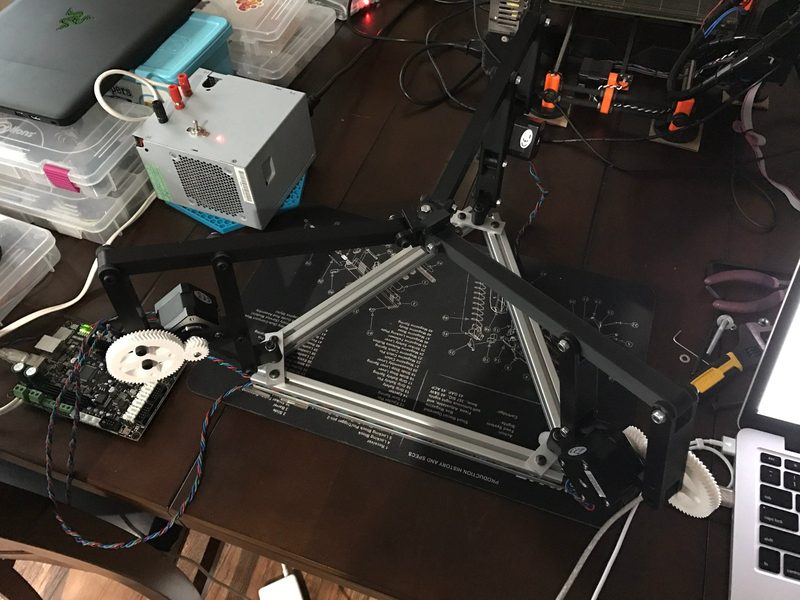
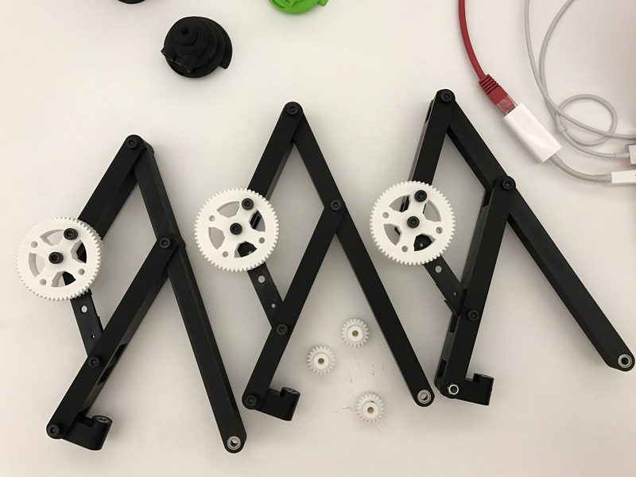

# Inverted Cantilever Delta

[Catalog row](../../README.md#inverted-cantilever-delta) · [Gallery](../../GALLERY.md)

| Field | Value |
| --- | --- |
| Section | Concepts and prototypes |
| Project page | [https://www.thingiverse.com/thing:1857648](https://www.thingiverse.com/thing:1857648) |
| Author | Apsu |
| About | Grounded delta prototype in the GUS Simpson line. A parallel linkage moves each arm motor to the base, where it drives the arm through a 3:1 gear pair. |
| Build type | Inverted cantilever delta |
| Build volume (X×Y×Z) | — |
| Exterior (W×D×H) | — |
| Latest version | Files [2016-10](https://www.thingiverse.com/thing:1857648/files) |
| Stars Likes Views | [💙⁠52](https://www.thingiverse.com/thing:1857648) [⏯️⁠2.6K](https://www.youtube.com/watch?v=bkq-SWTHQcE) [❤️⁠31](https://www.youtube.com/watch?v=bkq-SWTHQcE) |
| Links | [STL](https://github.com/Apsu/Parallel-Grounded-Delta) [Files](https://www.thingiverse.com/thing:1857648/files) [Video](https://www.youtube.com/watch?v=bkq-SWTHQcE) |
| Groups | — |
| License | [CC BY 4.0 (Thingiverse)](https://www.thingiverse.com/thing:1857648) |

## Pictures (4)

<table>
<tr><td align="center" width="33%"> Photo: <a href="https://www.thingiverse.com/Apsu">Apsu</a></td><td align="center" width="33%"> Version: prototype Photo: <a href="https://www.thingiverse.com/Apsu">Apsu</a></td><td align="center" width="33%"> Version: prototype Photo: <a href="https://www.thingiverse.com/Apsu">Apsu</a></td></tr>
<tr><td align="center" width="33%"> Photo: <a href="https://www.thingiverse.com/Apsu">Apsu</a></td></tr>
</table>
