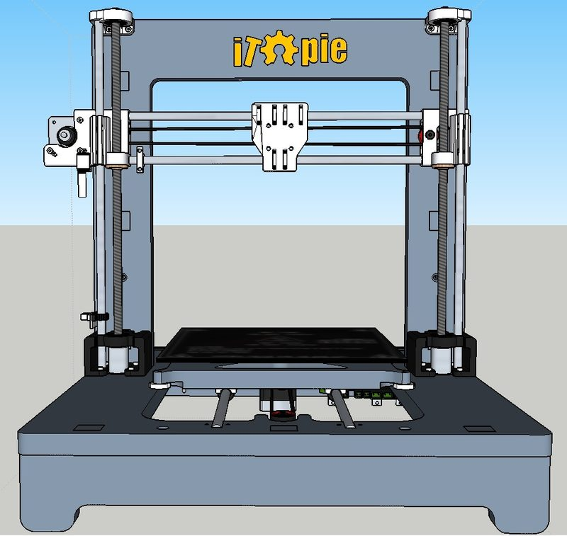
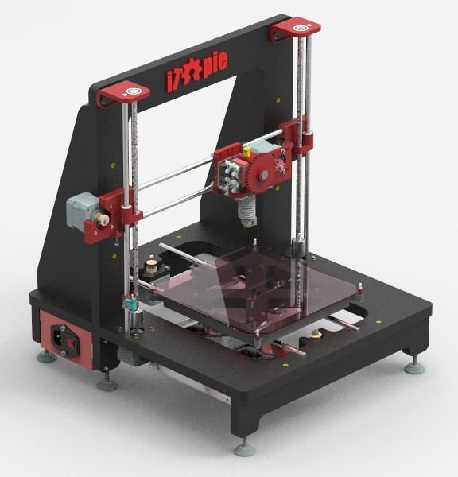
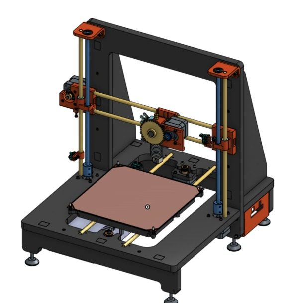
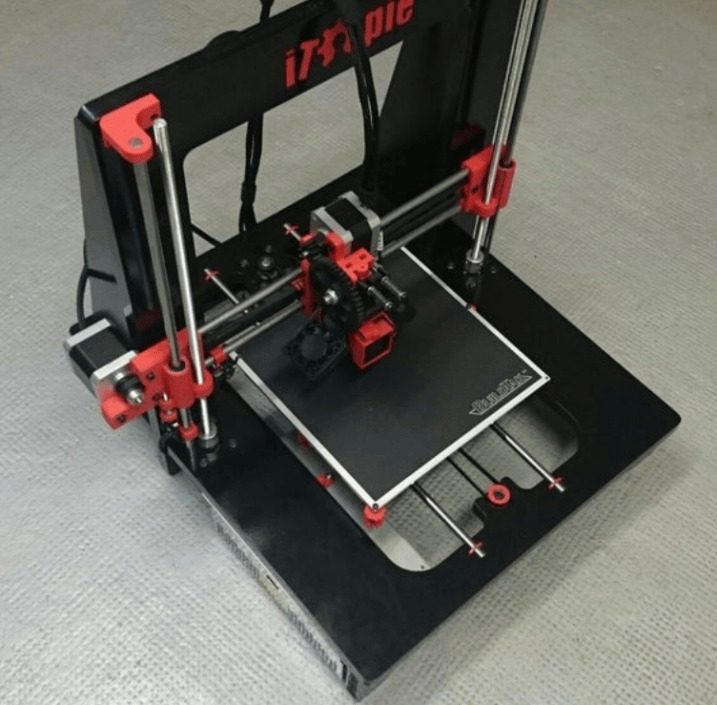
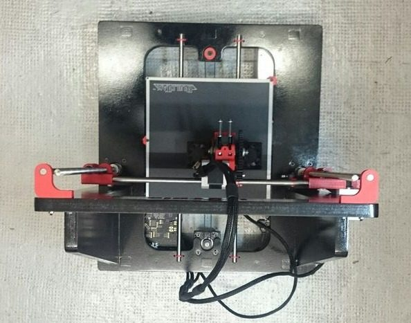
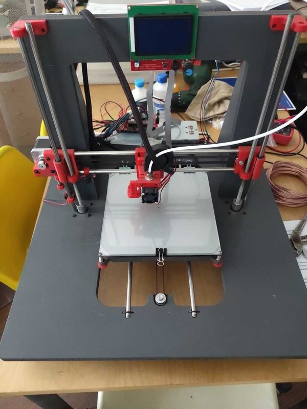
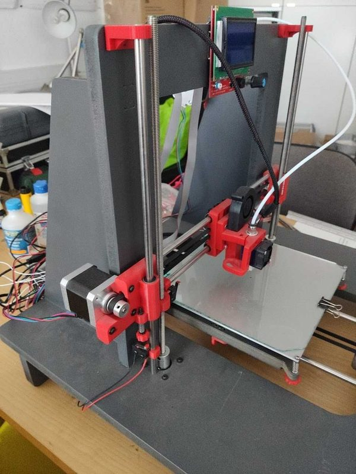
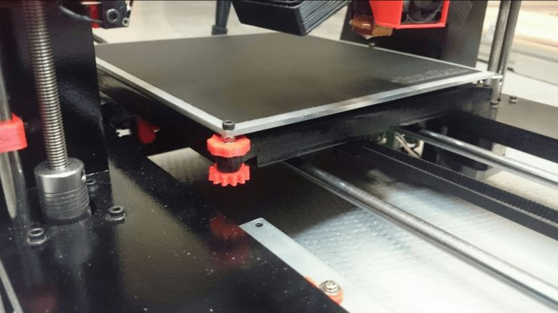
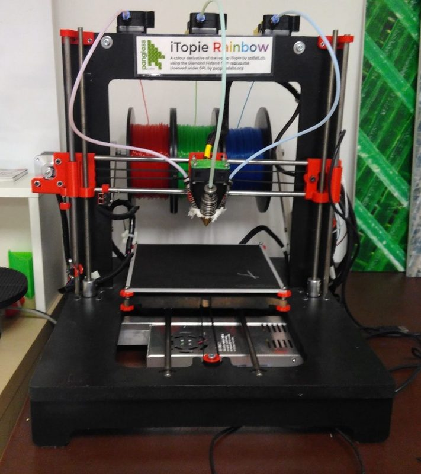

# ITopie

[Catalog row](../../README.md#itopie) · [Gallery](../../GALLERY.md)

| Field | Value |
| --- | --- |
| Section | Legacy designs |
| Project page | [https://github.com/skarab42/RepRap-iTopie](https://github.com/skarab42/RepRap-iTopie) |
| Author | skarab42 |
| About | Older framed Cartesian RepRap with released files and a build manual. No update since 2015. |
| Build volume (X×Y×Z) | 200×200×230 |
| Exterior (W×D×H) | 390×440×440 |
| Latest version | v2 [2015-11](https://github.com/skarab42/RepRap-iTopie/commit/520b5ebc5bcf347bb984b34748413ea4d1357ede) |
| Stars Likes Views |  [💙⁠228](https://www.thingiverse.com/thing:888609) |
| Links | [Manual](https://reprap.org/wiki/ITopie_Build_Manual) [Wiki](https://reprap.org/wiki/ITopie) |
| Groups | [Forum](https://reprap.org/forum/list.php?406) EN |
| License | [GPL-3.0 (GitHub, YouMagine), GPL-2.0 (Thingiverse)](https://github.com/skarab42/RepRap-iTopie/blob/dev/LICENSE.md) |

## Pictures (9)

<table>
<tr><td align="center" width="33%"> Photo: <a href="https://www.thingiverse.com/Absolem">Absolem</a></td><td align="center" width="33%"> Photo: <a href="https://grabcad.com/kabir.costa-2">Kabir Costa</a></td><td align="center" width="33%"> Photo: <a href="https://grabcad.com/kabir.costa-2">Kabir Costa</a></td></tr>
<tr><td align="center" width="33%"> Photo: <a href="https://github.com/skarab42">Sébastien Mischler (skarab42)</a></td><td align="center" width="33%"> Photo: <a href="https://github.com/skarab42">Sébastien Mischler (skarab42)</a></td><td align="center" width="33%"></td></tr>
<tr><td align="center" width="33%"></td><td align="center" width="33%"> Photo: <a href="https://github.com/skarab42">Sébastien Mischler (skarab42)</a></td><td align="center" width="33%"> Photo: Paul Bristow</td></tr>
</table>

## Other homes of the files

- [Thingiverse](https://www.thingiverse.com/thing:888609): source zip and plate DXF. GPL-2.0.
- [YouMagine](https://youmagine.com/designs/itopie-reprap): SketchUp model, plate DXF, 14 STL, build manual. GPL-3.0.
- [GrabCAD](https://grabcad.com/library/itopie-3d-printer-onshape-cad-1): Parasolid assembly of an Onshape remodel, no license shown (re-upload by Kabir Costa).
- [Onshape](https://cad.onshape.com/documents/5828f903961f70108c588554/w/a2c2a86dc69e1a6ad89ee0fa/e/aa64340aebc66319abedbd3c): public native CAD remodel, no license shown (re-upload by Kabir Costa).
- Wayback Machine: [latest snapshot](https://web.archive.org/web/20251230082343/https://github.com/skarab42/RepRap-iTopie), 2025-12-30.
