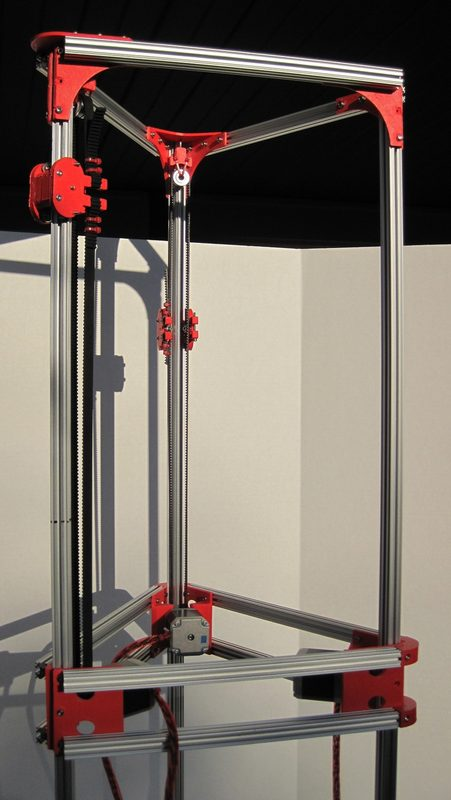
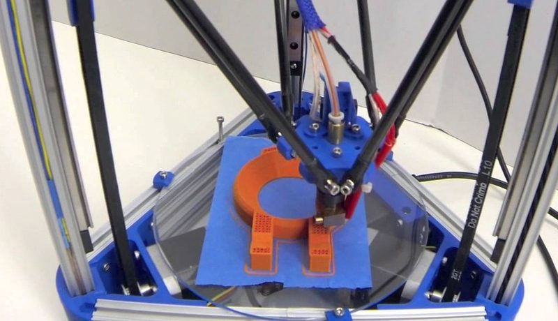

# Kossel

[Catalog row](../../README.md#kossel) · [Gallery](../../GALLERY.md)

| Field | Value |
| --- | --- |
| Section | Historical designs |
| Project page | [https://reprap.org/wiki/Kossel](https://reprap.org/wiki/Kossel) |
| Author | RepRap |
| About | The most built delta. Many commercial deltas copy it. |
| Build volume (X×Y×Z) | Ø170×240 |
| Exterior (W×D×H) | — |
| Latest version | CAD [2014-05](https://github.com/jcrocholl/kossel/commit/74e086041993af1f0ef2aae6850905a81c1b6bb2) |
| Stars Likes Views | [⏯️⁠314K](https://www.youtube.com/watch?v=0Ag3jeObNf8) [❤️⁠462](https://www.youtube.com/watch?v=0Ag3jeObNf8) |
| Links | — |
| Groups | [Forum](https://reprap.org/forum/list.php?178) EN [Facebook](https://www.facebook.com/groups/delta3dp/) EN 2.7K inactive |

## Pictures (3)

<table>
<tr><td align="center" width="33%"></td><td align="center" width="33%"></td><td align="center" width="33%"></td></tr>
</table>
