# Lemontron

[Catalog row](../../README.md#lemontron) · [Gallery](../../GALLERY.md)

| Field | Value |
| --- | --- |
| Section | Other motion systems |
| Project page | [https://lemontron.com/lemontron-rev-e/](https://lemontron.com/lemontron-rev-e/) |
| Author | Lemontron |
| About | Portable inverted design. Rev E is the current release after Rev A to D. Rev E has no own guide, so the build uses the earlier guide. |
| Build type | Inverted folding portable |
| Build volume (X×Y×Z) | 180×180×165 |
| Exterior (W×D×H) | — |
| Latest version | Rev E [2026-02](https://www.printables.com/model/1440115-lemontron-rev-e) |
| Stars Likes Views | [🧡⁠167](https://www.printables.com/model/1155525) [⏯️⁠120K](https://www.youtube.com/watch?v=n6l3GvkE4QU) [❤️⁠4.9K](https://www.youtube.com/watch?v=n6l3GvkE4QU) |
| Links | [Files](https://lemontron.com/lemontron-rev-e/printed-parts/) Rev E [CAD](https://www.printables.com/model/1440115-lemontron-rev-e/files) Rev E [BOM](https://lemontron.com/lemontron-rev-e/bom/) Rev E [Video](https://www.youtube.com/watch?v=FU5CCRJrfcg) Rev E [Manual](https://lemontron.com/lemontron-rev-a/build-guide/) Rev A [STEP](https://www.printables.com/model/1155525-lemontron-rev-d/files) Rev D [Video](https://www.youtube.com/watch?v=n6l3GvkE4QU) first release |
| Groups | [Discord](https://discord.com/invite/gSjfn4rnrm) EN 1.2K |
| License | [CC BY-SA (Printables), CC BY-NC 4.0 (PCBWay, tool end board)](https://www.printables.com/model/1440115-lemontron-endgame-portable-3d-printer) |

## Pictures (12)

<table>
<tr><td align="center" width="33%"> Photo: <a href="https://www.printables.com/@Lemontron">Lemontron</a></td><td align="center" width="33%"><a href="1-lemontron.jpg">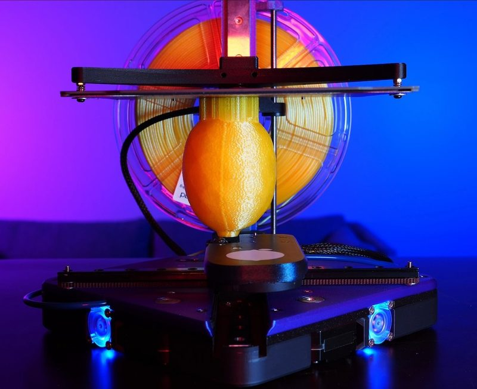</a> Photo: <a href="https://www.printables.com/@Lemontron">Lemontron</a></td><td align="center" width="33%"><a href="2-lemontron.jpg">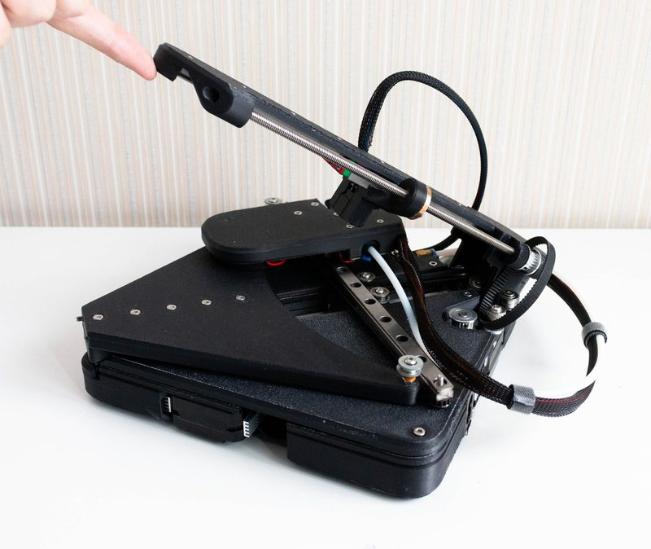</a> Photo: <a href="https://www.printables.com/@ArtNattanon_3094796">Art Nattanon</a></td></tr>
<tr><td align="center" width="33%"><a href="3-lemontron.jpg">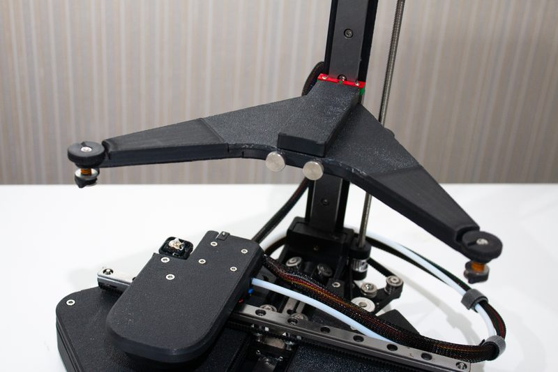</a> Photo: <a href="https://www.printables.com/@ArtNattanon_3094796">Art Nattanon</a></td><td align="center" width="33%"><a href="4-lemontron.jpg">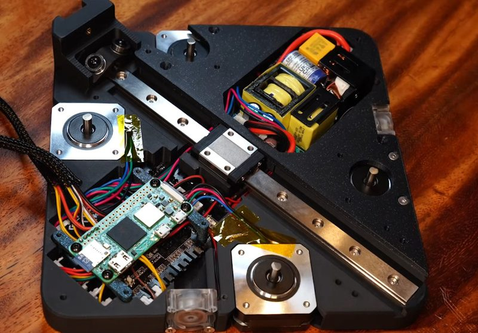</a> Photo: <a href="https://www.printables.com/@Lemontron">Lemontron</a></td><td align="center" width="33%"><a href="5-lemontron.jpg">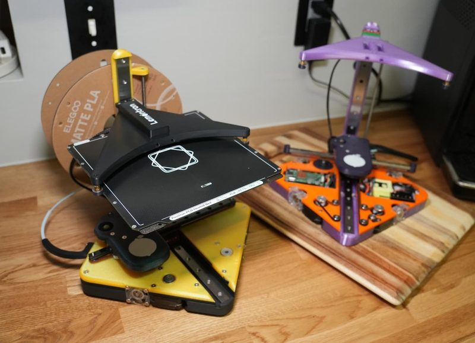</a> Photo: <a href="https://www.printables.com/@Lemontron">Lemontron</a></td></tr>
<tr><td align="center" width="33%"><a href="6-lemontron.jpg">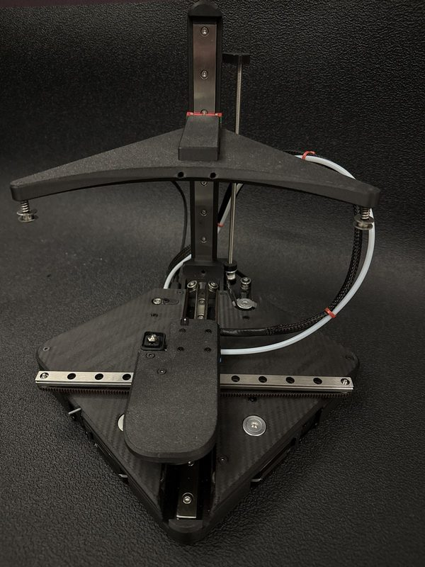</a> Version: Rev D Photo: <a href="https://www.printables.com/@Tech_Huskies">Tech_Huskies</a></td><td align="center" width="33%"><a href="7-lemontron.jpg">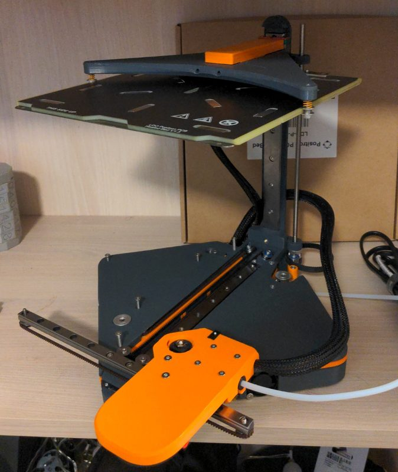</a> Version: Rev D Photo: <a href="https://www.printables.com/@4rno_3292223">4rno</a></td><td align="center" width="33%"><a href="8-lemontron.jpg">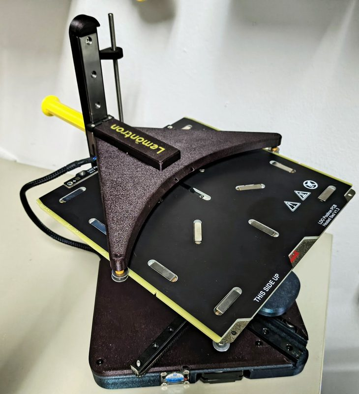</a> Version: Rev D Photo: <a href="https://www.printables.com/@wallace">wallace</a></td></tr>
<tr><td align="center" width="33%"><a href="9-lemontron.jpg">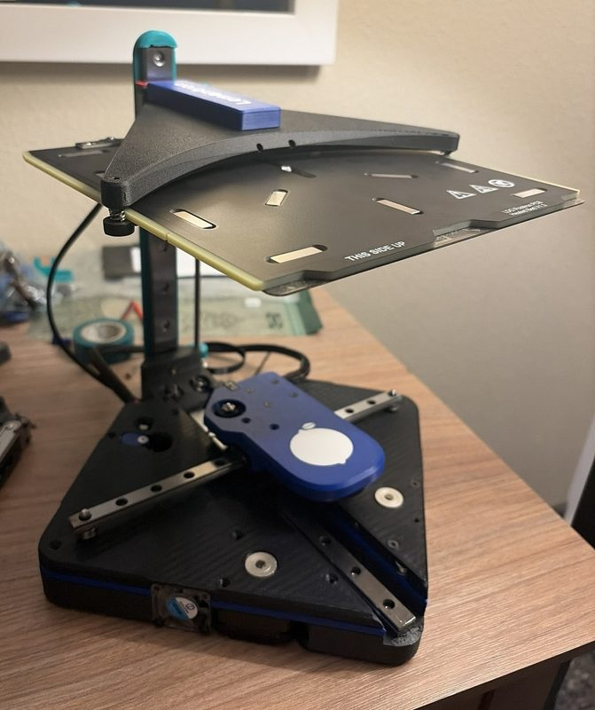</a> Version: Rev E Photo: <a href="https://www.printables.com/@oriphel_5268349">oriphel</a></td><td align="center" width="33%"><a href="10-lemontron.jpg">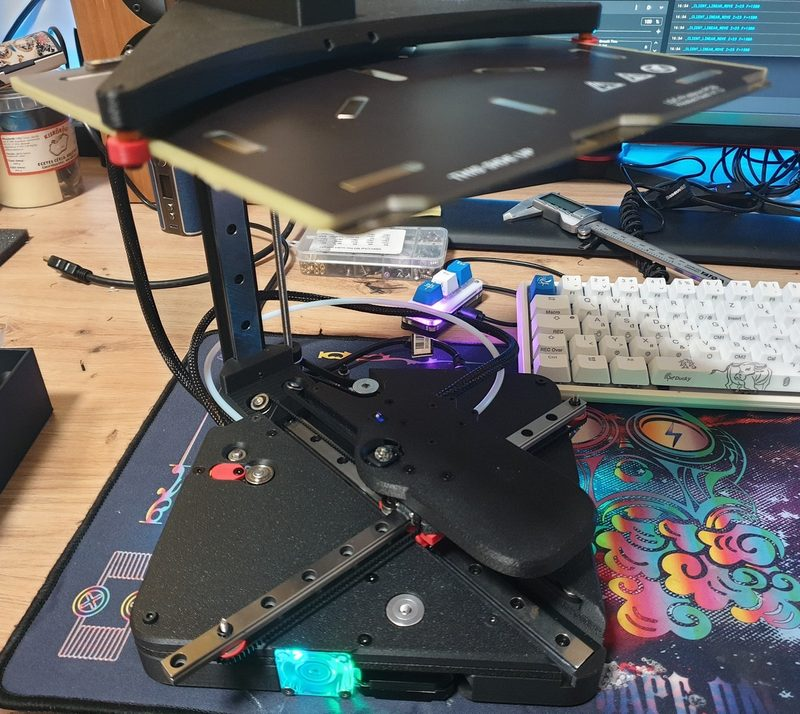</a> Version: Rev E Photo: <a href="https://www.printables.com/@JC1R_2203222">Jc1r</a></td><td align="center" width="33%"><a href="11-lemontron.jpg">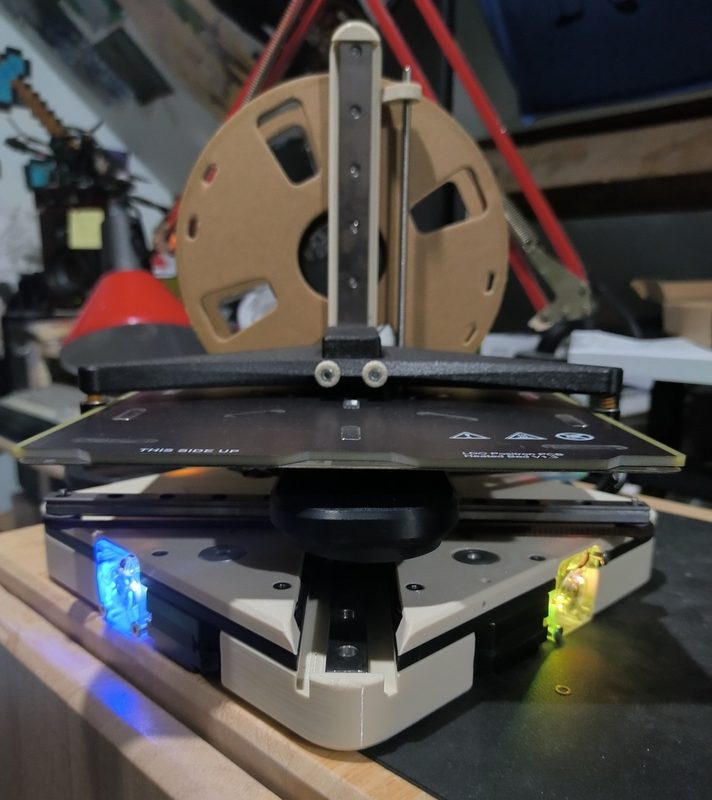</a> Version: Rev E Photo: <a href="https://www.printables.com/@roupouf">roupouf</a></td></tr>
</table>

## Other homes of the files

- [GitHub](https://github.com/lemontron/lemontron.com): source of lemontron.com with BOM data, guides and Klipper config templates. No printer CAD. No license file.
- [PCBWay](https://www.pcbway.com/project/shareproject/Lemontron_Tool_End_Breakout_Board_f0f9f248.html): tool end breakout board PCB files. CC BY-NC 4.0.
- Wayback Machine: [latest snapshot](https://web.archive.org/web/20260517144221/https://lemontron.com/lemontron-rev-e/), 2026-05-17.
