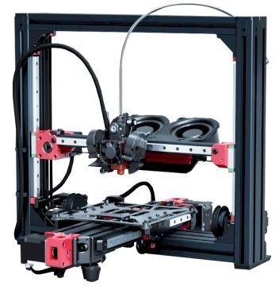
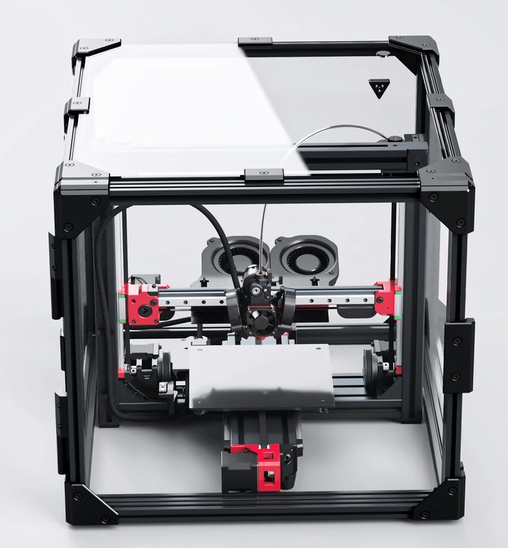
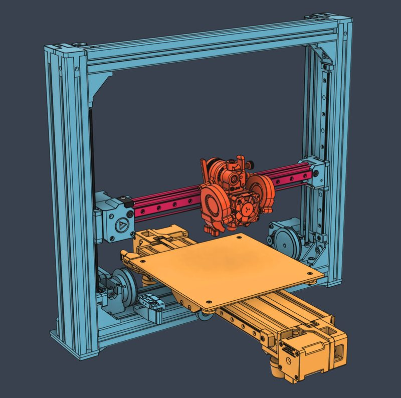
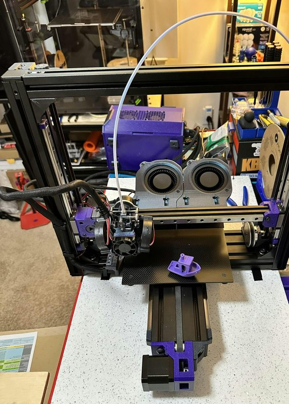
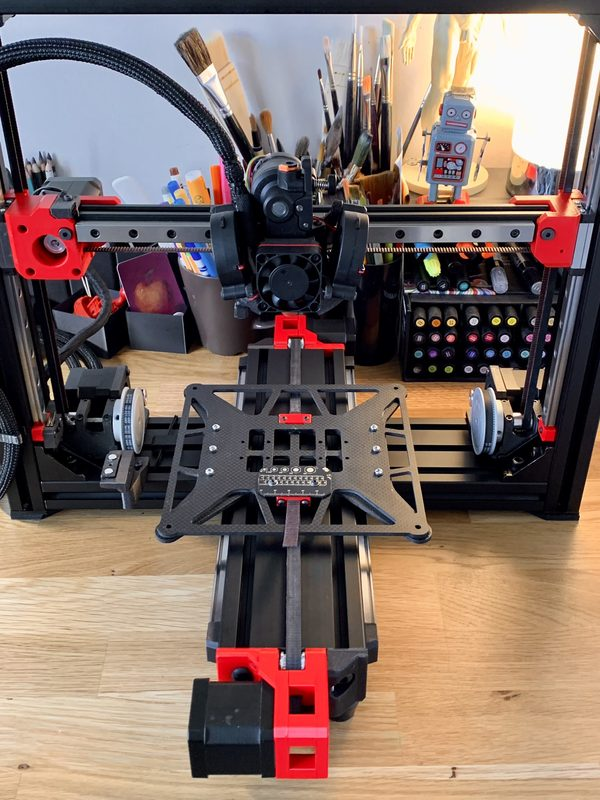
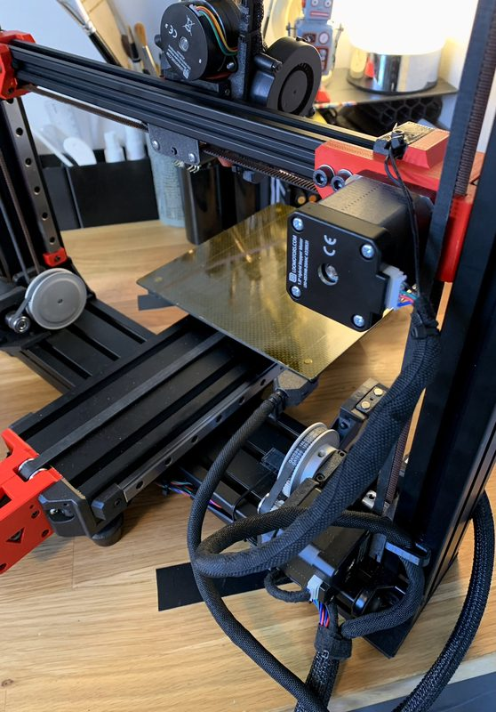

# LH Stinger

[Catalog row](../../README.md#lh-stinger) · [Gallery](../../GALLERY.md)

| Field | Value |
| --- | --- |
| Section | Cartesian · Medium (>180 mm on either X/Y axis) |
| Project page | [https://github.com/lhndo/LH-Stinger](https://github.com/lhndo/LH-Stinger) |
| Author | LHndo |
| About | Performance-focused moving-bed design. |
| Build volume (X×Y×Z) | 235×235×200 |
| Exterior (W×D×H) | — |
| Latest version | R1.0 [2024-08](https://github.com/lhndo/LH-Stinger/releases/tag/LHS-R1.0) |
| Stars Likes Views |  [🧡⁠104](https://www.printables.com/model/703110-lh-stinger) [⏯️⁠65.8K](https://www.youtube.com/watch?v=X41eK9_PCbA) [❤️⁠1.8K](https://www.youtube.com/watch?v=X41eK9_PCbA) |
| Links | [CAD](https://github.com/lhndo/LH-Stinger/tree/HEAD/CAD) [Wiki](https://github.com/lhndo/LH-Stinger/wiki) |
| Groups | [Discord](https://discord.gg/EzssCfnEDS) EN 2.7K |

## Pictures (6)

<table>
<tr><td align="center" width="33%"></td><td align="center" width="33%"></td><td align="center" width="33%"></td></tr>
<tr><td align="center" width="33%"></td><td align="center" width="33%"></td><td align="center" width="33%"></td></tr>
</table>
