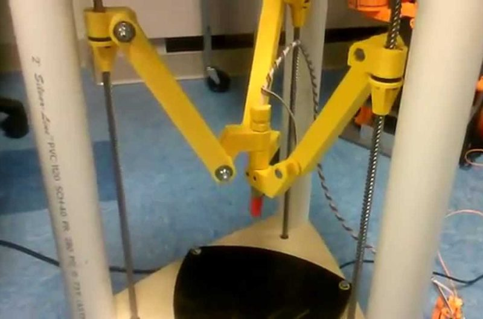

# LISA Simpson

[Catalog row](../../README.md#lisa-simpson) · [Gallery](../../GALLERY.md)

| Field | Value |
| --- | --- |
| Section | Historical designs |
| Project page | [https://reprap.org/wiki/LISA_Simpson](https://reprap.org/wiki/LISA_Simpson) |
| Author | Simpson family |
| About | Experimental grounded delta variant that followed the GUS Simpson. |
| Build volume (X×Y×Z) | — |
| Exterior (W×D×H) | — |
| Latest version | CAD [2013-12](https://github.com/NicholasSeward/ConceptFORGE/commit/45678f0afa2dc6453e01f95c084fde2b6fef4e30) |
| Stars Likes Views | [⏯️⁠48.1K](https://www.youtube.com/watch?v=N7XVxtgHHhY) [❤️⁠325](https://www.youtube.com/watch?v=N7XVxtgHHhY) |
| Links | — |
| Groups | [Forum](https://reprap.org/forum/list.php?178) EN |

## Pictures (1)

<table>
<tr><td align="center" width="33%"> Photo: <a href="https://www.youtube.com/@NicholasSeward">Nicholas J Seward</a></td></tr>
</table>
