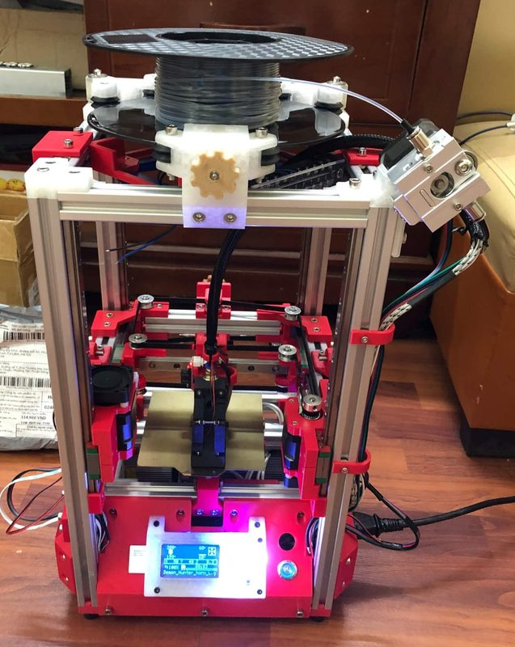

# Little Cube

[Catalog row](../../README.md#little-cube) · [Gallery](../../GALLERY.md)

| Field | Value |
| --- | --- |
| Section | Legacy designs |
| Project page | [https://www.thingiverse.com/thing:4487878](https://www.thingiverse.com/thing:4487878) |
| Author | longlh / looong-made |
| About | CoreXY with a 100 × 100 × 100 mm print volume, fixed bed, and belt-driven Z; an involved self-sourced build. No update since 2020 and no active group. |
| Build volume (X×Y×Z) | 100×100×100 |
| Exterior (W×D×H) | — |
| Latest version | First release [2020-06](https://www.thingiverse.com/thing:4487878) |
| Stars Likes Views | [💙⁠105](https://www.thingiverse.com/thing:4487878) |
| Links | [Files](https://www.thingiverse.com/thing:4487878/files) |
| Groups | — |

## Pictures (2)

<table>
<tr><td align="center" width="33%"></td><td align="center" width="33%"></td></tr>
</table>
