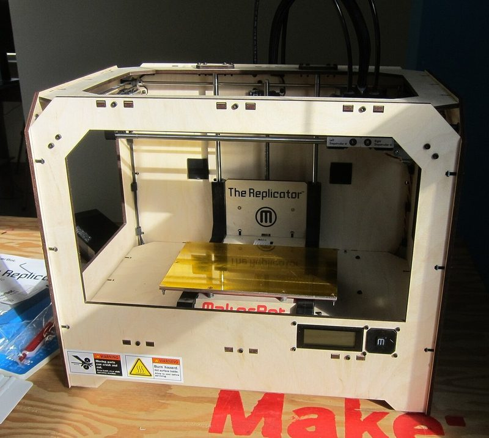
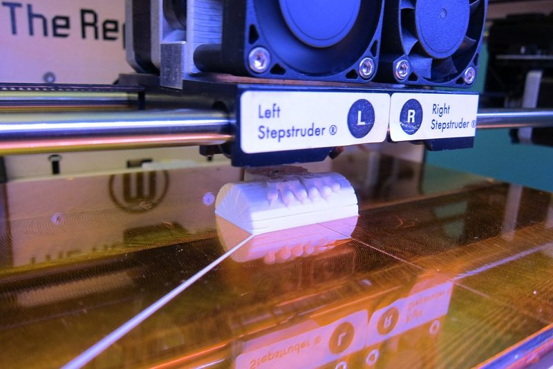
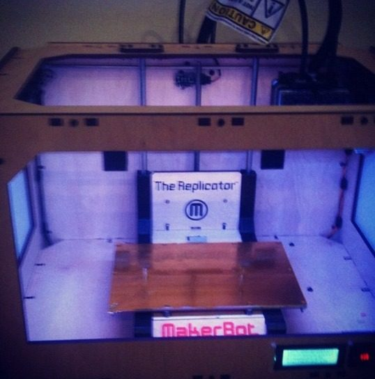
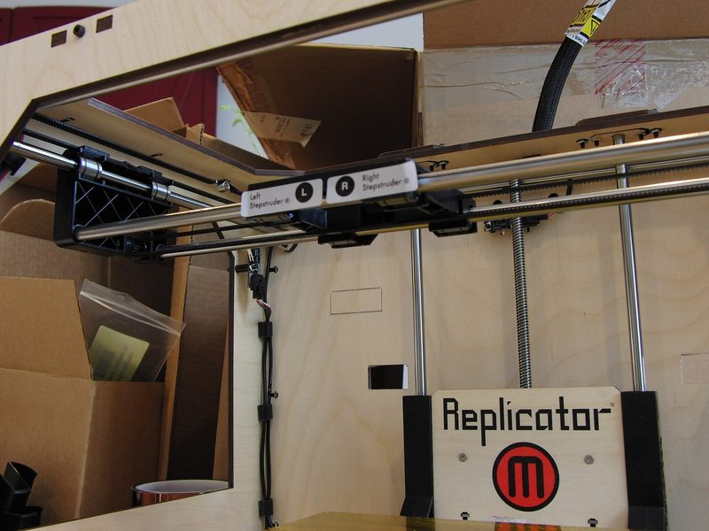
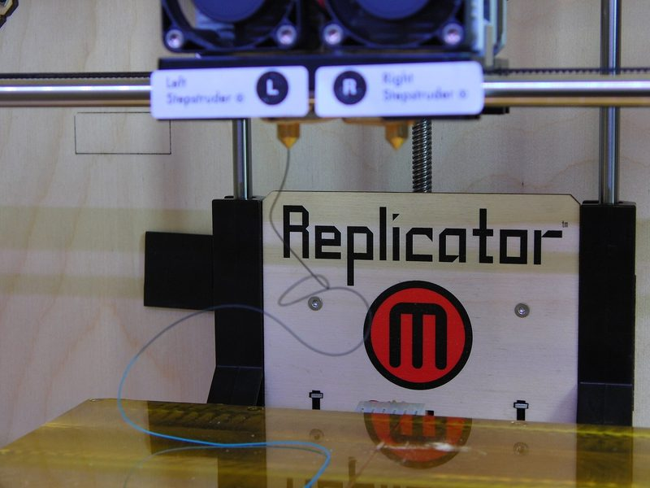
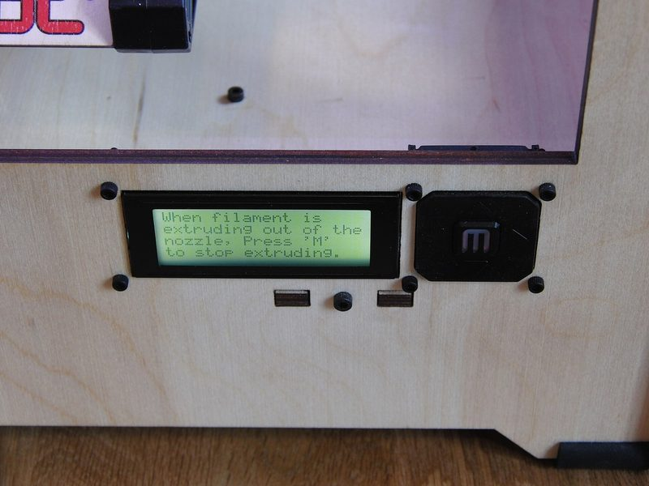
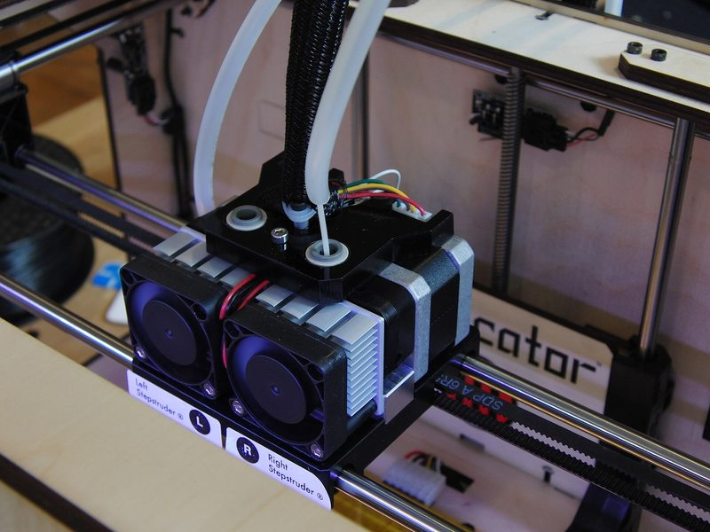
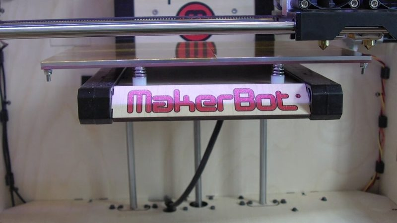

# MakerBot Replicator

[Catalog row](../../README.md#makerbot-replicator) · [Gallery](../../GALLERY.md)

| Field | Value |
| --- | --- |
| Section | Historical designs |
| Project page | [https://www.thingiverse.com/thing:18813](https://www.thingiverse.com/thing:18813) |
| Author | MakerBot |
| About | MakerBot's last open printer: a plywood box with a moving-head XY gantry on 8 mm shafts, a Z build platform and optional dual extrusion. The Replicator 2 kept the layout, but MakerBot did not release its body files. |
| Build volume (X×Y×Z) | 225×145×150 |
| Exterior (W×D×H) | 467×320×381 |
| Latest version | Files [2012-05](https://www.thingiverse.com/thing:18813/files) |
| Stars Likes Views | [💙⁠1K](https://www.thingiverse.com/thing:18813) [⏯️⁠563K](https://www.youtube.com/watch?v=DY6VSu-oOws) [❤️⁠521](https://www.youtube.com/watch?v=DY6VSu-oOws) |
| Links | [Files](https://www.thingiverse.com/thing:18813/files) [Files](https://www.thingiverse.com/thing:16058) MightyBoard [Firmware](https://github.com/makerbot/MightyBoardFirmware) |
| Groups | [Google Groups](https://groups.google.com/g/makerbot) EN inactive [Reddit](https://www.reddit.com/r/makerbot/) EN 5.2K |
| License | [CC BY-SA (Thingiverse; MightyBoardFirmware has no license file)](https://www.thingiverse.com/thing:18813) |

## Pictures (8)

<table>
<tr><td align="center" width="33%"> Version: Replicator (2012), dual extruder Photo: <a href="https://www.flickr.com/people/31954184@N00">jabella</a></td><td align="center" width="33%"> Photo: <a href="https://www.flickr.com/people/31954184@N00">jabella</a></td><td align="center" width="33%"> Version: Replicator (2012), dual extruder Photo: <a href="https://www.flickr.com/people/7702002@N08">Ethan Hein</a></td></tr>
<tr><td align="center" width="33%"> Version: Replicator (2012), dual Stepstruder Photo: <a href="https://www.flickr.com/people/33907867@N02">Creative Tools</a></td><td align="center" width="33%"> Photo: <a href="https://www.flickr.com/people/33907867@N02">Creative Tools</a></td><td align="center" width="33%"> Photo: <a href="https://www.flickr.com/people/33907867@N02">Creative Tools</a></td></tr>
<tr><td align="center" width="33%"> Version: Replicator (2012), dual Stepstruder MK8 Photo: <a href="https://www.flickr.com/people/33907867@N02">Creative Tools</a></td><td align="center" width="33%"> Photo: <a href="https://www.flickr.com/people/33907867@N02">Creative Tools</a></td></tr>
</table>

## Other homes of the files

- [Thingiverse, MightyBoard RevE](https://www.thingiverse.com/thing:16058), [BotStep17 RevE](https://www.thingiverse.com/thing:16059), [Heater Board RevB](https://www.thingiverse.com/thing:16061) and [LCD Interface RevB](https://www.thingiverse.com/thing:16067): the electronics of the Replicator, uploaded by MakerBot.
- [Sgail7/Replicator-Revival-Project on GitHub](https://github.com/Sgail7/Replicator-Revival-Project): community MightyBoard Rev E schematic and board files, Klipper configs for the Replicator 1 and 2. GPL-3.0.
- [MakerBot support, Replicator schematics, Wayback copy](https://web.archive.org/web/20121122122108/http://www.makerbot.com/support/replicator/documentation/schematics/): wiring diagrams.
- Wayback Machine: [latest snapshot](https://web.archive.org/web/20241218125746/https://www.thingiverse.com/thing:18813), 2024-12-18.
