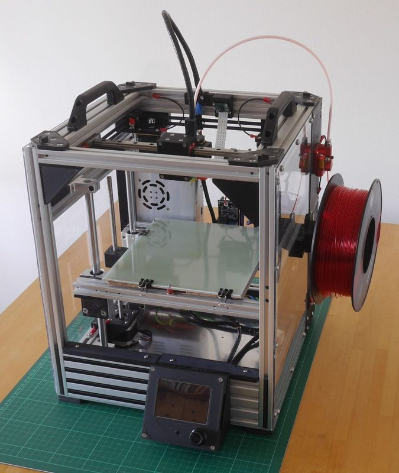
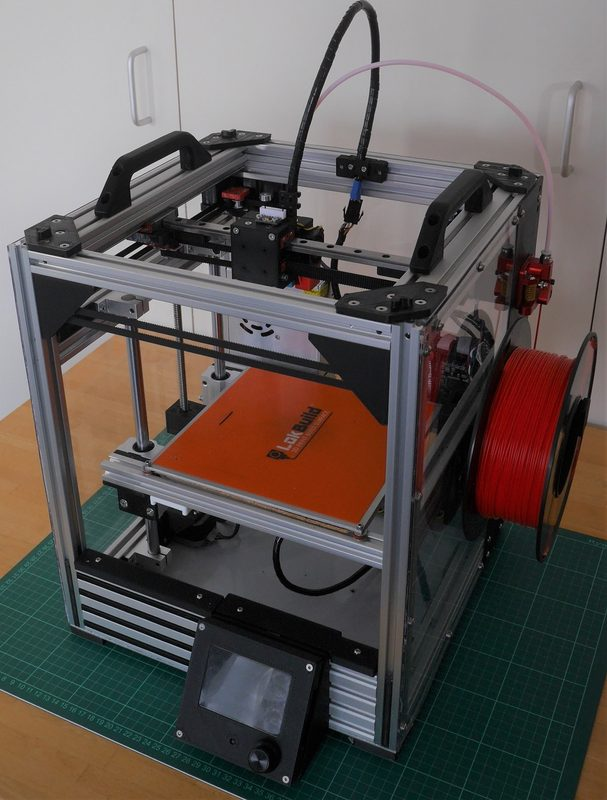
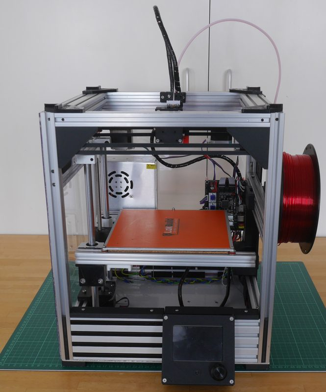

# MaybeCube

[Catalog row](../../README.md#maybecube) · [Gallery](../../GALLERY.md)

| Field | Value |
| --- | --- |
| Section | CoreXY · Medium (181–299 mm representative X/Y size) |
| Project page | [https://github.com/martinbudden/MaybeCube](https://github.com/martinbudden/MaybeCube) |
| Author | Martin Budden |
| About | BabyCube's larger, configurable extrusion-frame sibling. |
| Build volume (X×Y×Z) | MC300: 185×185×200 MC350: 225×225×235 MC400: 275×275×285 |
| Exterior (W×D×H) | MC300: 340×340×420 MC350: 390×390×470 MC400: 440×440×520 |
| Latest version | CAD [2024-09](https://github.com/martinbudden/MaybeCube/commit/83aeec32c94f3e004cd1ca78ecbb9fdc711e7357) |
| Stars Likes Views |  [💙⁠51](https://www.thingiverse.com/thing:4912095) |
| Links | [MC300RB](https://github.com/martinbudden/MaybeCube/blob/main/MC300RB/readme.md) [MC350](https://github.com/martinbudden/MaybeCube/blob/main/MC350/readme.md) [CAD](https://github.com/martinbudden/MaybeCube/tree/main/scad) |
| Groups | — |
| License | [CC BY-NC-SA 4.0](https://github.com/martinbudden/MaybeCube/blob/main/LICENSE.md) |

## Pictures (4)

<table>
<tr><td align="center" width="33%"> Photo: <a href="https://github.com/martinbudden">Martin Budden</a></td><td align="center" width="33%"> Photo: <a href="https://github.com/martinbudden">Martin Budden</a></td><td align="center" width="33%"> Photo: <a href="https://github.com/martinbudden">Martin Budden</a></td></tr>
<tr><td align="center" width="33%"> Photo: <a href="https://github.com/martinbudden">Martin Budden</a></td></tr>
</table>

## Other homes of the files

- [Thingiverse](https://www.thingiverse.com/thing:4912095): STL. The page links the GitHub MC300 and MC350 guides. CC BY-NC-SA 4.0.
- Wayback Machine: [latest snapshot](https://web.archive.org/web/20250531044757/https://github.com/martinbudden/MaybeCube), 2025-05-31.
