# Mendel

[Catalog row](../../README.md#mendel) · [Gallery](../../GALLERY.md)

| Field | Value |
| --- | --- |
| Section | Historical designs |
| Project page | [https://reprap.org/wiki/Mendel](https://reprap.org/wiki/Mendel) |
| Author | Ed Sells |
| About | Influential second-generation RepRap, and the parent of the Prusa Mendel and MendelMax. |
| Build volume (X×Y×Z) | 200×200×140 |
| Exterior (W×D×H) | — |
| Latest version | Files [2011-05](https://sourceforge.net/projects/reprap/files/) |
| Stars Likes Views |  [⏯️⁠55.2K](https://www.youtube.com/watch?v=toZpNpHQI7w) [❤️⁠29](https://www.youtube.com/watch?v=toZpNpHQI7w) |
| Links | [CAD](https://github.com/reprap/mendel/tree/master/mechanics/solid-models) |
| Groups | [Forum](https://reprap.org/forum/list.php?151) EN |
| License | [GPL-2.0](https://reprap.org/wiki/Mendel) |

## Pictures (12)

<table>
<tr><td align="center" width="33%"> Photo: <a href="https://grabcad.com/tomasz.nicinski-1">Tomasz Nicinski</a></td><td align="center" width="33%"><a href="1-mendel.jpg">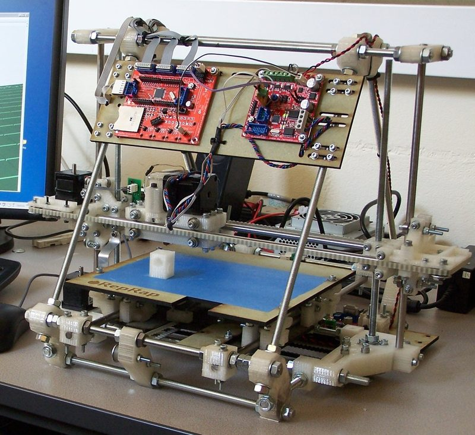</a> Photo: <a href="https://reprap.org/wiki/User:Adrianbowyer">Adrian Bowyer</a></td><td align="center" width="33%"><a href="2-mendel.jpg">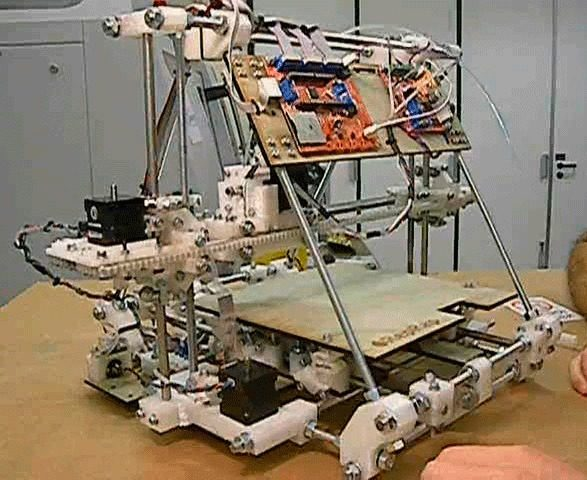</a> Photo: <a href="https://vimeo.com/user2389098">RepRap project</a></td></tr>
<tr><td align="center" width="33%"><a href="3-mendel.jpg">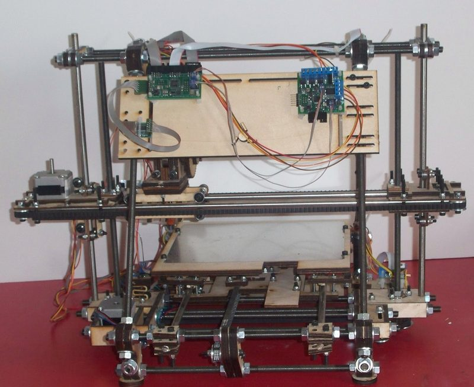</a> Photo: <a href="http://www.techzonecom.com">Techzone</a></td><td align="center" width="33%"><a href="4-mendel.jpg">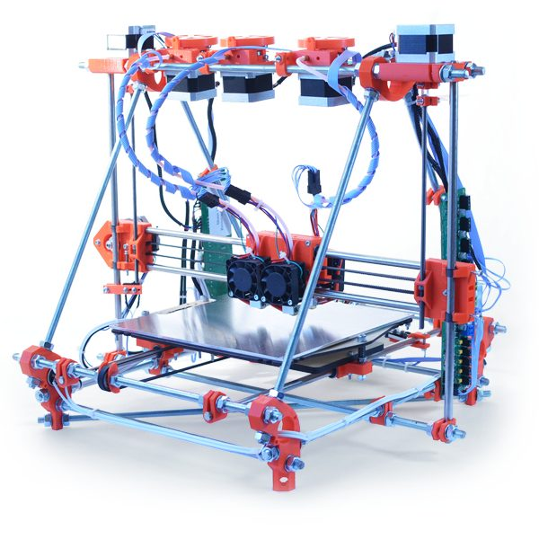</a> Photo: <a href="https://github.com/reprappro">RepRapPro</a></td><td align="center" width="33%"><a href="5-mendel.jpg">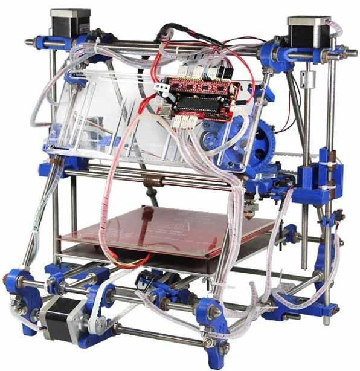</a> Photo: <a href="https://www.geeetech.com">Geeetech</a></td></tr>
<tr><td align="center" width="33%"><a href="6-mendel.jpg">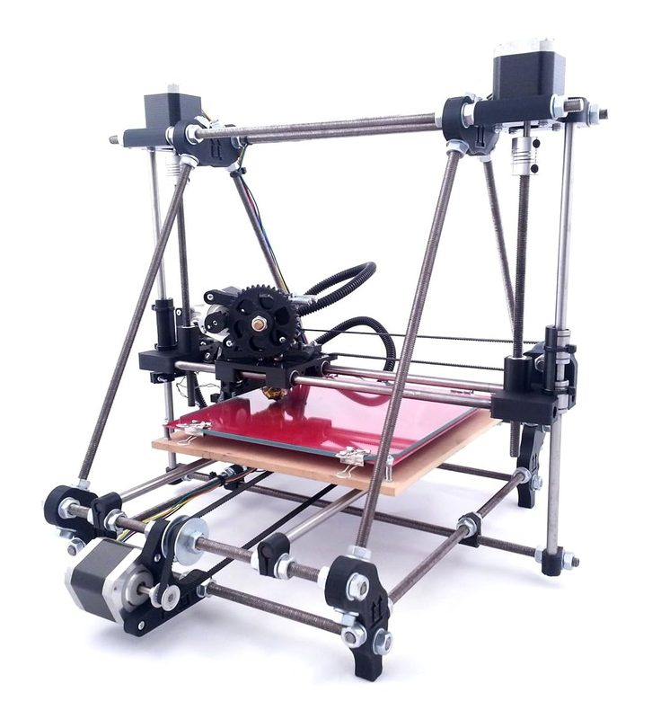</a></td><td align="center" width="33%"><a href="7-mendel.jpg">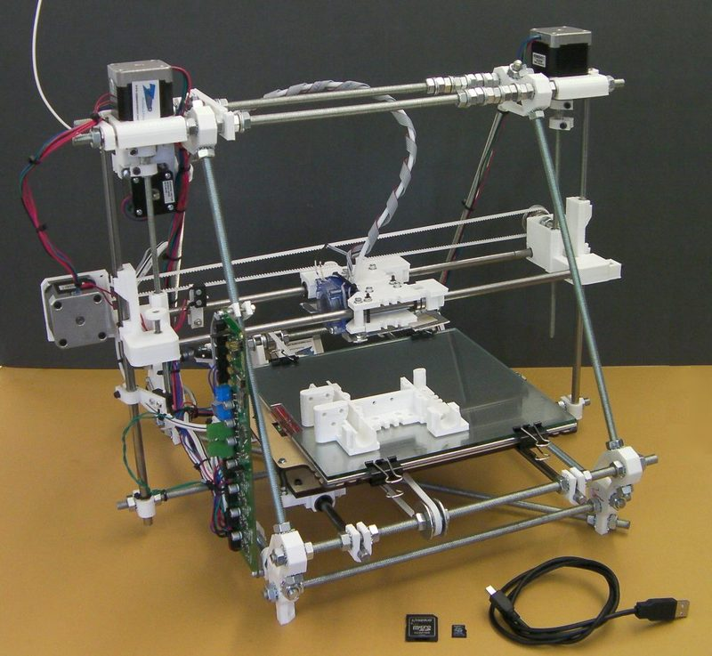</a> Photo: <a href="https://reprap.org/wiki/User:Adrianbowyer">Adrian Bowyer</a></td><td align="center" width="33%"><a href="8-mendel.jpg">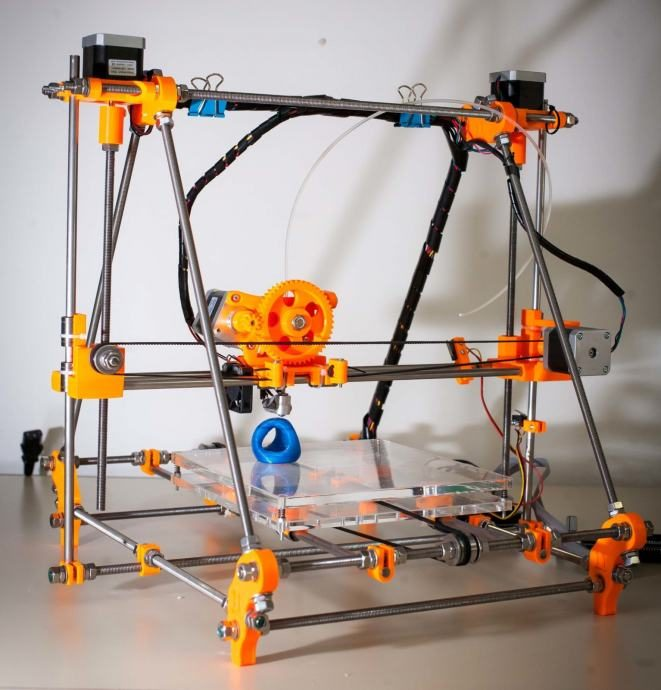</a></td></tr>
<tr><td align="center" width="33%"><a href="9-mendel.jpg">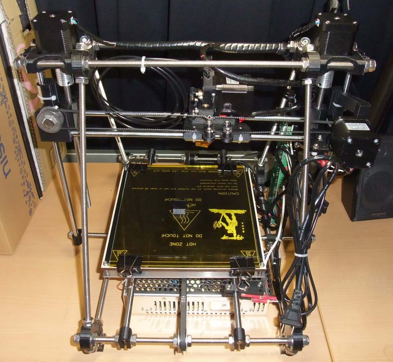</a> Photo: <a href="http://regz91.com/REPRAP.html">regz91</a></td><td align="center" width="33%"><a href="10-mendel.jpg">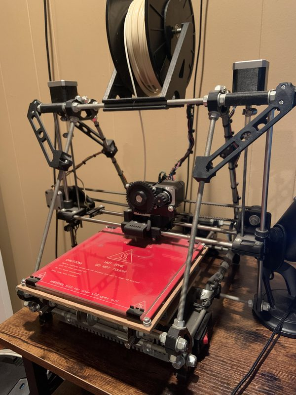</a></td><td align="center" width="33%"><a href="11-mendel.jpg">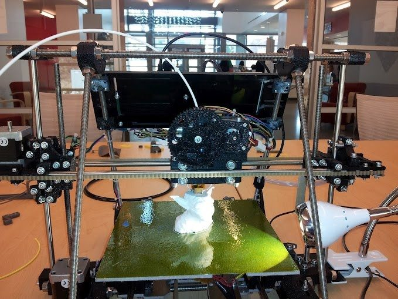</a></td></tr>
</table>

## Other homes of the files

- [SourceForge SVN](https://svn.code.sf.net/p/reprap/code/trunk/mendel/): original Mendel mechanics. Last design commit r4142 on 2011-06-22 fixed the X carriage STL. GPL-2.0.
- [SourceForge files](https://sourceforge.net/projects/reprap/files/): dated Mendel release zips from 2009-11 to 2011-05. GPL-2.0.
- [GitHub](https://github.com/reprap/mendel-II): deprecated Mendel II OpenSCAD files and STL. No license stated.
- Wayback Machine: [latest snapshot](http://web.archive.org/web/20261012224832/https://reprap.org/wiki/Mendel), 2026-10-12.
