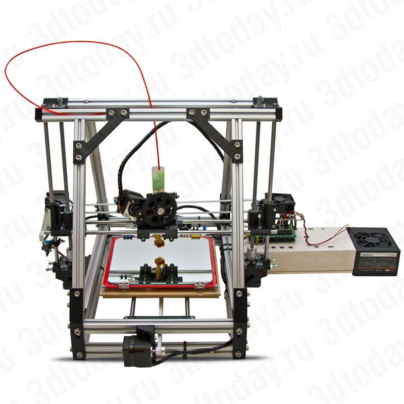
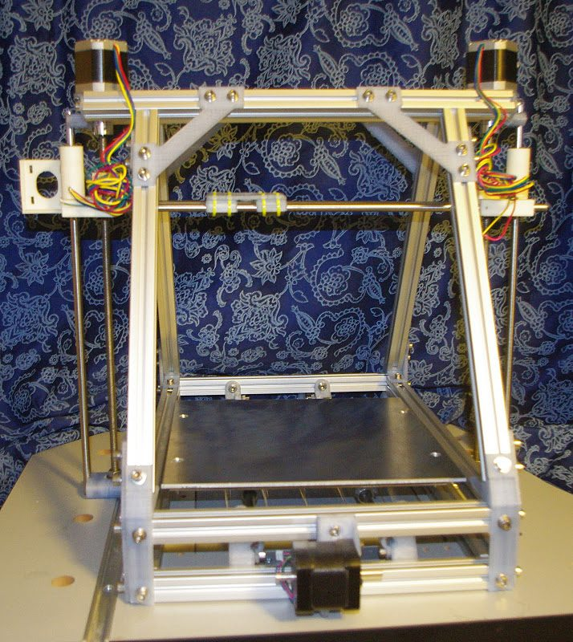
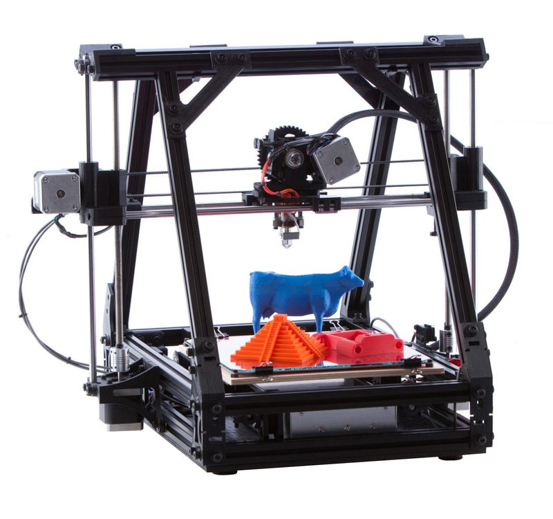
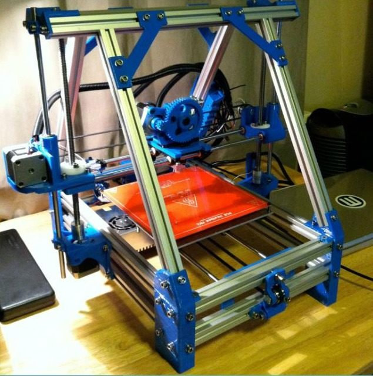

# MendelMax

[Catalog row](../../README.md#mendelmax) · [Gallery](../../GALLERY.md)

| Field | Value |
| --- | --- |
| Section | Historical designs |
| Project page | [https://github.com/maxbots/MendelMax](https://github.com/maxbots/MendelMax) |
| Author | Maxbots |
| About | Aluminum-extrusion Mendel variant. It made extrusion frames common on RepRaps. |
| Build volume (X×Y×Z) | 230×250×175 |
| Exterior (W×D×H) | — |
| Latest version | CAD [2011-12](https://github.com/maxbots/MendelMax/commit/955fcf5735f79297279bf20667821ff31d82bb3c) |
| Stars Likes Views |  [💙⁠763](https://www.thingiverse.com/thing:20355) |
| Links | [STEP](https://github.com/maxbots/MendelMax/blob/HEAD/MendelMax.stp) [Wiki](https://reprap.org/wiki/MendelMax) |
| Groups | [Forum](https://reprap.org/forum/list.php?177) EN [Forum](https://reprap.org/forum/list.php?151) EN |

## Pictures (5)

<table>
<tr><td align="center" width="33%"> Photo: Maxbots</td><td align="center" width="33%"></td><td align="center" width="33%"> Photo: <a href="https://reprap.org/wiki/User:Kludgineer">Kludgineer</a></td></tr>
<tr><td align="center" width="33%"></td><td align="center" width="33%"></td></tr>
</table>
