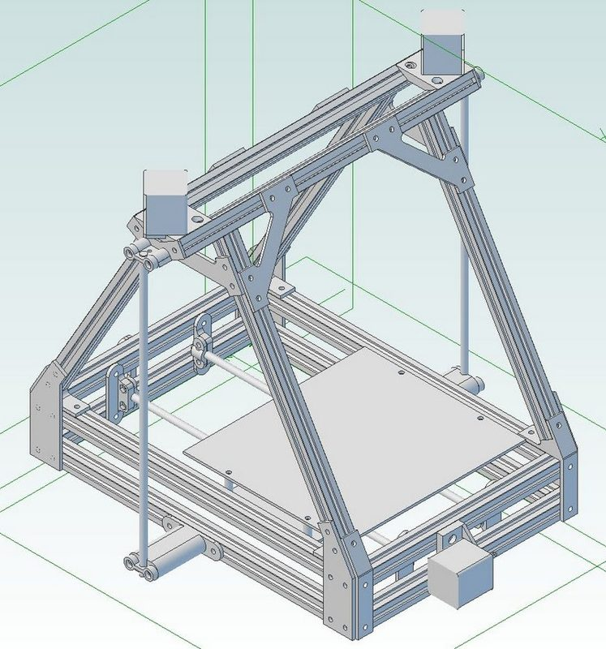
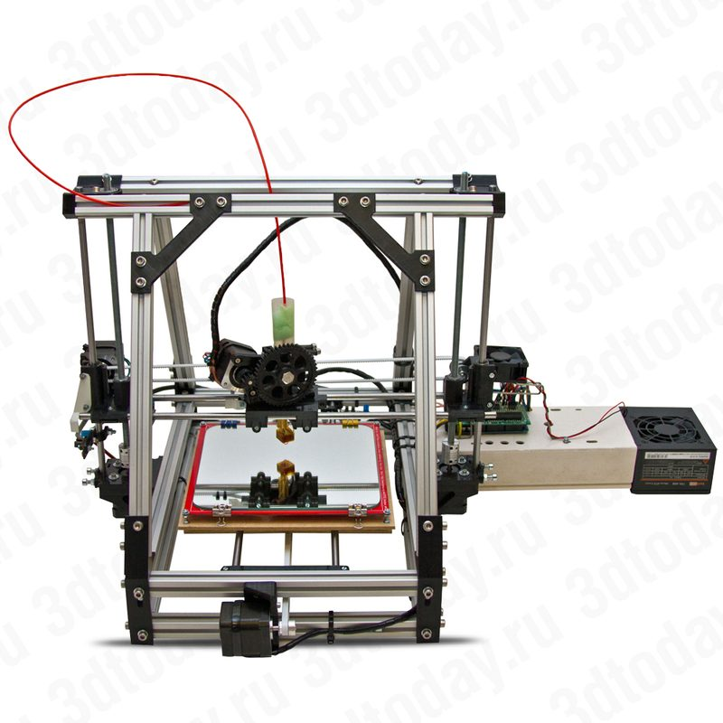
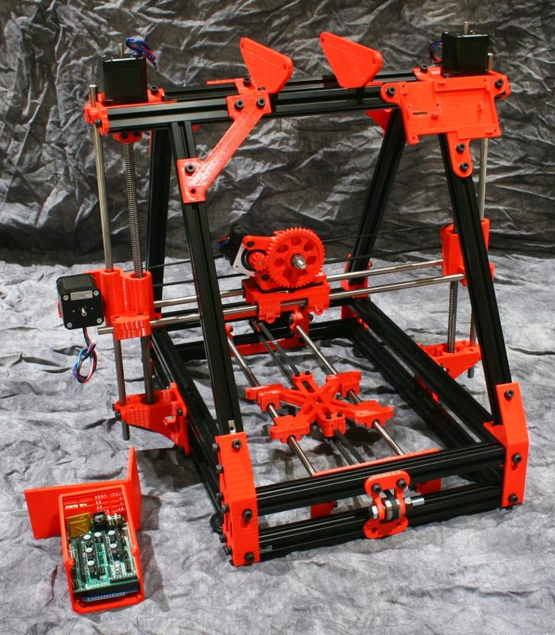
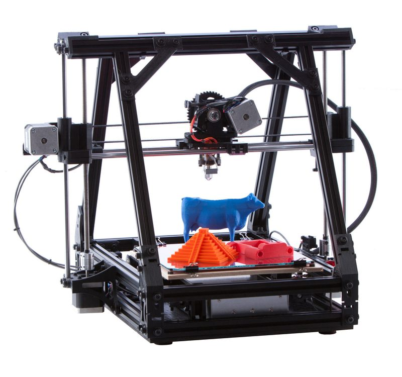

# MendelMax

[Catalog row](../../README.md#mendelmax) · [Gallery](../../GALLERY.md)

| Field | Value |
| --- | --- |
| Section | Historical designs |
| Project page | [https://github.com/maxbots/MendelMax](https://github.com/maxbots/MendelMax) |
| Author | Maxbots |
| About | Aluminum-extrusion Mendel variant. It made extrusion frames common on RepRaps. The row covers versions 1.0 (2011), 1.5 (2012) and 2.0 (2013). Versions 1.0 and 1.5 differ mainly in the Z motor placement. The redesigned 2.0 has a right-triangle frame of aluminum extrusions and flat plates, which can be machined, printed, laser cut or cut by hand. It moved X and Y to linear rails and keeps shafts and bushings on Z. |
| Build volume (X×Y×Z) | 1.x: 230×250×175 2.0: 230×310×225 |
| Exterior (W×D×H) | 2.0: 450×340×460 |
| Latest version | 2.0 [2013-11](https://github.com/Makers-Tool-Works/MendelMax-2.0/commit/2014c24b3b87bc7305690026667d116881b01d57) |
| Stars Likes Views |  [💙⁠763](https://www.thingiverse.com/thing:20355) |
| Links | [Files](https://www.thingiverse.com/thing:20355) 1.5 [STEP](https://github.com/maxbots/MendelMax/blob/HEAD/MendelMax.stp) 1.0 [Wiki](https://reprap.org/wiki/MendelMax) 1.x [CAD](https://github.com/Makers-Tool-Works/MendelMax-2.0/tree/master/Sources) 2.0 [STL](https://github.com/Makers-Tool-Works/MendelMax-2.0/tree/master/STLs) 2.0 [CAD](https://cad.onshape.com/documents/581d1d7ce5385f105d0cc7fe/w/31fc6c14bc3a6d4652915048/e/e3665072d0724de48ff22476) 2.0 Onshape [Wiki](https://reprap.org/wiki/MendelMax_2) 2.0 |
| Groups | [Forum](https://reprap.org/forum/list.php?177) EN [Forum](https://reprap.org/forum/list.php?151) EN |
| License | [GPL (Thingiverse 1.0, RepRap wiki 1.x and 2.0), CC BY (Thingiverse 1.5)](https://www.thingiverse.com/thing:12645) |

## Pictures (5)

<table>
<tr><td align="center" width="33%"> Version: 1.0 Photo: Maxbots</td><td align="center" width="33%"> Version: 1.5</td><td align="center" width="33%"> Version: 1.0 Photo: <a href="https://reprap.org/wiki/User:Kludgineer">Kludgineer</a></td></tr>
<tr><td align="center" width="33%"> Version: 1.5</td><td align="center" width="33%"> Version: 1.5</td></tr>
</table>

## Other homes of the files

- [Thingiverse](https://www.thingiverse.com/thing:12645): MendelMax 1.0, STL and STP, GPL, uploaded by kludgineer.
- [Thingiverse](https://www.thingiverse.com/thing:20355): MendelMax 1.5, STL, 3D PDF, and Alibre source, CC BY, uploaded by kludgineer.
- [Thingiverse](https://www.thingiverse.com/thing:21638): laser-cut Y axis, CC BY, uploaded by kludgineer.
- [GitHub](https://github.com/Makers-Tool-Works/MendelMax-2.0): MendelMax 2.0 sources and STL, last commit 2013-11. No license file, the RepRap wiki says GPL.
- [mendelmax.com, archived](https://web.archive.org/web/20150511210735/http://www.mendelmax.com/): author site, offline.
- Wayback Machine: [latest snapshot](https://web.archive.org/web/20250124225704/https://github.com/maxbots/MendelMax), 2025-01-24.
