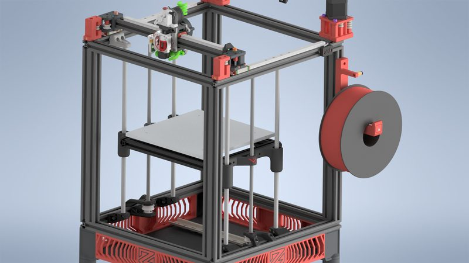
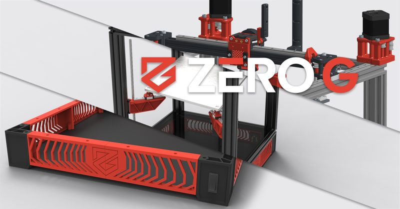
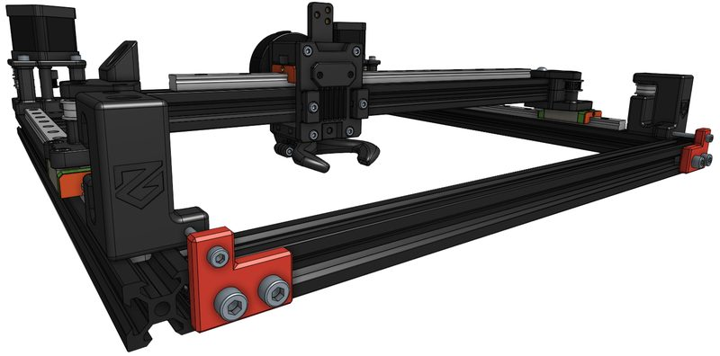
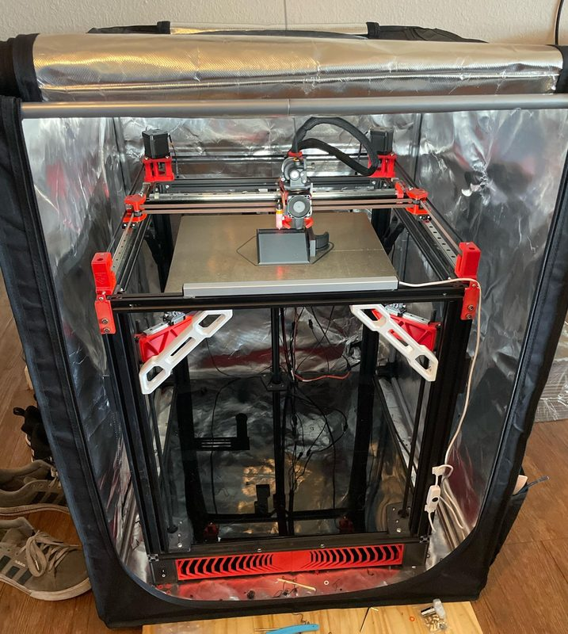
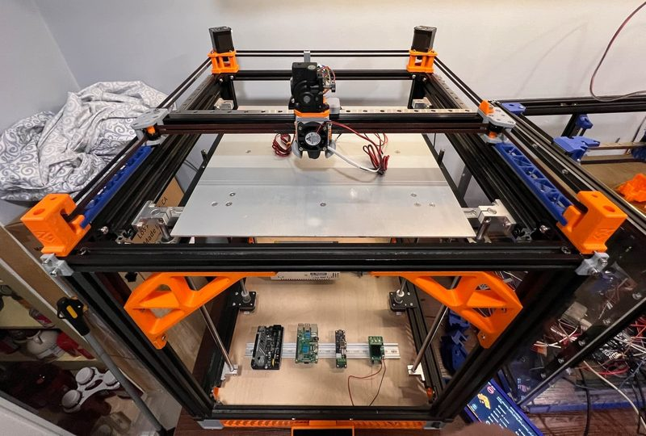
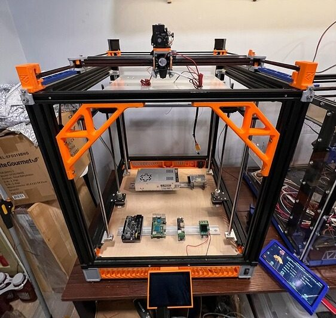
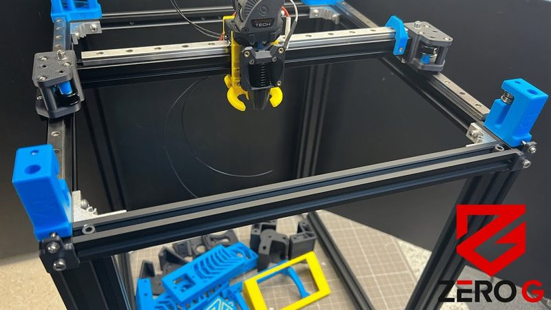

# Mercury One

[Catalog row](../../README.md#mercury-one) · [Gallery](../../GALLERY.md)

| Field | Value |
| --- | --- |
| Section | Conversions |
| Project page | [https://github.com/ZeroGDesign/MercuryOne](https://github.com/ZeroGDesign/MercuryOne) |
| Author | ZeroG |
| About | CoreXY conversion for Ender-5 family machines. |
| Build volume (X×Y×Z) | — |
| Exterior (W×D×H) | — |
| Latest version | One.1 [2022-08](https://github.com/ZeroGDesign/Mercury-OUTDATED/commit/d916c4ad6a) |
| Stars Likes Views |  [⏯️⁠15.2K](https://www.youtube.com/watch?v=nUwLjH3-oIc) [❤️⁠164](https://www.youtube.com/watch?v=nUwLjH3-oIc) |
| Links | [CAD](https://github.com/ZeroGDesign/MercuryOne/tree/HEAD/CAD) [Manual](https://docs.zerog.one/manual/build/mercury_eva) |
| Groups | [Discord](https://discord.gg/zerog) EN 9.7K |
| License | [CC BY-NC-SA 4.0](https://github.com/ZeroGDesign/MercuryOne/blob/MercuryOne.1/LICENSE) |

## Pictures (8)

<table>
<tr><td align="center" width="33%"> Photo: <a href="https://github.com/ZeroGDesign">ZeroG</a></td><td align="center" width="33%"> Photo: <a href="https://cults3d.com/en/users/RkDesigns">RkDesigns</a></td><td align="center" width="33%"> Photo: <a href="https://github.com/ZeroGDesign">ZeroG</a></td></tr>
<tr><td align="center" width="33%"> Photo: <a href="https://github.com/ZeroGDesign">ZeroG</a></td><td align="center" width="33%"> Photo: <a href="https://www.reddit.com/user/IndependentSquash425">u/IndependentSquash425</a></td><td align="center" width="33%"> Photo: <a href="https://forum.v1e.com/u/Jonathjon">Jonathan Jones (Jonathjon)</a></td></tr>
<tr><td align="center" width="33%"> Photo: <a href="https://forum.v1e.com/u/Jonathjon">Jonathan Jones (Jonathjon)</a></td><td align="center" width="33%"> Photo: <a href="https://www.youtube.com/@SteveBuilds">Steve Builds</a></td></tr>
</table>
