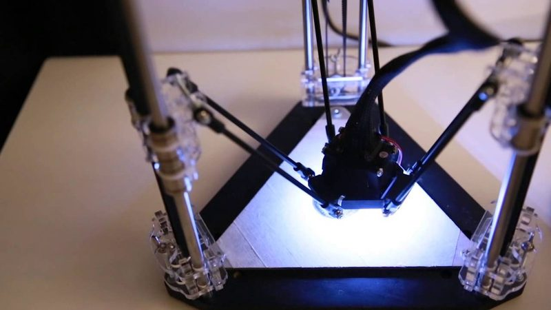
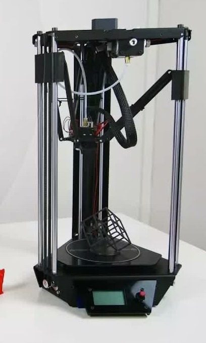
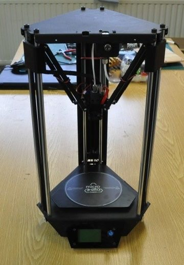
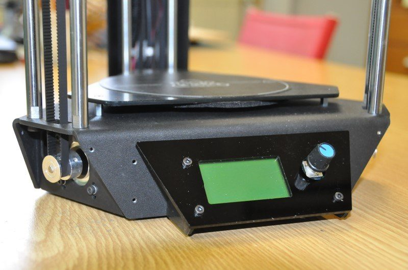
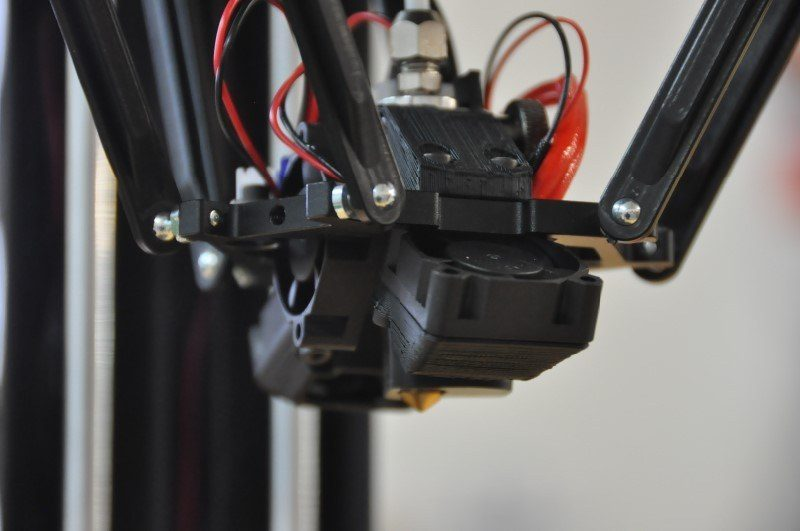
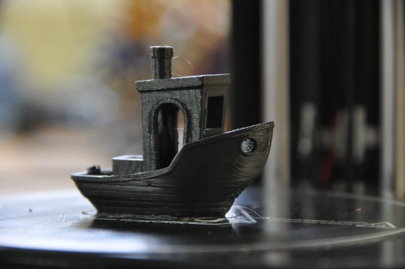

# µDelta / MicroDelta Rework

[Catalog row](../../README.md#micro-delta) · [Gallery](../../GALLERY.md)

| Field | Value |
| --- | --- |
| Section | Legacy designs |
| Project page | [https://github.com/eMotion-Tech/uDelta](https://github.com/eMotion-Tech/uDelta) |
| Author | eMotion Tech |
| About | Small French delta kit with few screws and a software calibration plugin. The µDelta (2014) has acrylic and wood parts, and the MicroDelta Rework (2016) has steel plates, an aluminium core, and a larger print area. No update since 2017-11. |
| Build volume (X×Y×Z) | µDelta: Ø120×190 Rework: Ø150×200 |
| Exterior (W×D×H) | 250×250×440 |
| Latest version | CAD [2017-11](https://github.com/eMotion-Tech/MicroDeltaRework/commit/05652e6ac85632057785f8720d8c781dbe143677) |
| Stars Likes Views |  [⏯️⁠28.9K](https://www.youtube.com/watch?v=JO8-RkK0Y1A) [❤️⁠51](https://www.youtube.com/watch?v=JO8-RkK0Y1A) |
| Links | [CAD](https://github.com/eMotion-Tech/MicroDeltaRework) Rework [Manual](https://data.emotion-tech.com/files/microdelta_rework/technical/Documentation%20-%20User%20guide/MicroDelta%20Rework_KIT_Assembly%20instructions.pdf) Rework [Files](https://github.com/eMotion-Tech/uDelta/tree/master/Parts) µDelta [Manual](https://github.com/eMotion-Tech/uDelta/tree/master/assembly) µDelta [Wiki](https://reprap.org/wiki/Micro_Delta) µDelta |
| Groups | — |
| License | [CC BY-NC-SA (µDelta, no version: GitHub README and RepRap wiki); CC BY-NC-SA 2.0 (MicroDelta Rework, license.md)](https://github.com/eMotion-Tech/MicroDeltaRework/blob/master/license.md) |

## Pictures (7)

<table>
<tr><td align="center" width="33%"> Version: original µDelta Photo: <a href="https://www.emotion-tech.com/">eMotion Tech</a></td><td align="center" width="33%"> Version: original µDelta Photo: <a href="https://www.youtube.com/channel/UCRPFI00EURRNvE3troHD95Q">eMotion Tech</a></td><td align="center" width="33%"> Version: MicroDelta Rework Photo: <a href="https://www.youtube.com/channel/UCfSAX4DQjY0m2JxhjWzjDbA">Revolution-3D</a></td></tr>
<tr><td align="center" width="33%"> Version: MicroDelta Rework Photo: <a href="https://www.3dnatives.com/author/mulpy/">Alex M.</a></td><td align="center" width="33%"> Version: MicroDelta Rework Photo: <a href="https://www.3dnatives.com/author/mulpy/">Alex M.</a></td><td align="center" width="33%"> Version: MicroDelta Rework Photo: <a href="https://www.3dnatives.com/author/mulpy/">Alex M.</a></td></tr>
<tr><td align="center" width="33%"> Version: MicroDelta Rework Photo: <a href="https://www.3dnatives.com/author/mulpy/">Alex M.</a></td></tr>
</table>
