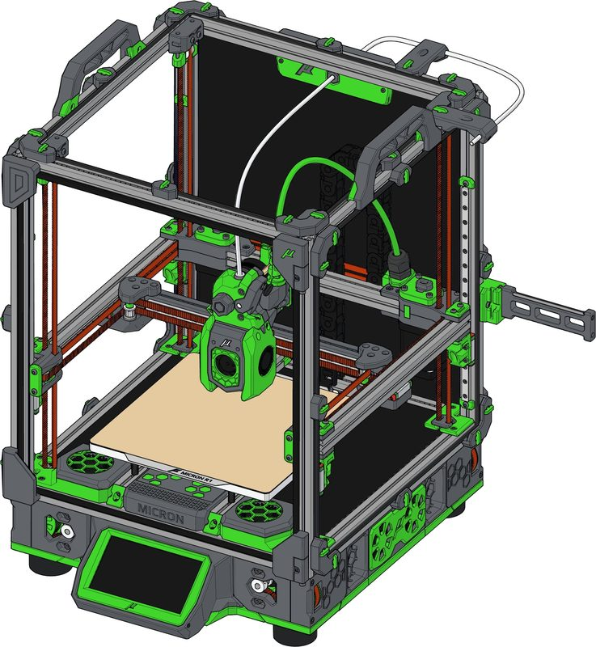
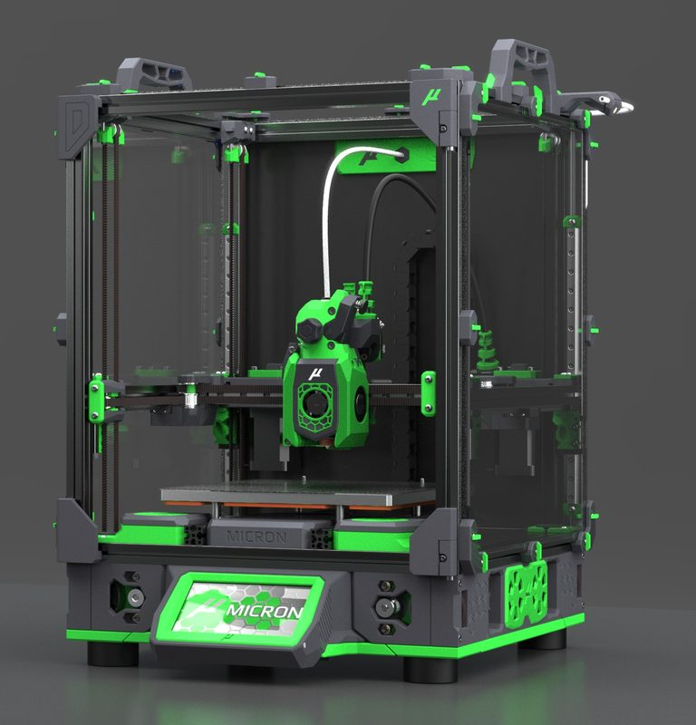
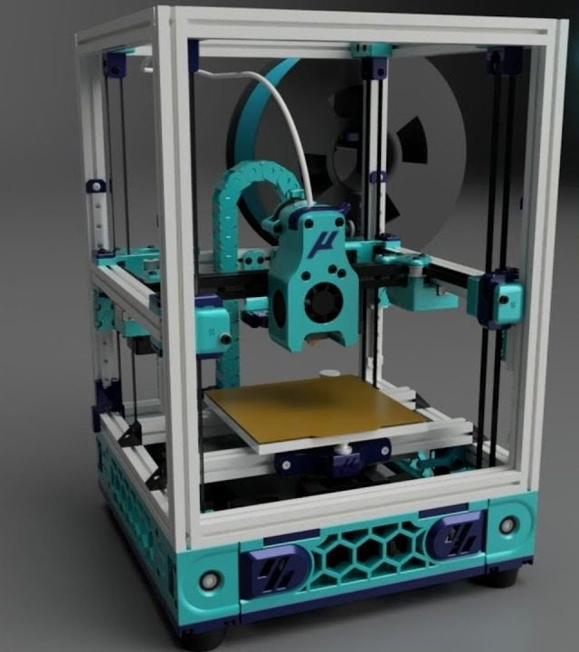
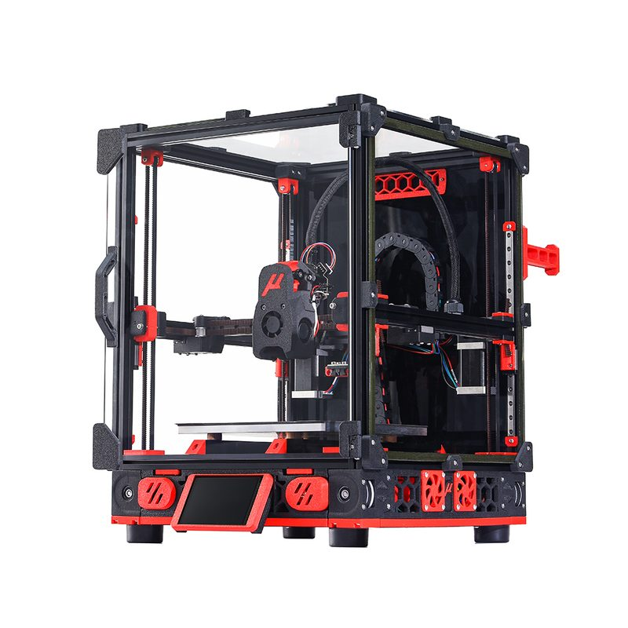
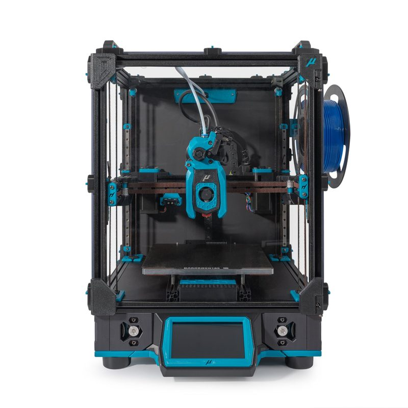
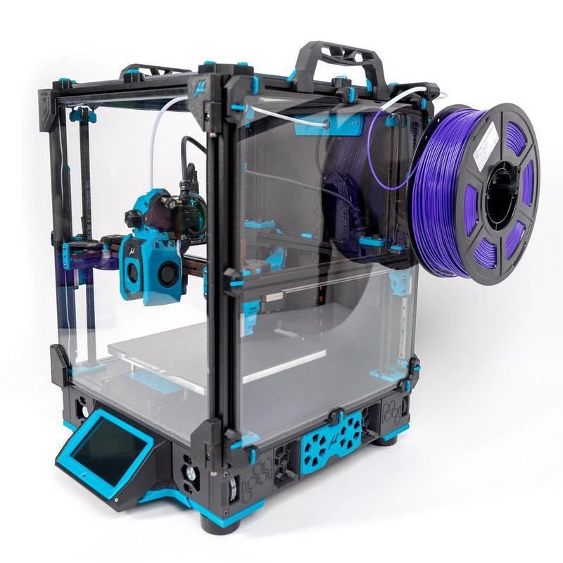
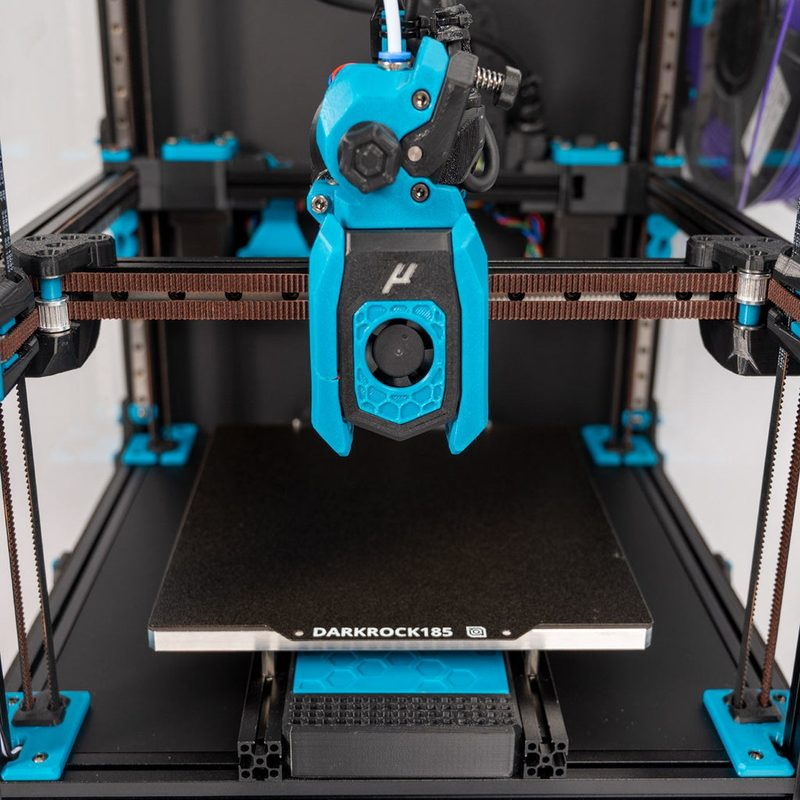

# Micron

[Catalog row](../../README.md#micron) · [Gallery](../../GALLERY.md)

| Field | Value |
| --- | --- |
| Section | CoreXY · Small (≤180 mm representative X/Y size) |
| Project page | [https://github.com/PrintersForAnts/Micron](https://github.com/PrintersForAnts/Micron) |
| Author | Printers for Ants |
| About | Miniature Voron-inspired enclosed build. Micron2020 is an upscaled 2020 and NEMA17 version that is still in progress. |
| Build volume (X×Y×Z) | 120: 120×120×? 180: 180×180×? |
| Exterior (W×D×H) | — |
| Latest version | CAD [2026-10](https://github.com/PrintersForAnts/Micron/commit/79a1b20da304932187229d75edcf49c5dd41a246) |
| Stars Likes Views |  |
| Links | [CAD](https://github.com/PrintersForAnts/Micron/tree/HEAD/CAD) R1 [Manual](https://github.com/PrintersForAnts/Micron/blob/HEAD/Documentation/Micron_R1_Manual_WIP.pdf) R1 [CAD](https://github.com/PrintersForAnts/Micron2020/tree/HEAD/CAD) 2020 |
| Groups | [Discord](https://discord.gg/doomcube) EN 6.9K |
| License | [GPL-3.0](https://github.com/PrintersForAnts/Micron/blob/main/LICENSE) |

## Pictures (7)

<table>
<tr><td align="center" width="33%"> Photo: <a href="https://github.com/hartk1213">hartk1213</a></td><td align="center" width="33%"> Photo: <a href="https://github.com/PrintersForAnts">Printers for Ants</a></td><td align="center" width="33%"> Photo: <a href="https://www.youtube.com/@CanuckCreator">Canuck Creator</a></td></tr>
<tr><td align="center" width="33%"> Photo: <a href="https://www.formbot3d.com">Formbot</a></td><td align="center" width="33%"> Photo: <a href="https://myrigs3d.com">myrigs3d/LDO</a></td><td align="center" width="33%"> Photo: <a href="https://hartsmartproducts.com">hartsmartproducts/LDO</a></td></tr>
<tr><td align="center" width="33%"> Photo: <a href="https://west3d.com">West3D/LDO</a></td></tr>
</table>

## Other homes of the files

- [GitHub, manual source](https://github.com/PrintersForAnts/MicronManual): Markdown source of the R1 manual. GPL-3.0.
- [Printed part configurator](https://micron.wizards-enclave.net/): picks the STL set by option. Linked from the Micron README. License not shown.
- Wayback Machine: [latest snapshot](https://web.archive.org/web/20260516101528/https://github.com/PrintersForAnts/Micron), 2026-05-16.
