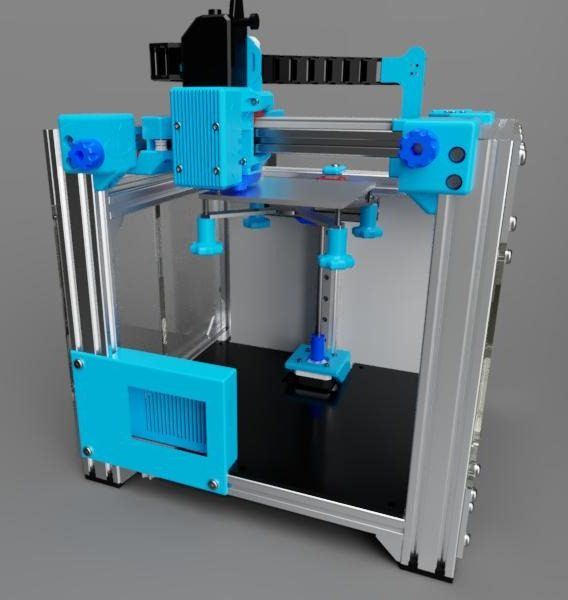
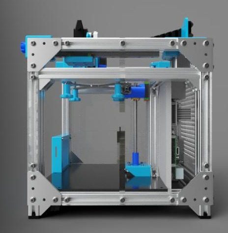
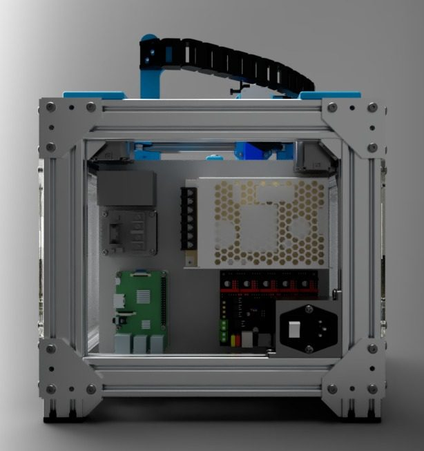
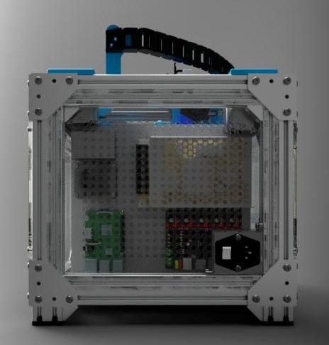

# 3d Mini Cube (iChalix)

[Catalog row](../../README.md#mini-cube-ichalix) · [Gallery](../../GALLERY.md)

| Field | Value |
| --- | --- |
| Section | Legacy designs |
| Project page | [https://www.thingiverse.com/thing:3910543](https://www.thingiverse.com/thing:3910543) |
| Author | 120 mm BLV MGN Cube derivative with a single Z axis; documentation remains work in progress. No update since 2019. |
| About |  |
| Build volume (X×Y×Z) | 120×120×110 |
| Exterior (W×D×H) | 325×355×338 |
| Latest version | Log [2019-12](https://www.thingiverse.com/thing:3910543) |
| Stars Likes Views | [💙⁠165](https://www.thingiverse.com/thing:3910543) |
| Links | [Files](https://www.thingiverse.com/thing:3910543/files) |
| Groups | [Facebook](https://www.facebook.com/groups/BenLevi) EN 7K |

## Pictures (5)

<table>
<tr><td align="center" width="33%"></td><td align="center" width="33%"></td><td align="center" width="33%"></td></tr>
<tr><td align="center" width="33%"></td><td align="center" width="33%"></td></tr>
</table>
