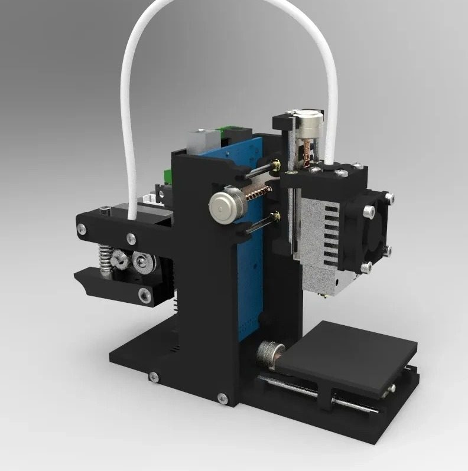
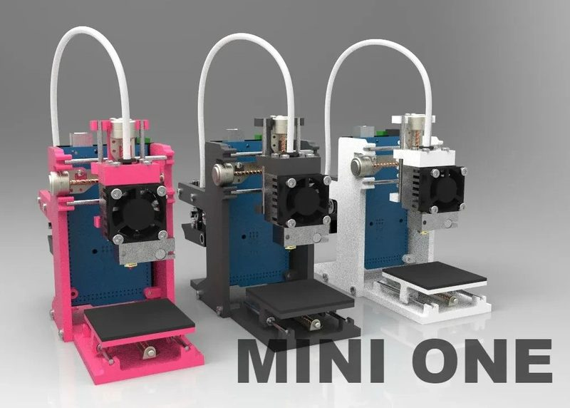
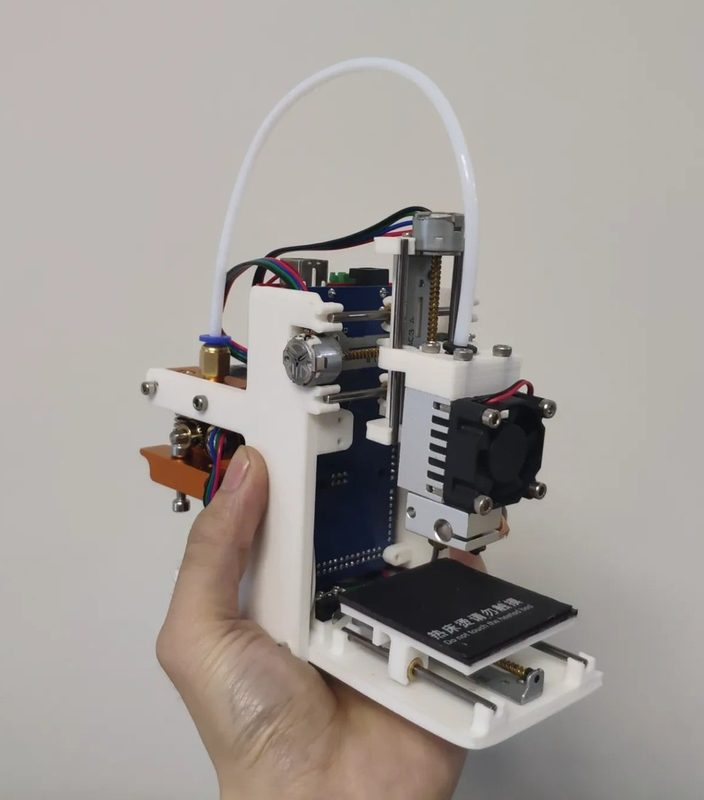
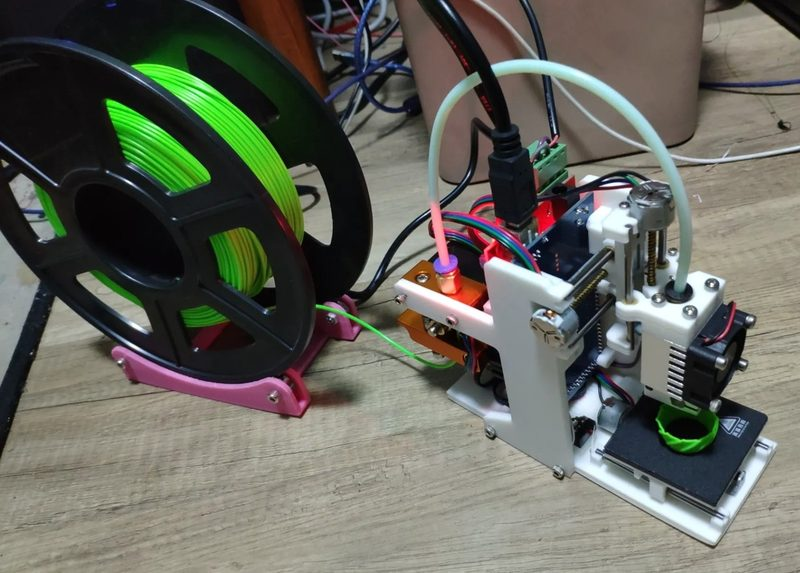
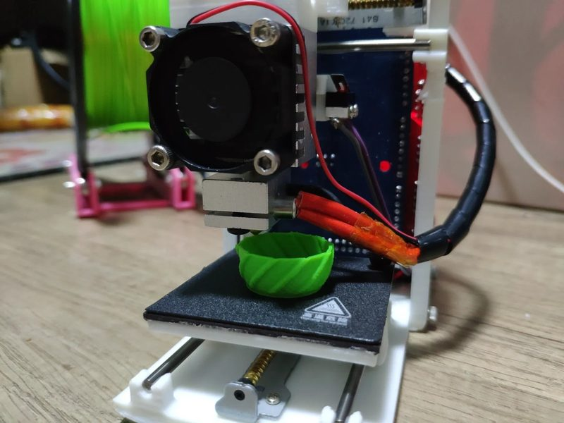
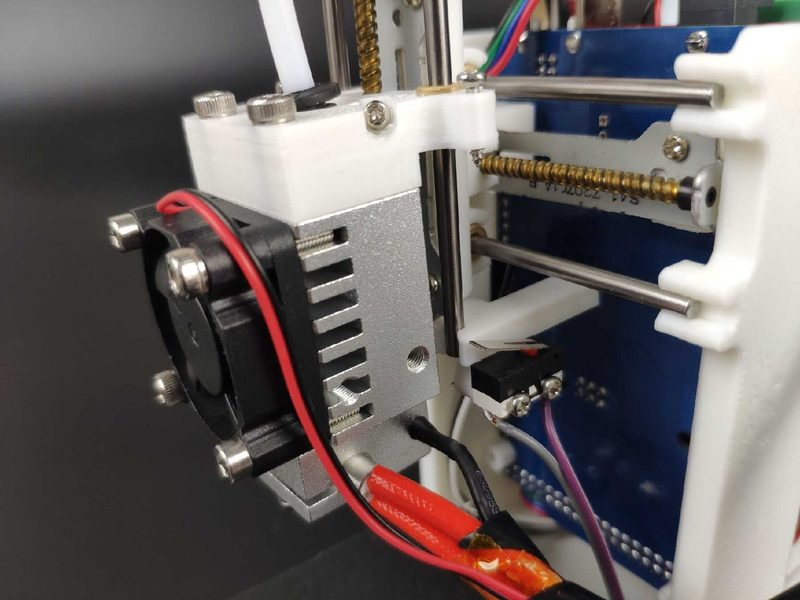

# Mini One

[Catalog row](../../README.md#mini-one-pocket) · [Gallery](../../GALLERY.md)

| Field | Value |
| --- | --- |
| Section | Cartesian · Small (≤180 mm on both X/Y axes) |
| Project page | [https://makerworld.com/en/models/903275](https://makerworld.com/en/models/903275) |
| Author | mossbot / M-G |
| About | Palm-sized bedslinger with micro lead-screw stepper motors on all three axes, a 0.2 mm nozzle, and an unheated film bed. It runs Marlin 1.0.2 on an Arduino Mega with RAMPS 1.4. |
| Build volume (X×Y×Z) | 45×45×45 |
| Exterior (W×D×H) | — |
| Latest version | Files [2024-12](https://makerworld.com/en/models/903275) |
| Stars Likes Views |  [💙⁠2.2K](https://www.thingiverse.com/thing:3749961) [💚⁠7.8K](https://makerworld.com/en/models/903275) |
| Links | [CAD](https://grabcad.com/library/mini-one-pocket-3d-printer-1) [STL](https://www.thingiverse.com/thing:3749961/files) [Manual](https://makerworld.com/en/models/903275) [Firmware](https://github.com/mossbot-MG/mini-one-pocket-3D-printer-firmware) |
| Groups | — |
| License | [CC BY-NC-SA 4.0 (Thingiverse), Standard Digital File License (MakerWorld)](https://www.thingiverse.com/thing:3749961) |

## Pictures (6)

<table>
<tr><td align="center" width="33%"> Photo: <a href="https://makerworld.com/en/@mossbot">mossbot</a></td><td align="center" width="33%"> Version: three colour versions (pink, black, white) Photo: <a href="https://makerworld.com/en/@mossbot">mossbot</a></td><td align="center" width="33%"> Photo: <a href="https://makerworld.com/en/@mossbot">mossbot</a></td></tr>
<tr><td align="center" width="33%"> Photo: <a href="https://makerworld.com/en/@mossbot">mossbot</a></td><td align="center" width="33%"> Photo: <a href="https://makerworld.com/en/@mossbot">mossbot</a></td><td align="center" width="33%"> Photo: <a href="https://github.com/mossbot-MG">mossbot</a></td></tr>
</table>
