# MiniB

[Catalog row](../../README.md#minib) · [Gallery](../../GALLERY.md)

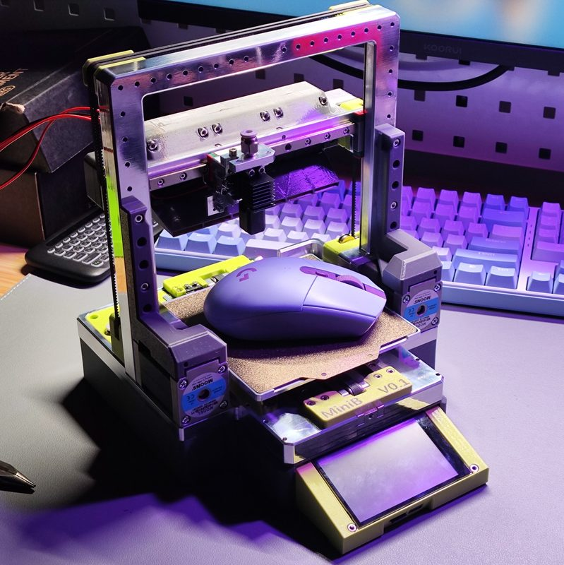

| Field | Value |
| --- | --- |
| Section | Concepts and prototypes |
| Project page | [https://makerworld.com.cn/zh/models/935514](https://makerworld.com.cn/zh/models/935514) |
| Author | 飞翔的AMX (Flying-AMX) |
| About | Foldable CoreXZ printer with 3 mm belts, MGN7 rails and CNC aluminum parts. Bicycle quick-release levers lock the XZ gantry to the Y base. The gantry folds down onto the base, and the folded printer, about 4 kg, packs into a printed case. The STEP model is public, but there is no BOM or build guide. |
| Build type | Foldable CoreXZ |
| Build volume (X×Y×Z) | 120×120×120 |
| Exterior (W×D×H) | — |
| Latest version | V0.12 [2025-03](https://makerworld.com.cn/zh/models/935514) |
| Stars Likes Views | [💚⁠595](https://makerworld.com.cn/zh/models/935514) [⏯️⁠288](https://www.youtube.com/watch?v=-B0b-mdRQaM) [❤️⁠25](https://www.youtube.com/watch?v=-B0b-mdRQaM) |
| Links | [STEP](https://grabcad.com/library/minib-foldable-3d-printer-3d-1/files) [Files](https://makerworld.com.cn/zh/models/935514) [Video](https://www.bilibili.com/video/BV1tuKjeYEtj/) [Video](https://www.bilibili.com/video/BV1CkmmYiEr3/) |
| Groups | — |
| License | [CC BY-NC-SA 4.0](https://makerworld.com.cn/zh/models/935514) |

## Pictures (11)

<table>
<tr><td align="center" width="33%"> Version: V0.1 Photo: <a href="https://grabcad.com/flying.amx-1">飞翔的AMX</a></td><td align="center" width="33%"><a href="1-minib.jpg">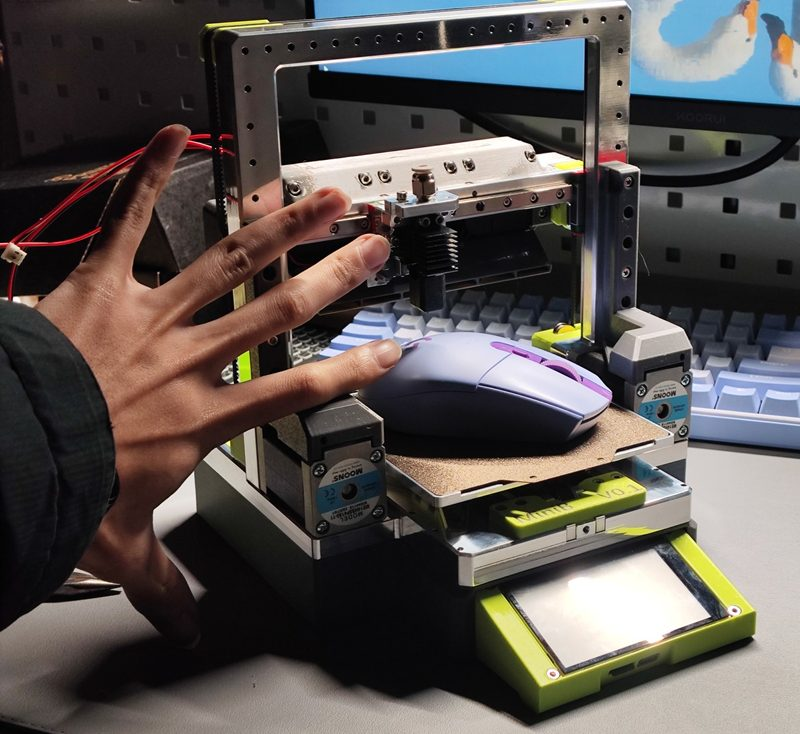</a> Version: V0.1 Photo: <a href="https://grabcad.com/flying.amx-1">飞翔的AMX</a></td><td align="center" width="33%"><a href="2-minib.jpg">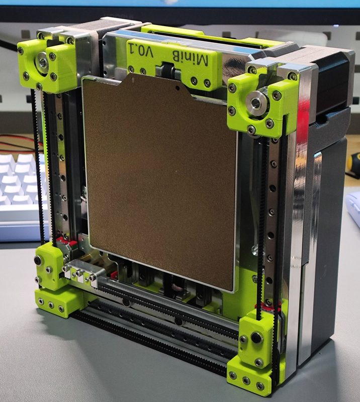</a> Version: V0.1 Photo: <a href="https://grabcad.com/flying.amx-1">飞翔的AMX</a></td></tr>
<tr><td align="center" width="33%"><a href="3-minib.jpg">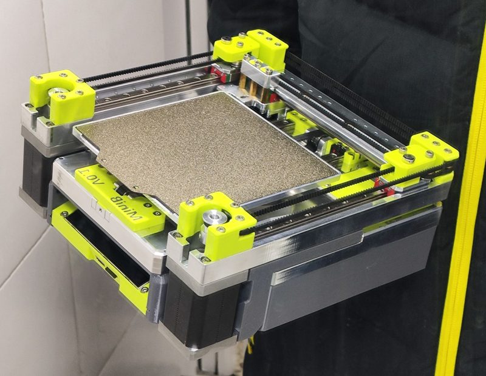</a> Version: V0.1 Photo: <a href="https://grabcad.com/flying.amx-1">飞翔的AMX</a></td><td align="center" width="33%"><a href="4-minib.jpg">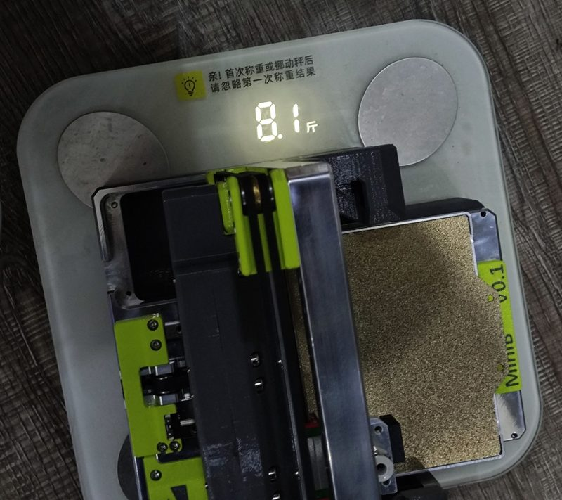</a> Version: V0.1 Photo: <a href="https://grabcad.com/flying.amx-1">飞翔的AMX</a></td><td align="center" width="33%"><a href="5-minib.jpg">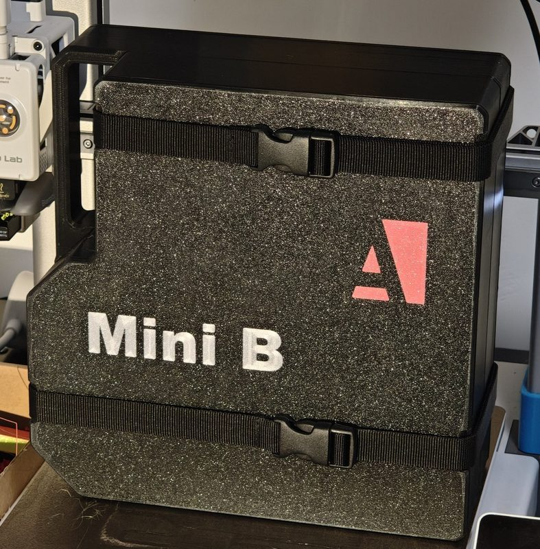</a> Version: V0.12 Photo: <a href="https://grabcad.com/flying.amx-1">飞翔的AMX</a></td></tr>
<tr><td align="center" width="33%"><a href="6-minib.jpg">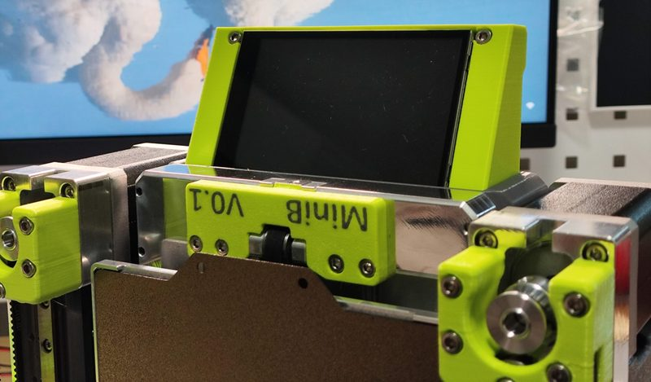</a> Version: V0.1 Photo: <a href="https://grabcad.com/flying.amx-1">飞翔的AMX</a></td><td align="center" width="33%"><a href="7-minib.jpg">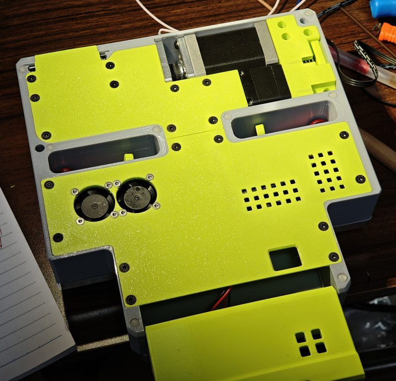</a> Photo: <a href="https://grabcad.com/flying.amx-1">飞翔的AMX</a></td><td align="center" width="33%"><a href="8-minib.jpg">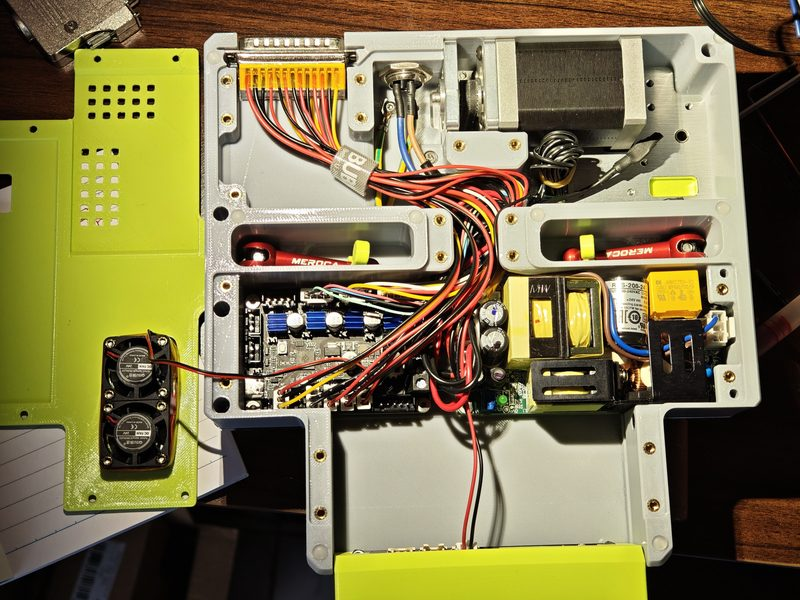</a> Photo: <a href="https://grabcad.com/flying.amx-1">飞翔的AMX</a></td></tr>
<tr><td align="center" width="33%"><a href="9-minib.jpg">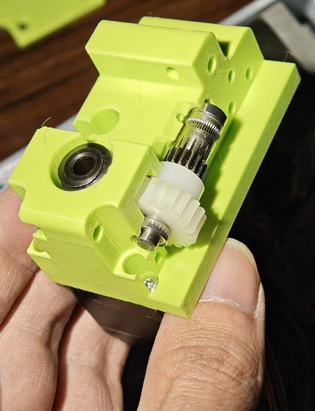</a> Version: V0.1 Photo: <a href="https://grabcad.com/flying.amx-1">飞翔的AMX</a></td><td align="center" width="33%"><a href="10-minib.jpg">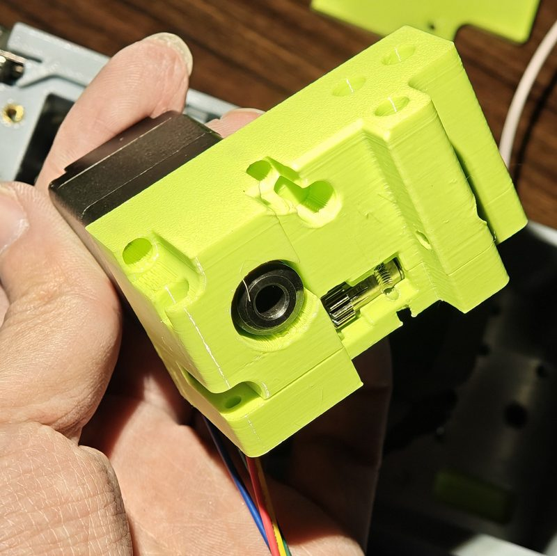</a> Version: V0.1 Photo: <a href="https://grabcad.com/flying.amx-1">飞翔的AMX</a></td></tr>
</table>

## Other homes of the files

- [GrabCAD](https://grabcad.com/library/minib-foldable-3d-printer-3d-1): the STEP revisions V0.1 to V0.12 and 12 photos, uploaded by the author. No license stated.
- Wayback Machine: no snapshot.
