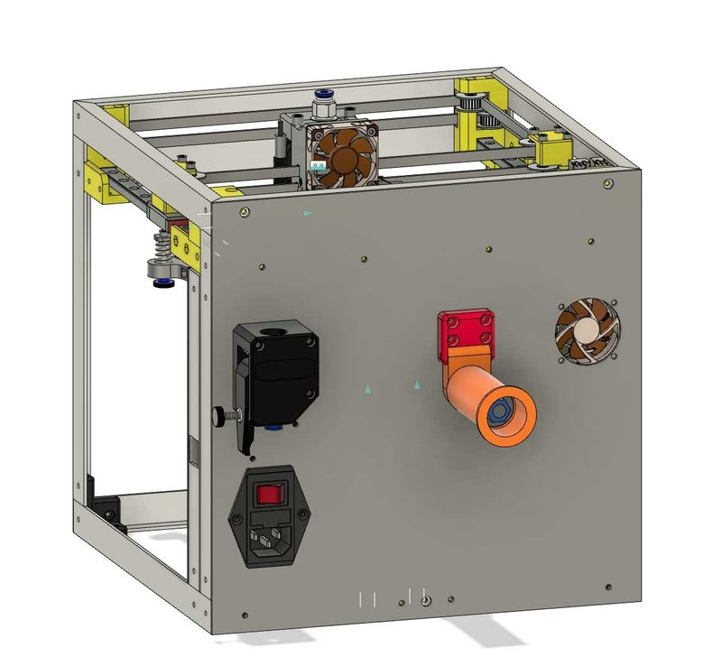

# MiniCube (Kotvic)

[Catalog row](../../README.md#minicube-kotvic) · [Gallery](../../GALLERY.md)

| Field | Value |
| --- | --- |
| Section | Legacy designs |
| Project page | [https://www.thingiverse.com/thing:4795475](https://www.thingiverse.com/thing:4795475) |
| Author | Kotvic |
| About | Compact CoreXY with Fusion 360 files; marked work in progress and missing assembly instructions. No update since 2021 and no active group. |
| Build volume (X×Y×Z) | 149×140×135 |
| Exterior (W×D×H) | 265×265×265 |
| Latest version | First release [2021-03](https://www.thingiverse.com/thing:4795475) |
| Stars Likes Views | [💙⁠9](https://www.thingiverse.com/thing:4795475) |
| Links | [Files](https://www.thingiverse.com/thing:4795475/files) |
| Groups | — |
| License | [CC BY](https://www.thingiverse.com/thing:4795475) |

## Pictures (2)

<table>
<tr><td align="center" width="33%"> Photo: <a href="https://www.thingiverse.com/kotvic">Kotvic</a></td><td align="center" width="33%"> Photo: <a href="https://www.thingiverse.com/kotvic">Kotvic</a></td></tr>
</table>

## Other homes of the files

- Wayback Machine: [latest snapshot](https://web.archive.org/web/20230515104353/https://www.thingiverse.com/thing:4795475), 2023-05-15.
