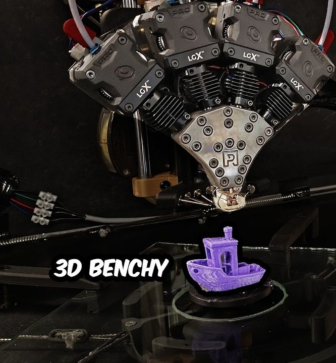
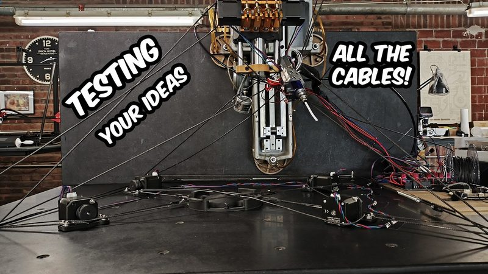
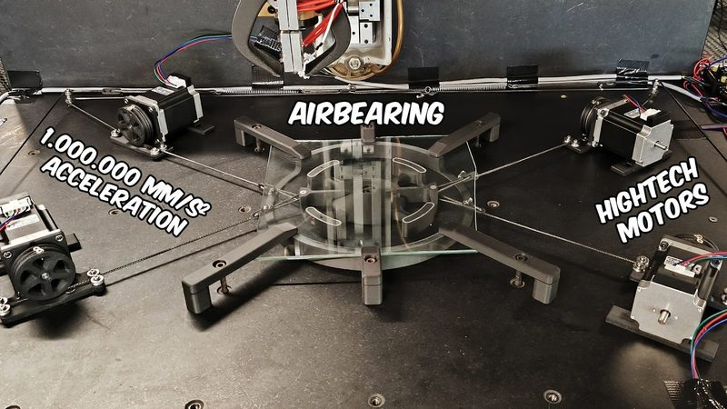

# Minuteman

[Catalog row](../../README.md#minuteman) · [Gallery](../../GALLERY.md)

| Field | Value |
| --- | --- |
| Section | Concepts and prototypes |
| Project page | [https://www.youtube.com/watch?v=iMAWa9vfxcE](https://www.youtube.com/watch?v=iMAWa9vfxcE) |
| Author | Roetz 4.0 |
| About | One-off, Benchy-sized speed printer with a four-cable winch XY, air-bearing moving bed, and independent Z toolhead. Its CAD, BOM, and build guide are not public, but the build series is fun to watch. |
| Build type | Cable winch XY moving bed |
| Build volume (X×Y×Z) | 60×60×73 |
| Exterior (W×D×H) | — |
| Latest version | Video [2026-05](https://www.youtube.com/watch?v=iMAWa9vfxcE) |
| Stars Likes Views | [⏯️⁠4.3M](https://www.youtube.com/watch?v=AJhCPCpLYcE) [❤️⁠18.1K](https://www.youtube.com/watch?v=AJhCPCpLYcE) |
| Links | [Video](https://www.youtube.com/playlist?list=PLT7wyh27LmscPT1EZpoS3BTWUJjAOQ5Gf) [Hotend](https://github.com/Roetz4point0/Roetz-End) |
| Groups | [Discord](https://discord.gg/nr6QrWE9Dd) EN 819 |

## Pictures (4)

<table>
<tr><td align="center" width="33%"> Photo: <a href="https://www.youtube.com/@Roetz40">Roetz 4.0</a></td><td align="center" width="33%"> Photo: <a href="https://www.youtube.com/@Roetz40">Roetz 4.0</a></td><td align="center" width="33%"> Photo: <a href="https://www.youtube.com/@Roetz40">Roetz 4.0</a></td></tr>
<tr><td align="center" width="33%"> Photo: <a href="https://www.youtube.com/@Roetz40">Roetz 4.0</a></td></tr>
</table>
