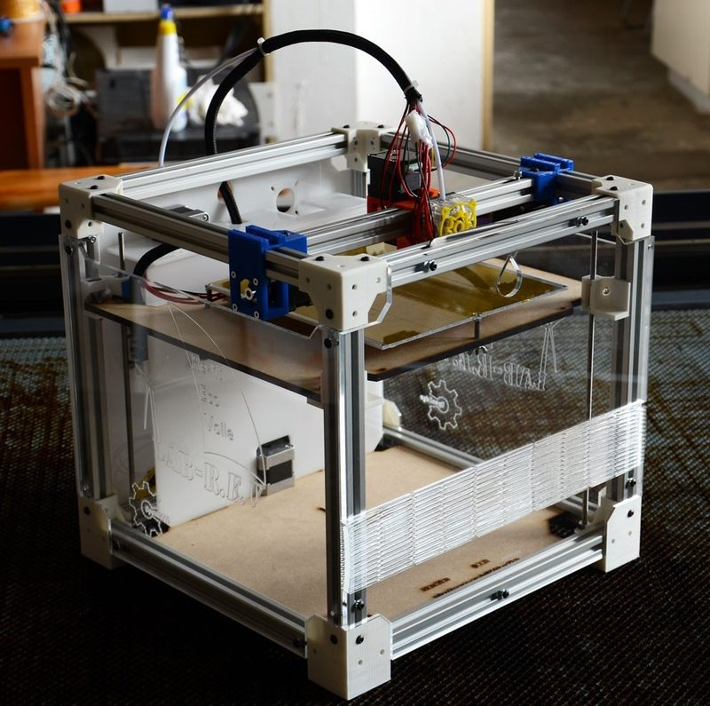
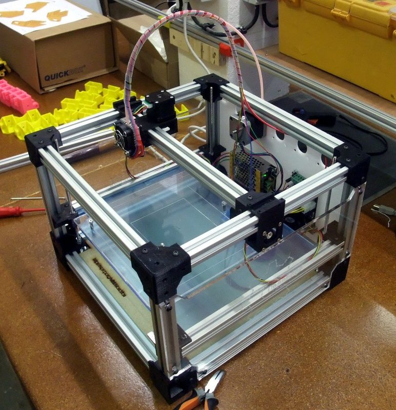
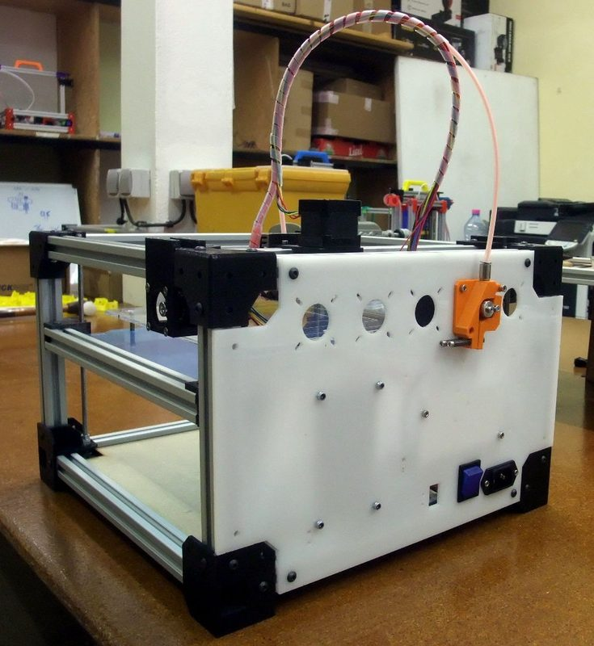
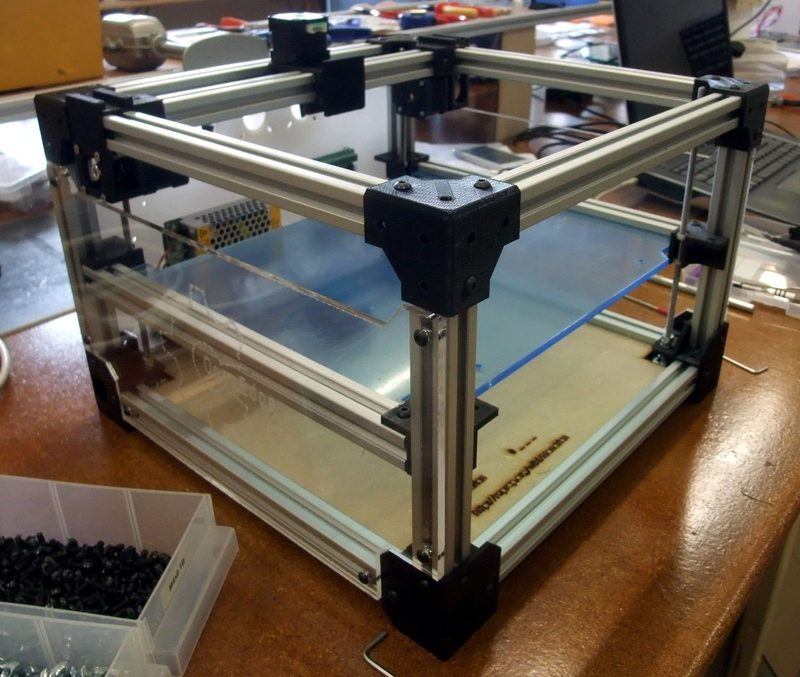
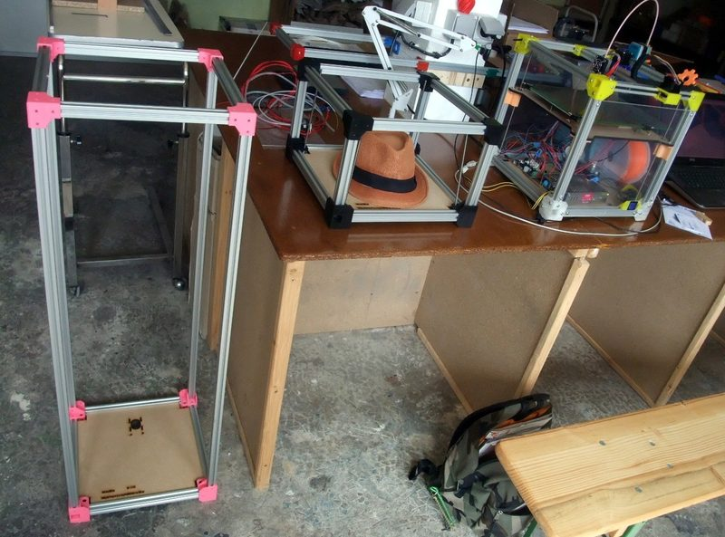
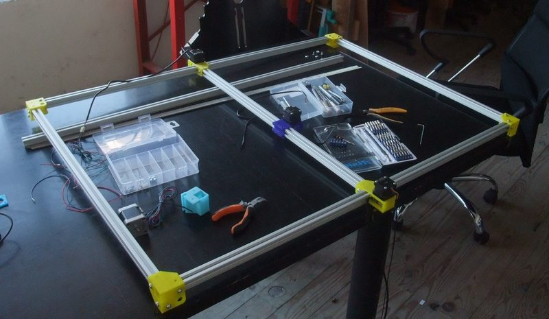

# Mondrian

[Catalog row](../../README.md#mondrian) · [Gallery](../../GALLERY.md)

| Field | Value |
| --- | --- |
| Section | Legacy designs |
| Project page | [https://reprap.org/wiki/Mondrian](https://reprap.org/wiki/Mondrian) |
| Author | Emmanuel Gilloz |
| About | Modular Cartesian RepRap. The 20×20 mm extrusion frame is the linear guide for all three axes. Open Edge offered version 3.0 as a kit on Kickstarter in 2015. No update since 2016-09. |
| Build volume (X×Y×Z) | 200×200×200 |
| Exterior (W×D×H) | 240×240×? |
| Latest version | 3.0 [2016-09](https://github.com/OpenEdge/Mondrian3/commit/19e97ebabb76139520f8f536f755c1b2fb436180) |
| Stars Likes Views |  [💙⁠260](https://www.thingiverse.com/thing:22956) [⏯️⁠4.9K](https://www.youtube.com/watch?v=iblqWGGPKoU) [❤️⁠12](https://www.youtube.com/watch?v=iblqWGGPKoU) |
| Links | [CAD](https://github.com/OpenEdge/Mondrian3/tree/master/source) 3.0 [STL](https://github.com/OpenEdge/Mondrian3/tree/master/hardware/STL) 3.0 [FW](https://github.com/OpenEdge/Mondrian3/tree/master/firmware) 3.0 [Files](https://github.com/OpenEdge/Mondrian2.5) 2.5 [Files](https://github.com/OpenEdge/Mondrian2.2) 2.2 [Files](https://github.com/OpenEdge/Mondrian2.1) 2.1 [Files](https://github.com/OpenEdge/Mondrian2.0) 2.0 [Files](https://github.com/OpenEdge/Mondrian1) 1 [Wiki](https://reprap.org/wiki/Mondrian) |
| Groups | [Forum](https://reprap.org/forum/list.php?283) EN inactive |
| License | [GPL-3.0 (GitHub), GPL (RepRap wiki), GPL-2.0 (Thingiverse)](https://github.com/OpenEdge/Mondrian3/blob/master/LICENSE) |

## Pictures (7)

<table>
<tr><td align="center" width="33%"> Version: Mondrian 3.0 Photo: <a href="https://www.thingiverse.com/watsdesign">Emmanuel Gilloz</a></td><td align="center" width="33%"> Version: Mondrian 2 Photo: <a href="https://reprap.org/wiki/User:Emmanuel">Emmanuel Gilloz</a></td><td align="center" width="33%"> Version: Mondrian 2 Photo: <a href="https://reprap.org/wiki/User:Emmanuel">Emmanuel Gilloz</a></td></tr>
<tr><td align="center" width="33%"> Version: Mondrian 2 Photo: <a href="https://reprap.org/wiki/User:Emmanuel">Emmanuel Gilloz</a></td><td align="center" width="33%"> Version: Mondrian 2 (build in progress) Photo: <a href="https://reprap.org/wiki/User:Emmanuel">Emmanuel Gilloz</a></td><td align="center" width="33%"> Version: Mondrian 2 frames in 3310, 332 and 333 sizes Photo: <a href="https://reprap.org/wiki/User:Emmanuel">Emmanuel Gilloz</a></td></tr>
<tr><td align="center" width="33%"> Version: XL Mondrian frame M71010 (70x100x100 cm) Photo: <a href="https://reprap.org/wiki/User:Emmanuel">Emmanuel Gilloz</a></td></tr>
</table>
