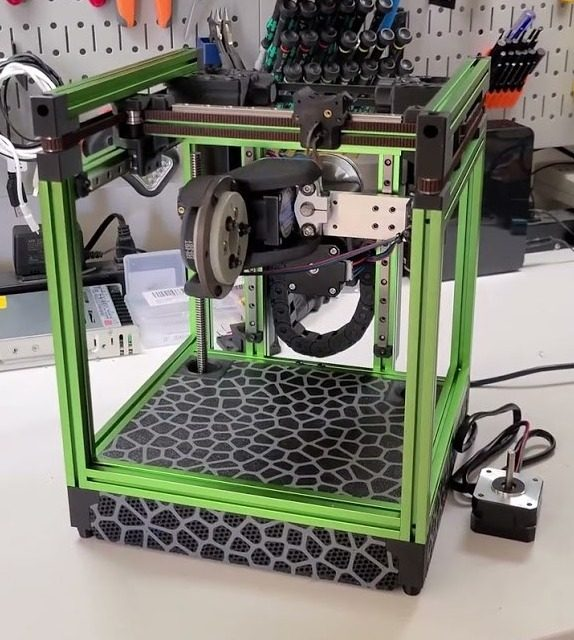
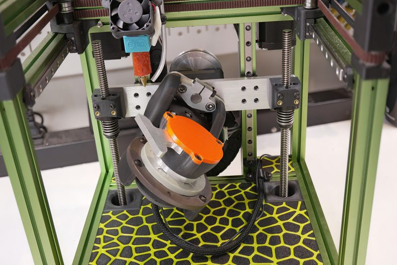
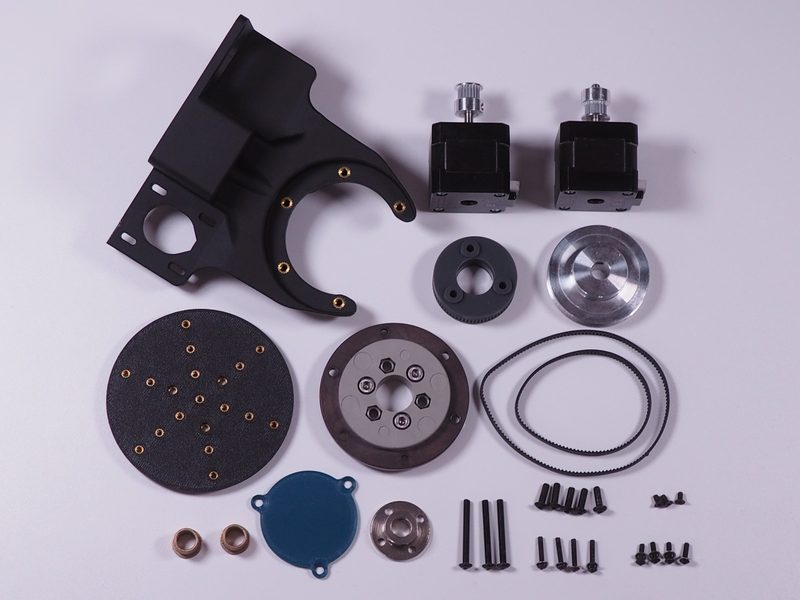
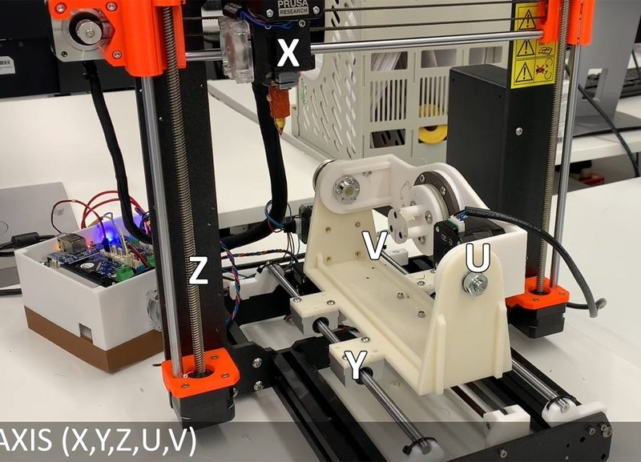
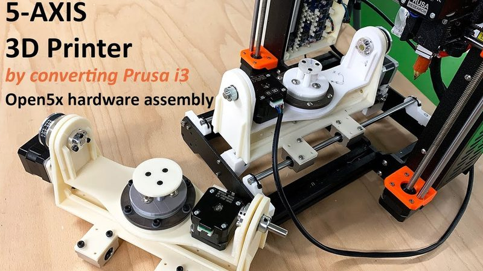
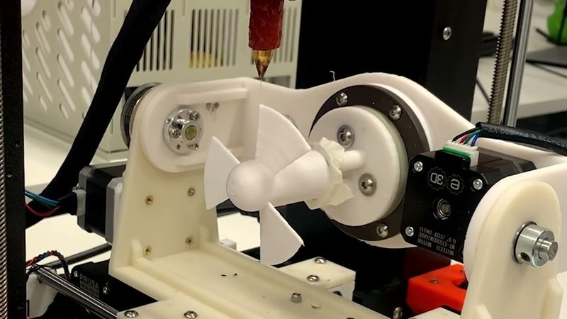
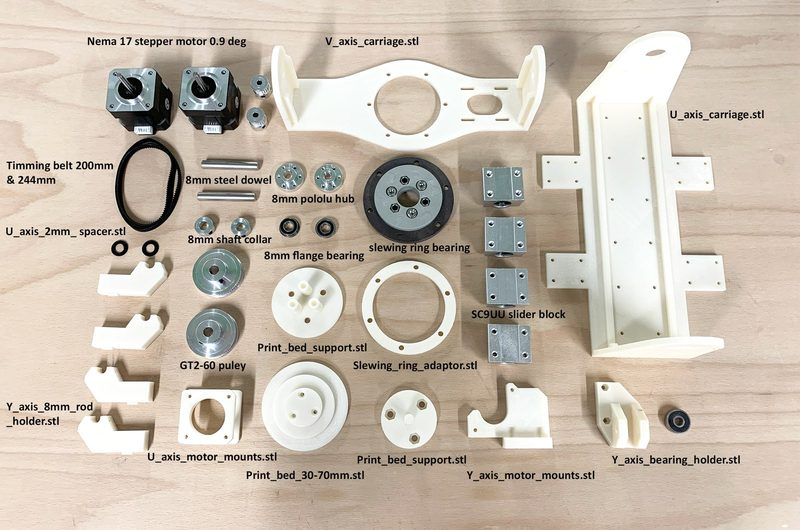

# Open5x

[Catalog row](../../README.md#open5x) · [Gallery](../../GALLERY.md)

| Field | Value |
| --- | --- |
| Section | 5-axis |
| Project page | [https://github.com/FreddieHong19/Open5x](https://github.com/FreddieHong19/Open5x) |
| Author | Freddie Hong |
| About | Kit that turns a 3-axis printer into a 5-axis printer. A printed trunnion replaces the bed, and a slewing-ring plate on it tilts and spins. It runs on a Duet board with RepRapFirmware and comes with a Grasshopper conformal slicer. The first build is a Prusa i3. BrendonBuilds ported it to an E3D ToolChanger, a Voron V0.1, and his mod0. Garth-42 and tobywhy ported it to the Jubilee. |
| Build volume (X×Y×Z) | — |
| Exterior (W×D×H) | — |
| Latest version | mod0 port [2024-06](https://github.com/BrendonBuilds/mod0/commit/88e52bc2990330fccb4a3359abab9539524b8c76) |
| Stars Likes Views |  [⏯️⁠179K](https://www.youtube.com/watch?v=f09oCH1REAs) [❤️⁠3.3K](https://www.youtube.com/watch?v=f09oCH1REAs) |
| Links | [CAD](https://github.com/FreddieHong19/Open5x/blob/main/3D_Model/Open5x%20Assembly.f3z) Prusa i3 [STL](https://github.com/FreddieHong19/Open5x/tree/main/3D_Model/Prusa%20i3) Prusa i3 [BOM](https://github.com/FreddieHong19/Open5x/blob/main/3D_Model/Prusa%20i3/Materials_and_supplier.md) Prusa i3 [Config](https://github.com/FreddieHong19/Open5x/tree/main/Duet2_Configuration) Prusa i3 [STEP](https://github.com/FreddieHong19/Open5x/blob/main/3D_Model/E3D_ToolChanger/ToolChanger-Open5x-assembly.step) E3D TC [STEP](https://github.com/FreddieHong19/Open5x/blob/main/3D_Model/Voron_0/voron-0-open5x.step) Voron 0 [Config](https://github.com/FreddieHong19/Open5x/tree/main/3D_Model/Voron_0/DuetConfig) Voron 0 [STEP](https://github.com/FreddieHong19/Open5x/blob/main/3D_Model/Jubilee%20Tool%20changer/Jubilee-Open5x-assembly.step) Jubilee [BOM](https://github.com/FreddieHong19/Open5x/blob/main/3D_Model/Jubilee%20Tool%20changer/5%20Axis%20Jubilee%20BOM.pdf) Jubilee [Manual](https://github.com/FreddieHong19/Open5x/blob/main/3D_Model/Jubilee%20Tool%20changer/Guide%20to%205%20Axis%20on%20the%20Jubilee.pdf) Jubilee [Config](https://github.com/FreddieHong19/Open5x/tree/main/3D_Model/Jubilee%20Tool%20changer/System%20files) Jubilee [STEP](https://github.com/BrendonBuilds/mod0/blob/main/CAD/Open5x/mod0-open5x-v1.step) mod0 [Files](https://github.com/FreddieHong19/Open5x/tree/main/Grasshopper_Definition) slicer [Video](https://www.youtube.com/watch?v=x9rG15qrDIE) [Video](https://www.youtube.com/watch?v=LZs5z4K3-sw) Voron 0 |
| Groups | — |
| License | [MIT (GitHub), GPL-3.0 (mod0 port, GitHub)](https://github.com/FreddieHong19/Open5x/blob/main/LICENSE) |

## Pictures (8)

<table>
<tr><td align="center" width="33%"> Version: mod0 Open5x module Photo: <a href="https://github.com/BrendonBuilds">BrendonBuilds</a></td><td align="center" width="33%"> Version: Voron 0.1 port Photo: <a href="https://www.youtube.com/@BrendonBuilds">BrendonBuilds</a></td><td align="center" width="33%"> Version: Voron 0 port Photo: <a href="https://github.com/BrendonBuilds">BrendonBuilds</a></td></tr>
<tr><td align="center" width="33%"> Version: E3D ToolChanger port Photo: <a href="https://github.com/BrendonBuilds">BrendonBuilds</a></td><td align="center" width="33%"> Version: Prusa i3 conversion Photo: <a href="https://github.com/FreddieHong19">Freddie Hong</a></td><td align="center" width="33%"> Version: Prusa i3 conversion Photo: <a href="https://www.youtube.com/@freddiehong">Freddie Hong</a></td></tr>
<tr><td align="center" width="33%"> Version: Prusa i3 conversion Photo: <a href="https://www.youtube.com/@freddiehong">Freddie Hong</a></td><td align="center" width="33%"> Version: Prusa i3 conversion kit Photo: <a href="https://github.com/FreddieHong19">Freddie Hong</a></td></tr>
</table>

## Mods and variants

- [Rep5x](https://github.com/dennisklappe/Rep5x) by Dennis Klappe: a retrofit toolhead with a B tilt past 90° and endless C rotation, base Ender 3 V3 SE or Ender 5 Pro. GPL-3.0.
- [FullControl multiaxis](https://github.com/FullControlXYZ/multiaxis) by FullControl with Loughborough University students: a geared tilting hotend (B), with add-ons for a C rotating bed or an A mandrel, base Prusa i3 MK3, with untested brackets for Ender 3 and TAZ 5. License not stated.
