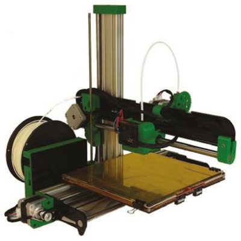
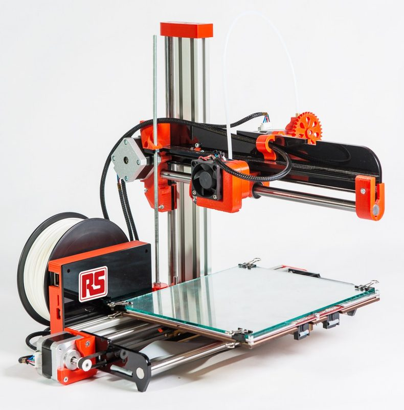
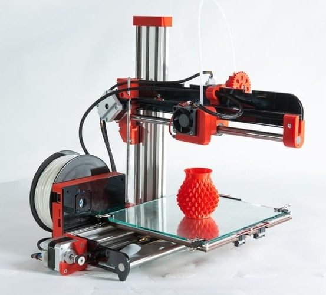

# RepRapPro Ormerod 1 / 2

[Catalog row](../../README.md#ormerod-2) · [Gallery](../../GALLERY.md)

| Field | Value |
| --- | --- |
| Section | Historical designs |
| Project page | [https://github.com/reprappro/Ormerod](https://github.com/reprappro/Ormerod) |
| Author | RepRapPro |
| About | Cantilevered Cartesian kit with full assembly files and build instructions. The first printer with the Duet board, now common on DIY printers. |
| Build volume (X×Y×Z) | 200×200×200 |
| Exterior (W×D×H) | 500×460×410 |
| Latest version | 528.5 [2015-05](https://github.com/reprappro/Ormerod/releases/tag/528.5) |
| Stars Likes Views |  [⏯️⁠7K](https://www.youtube.com/watch?v=HoZ7rOVZr-Q) [❤️⁠20](https://www.youtube.com/watch?v=HoZ7rOVZr-Q) |
| Links | [CAD](https://github.com/reprappro/Ormerod/tree/master/freeCAD) [Manual](https://reprap.org/wiki/Ormerod#Build_instructions) |
| Groups | [Forum](https://reprap.org/forum/list.php?340) EN |
| License | [GPL-3.0](https://github.com/reprappro/Ormerod/blob/master/README.md) |

## Pictures (5)

<table>
<tr><td align="center" width="33%"> Photo: <a href="https://github.com/reprappro">RepRapPro</a></td><td align="center" width="33%"> Photo: <a href="https://uk.rs-online.com/">RS Components/RepRapPro</a></td><td align="center" width="33%"> Photo: <a href="https://github.com/reprappro">RepRapPro</a></td></tr>
<tr><td align="center" width="33%"> Photo: <a href="https://github.com/reprappro">RepRapPro</a></td><td align="center" width="33%"> Photo: <a href="https://github.com/reprappro">RepRapPro</a></td></tr>
</table>

## Other homes of the files

- [GitHub (RepRap Ltd)](https://github.com/RepRapLtd/Ormerod): copy of the RepRapPro repo with SolidWorks, FreeCAD, STL, and BOM. GPL per README. Uploader RepRap Ltd.
- [GitHub (RepRap Ltd)](https://github.com/RepRapLtd/Ormerod-stuff): full Ormerod STEP, Ormerod 2 FreeCAD model, and add-on parts. No license stated. Uploader RepRap Ltd.
- [RepRap Ltd docs](https://reprapltd.com/reprappro/documentation/ormerod-2/index.html): Ormerod 2 build manual. GPL.
- [RepRap Ltd docs](https://reprapltd.com/reprappro/documentation/ormerod/index.html): Ormerod 1 build manual. GPL.
- Wayback Machine: [latest snapshot](http://web.archive.org/web/20250728164104/https://github.com/reprappro/Ormerod), 2025-07-28.
