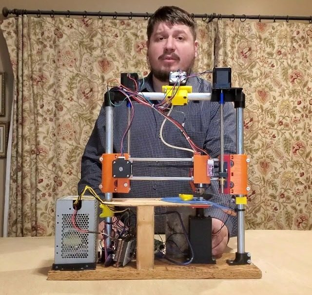
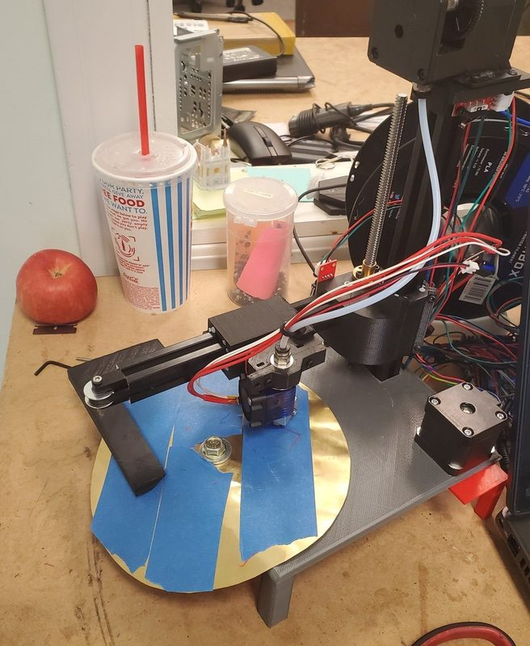
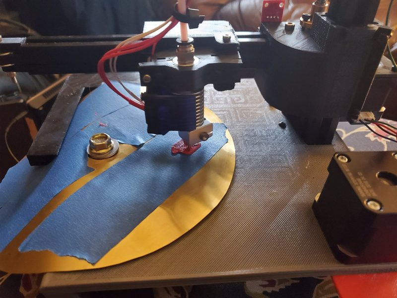

# Polar printer v2

[Catalog row](../../README.md#polar-printer-v2) · [Gallery](../../GALLERY.md)

| Field | Value |
| --- | --- |
| Section | Legacy designs |
| Project page | [https://www.thingiverse.com/thing:4032809](https://www.thingiverse.com/thing:4032809) |
| Author | Rob Mink |
| About | Polar printer with a rotating half-round bed and a radial arm on one Z column. Version 2 is a full redesign of the machine that Rob Mink showed at ERRF 2019. The page is marked work in progress. No update since 2019-12. |
| Build volume (X×Y×Z) | — |
| Exterior (W×D×H) | — |
| Latest version | Files [2019-12](https://www.thingiverse.com/thing:4032809/files) |
| Stars Likes Views | [💙⁠8](https://www.thingiverse.com/thing:4032809) [⏯️⁠2K](https://www.youtube.com/watch?v=9lM06mLXj50) [❤️⁠39](https://www.youtube.com/watch?v=9lM06mLXj50) |
| Links | [Files](https://www.thingiverse.com/thing:4032809/files) v2 [Firmware](https://github.com/RobMink/UpdatedPolarFirmware---Marlin) [CAD](https://github.com/RobMink/Polar) v1 [Video](https://www.youtube.com/watch?v=5Q1t9RF6neE) |
| Groups | [Discord](https://discord.gg/NTDZMsCwXh) EN 888 |
| License | [CC BY-NC-SA 4.0 (v2, Thingiverse); GPL-3.0 (v1, GitHub)](https://www.thingiverse.com/thing:4032809) |

## Pictures (4)

<table>
<tr><td align="center" width="33%"> Version: Polar v1 (ERRF 2019) Photo: <a href="https://github.com/RobMink">Rob Mink</a></td><td align="center" width="33%"> Version: Polar v1 (ERRF 2019) Photo: <a href="https://www.youtube.com/channel/UCJOlq9X_iJxpC_L0wHOz_4g">Rob Mink</a></td><td align="center" width="33%"> Version: Polar v2 Photo: <a href="https://www.thingiverse.com/robmink/designs">Rob Mink</a></td></tr>
<tr><td align="center" width="33%"> Version: Polar v2 Photo: <a href="https://www.thingiverse.com/robmink/designs">Rob Mink</a></td></tr>
</table>
