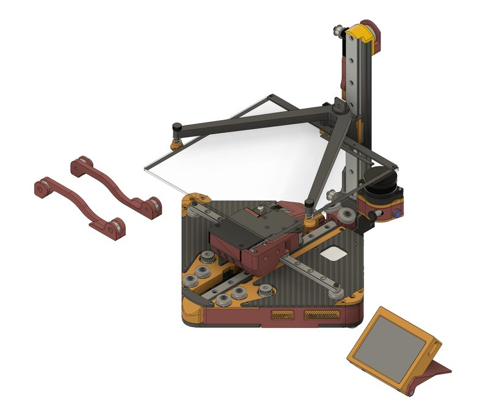
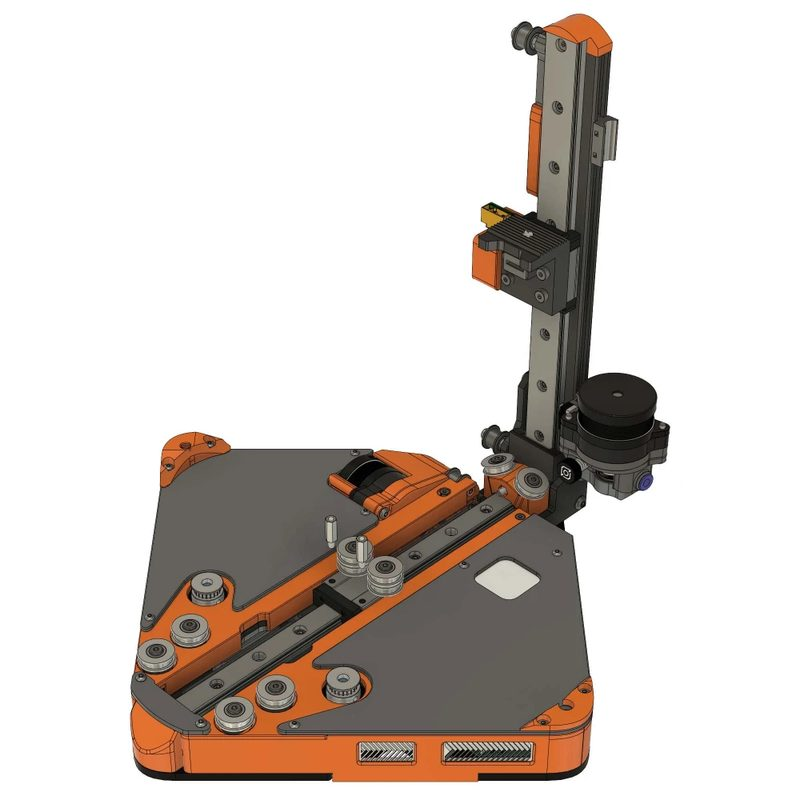
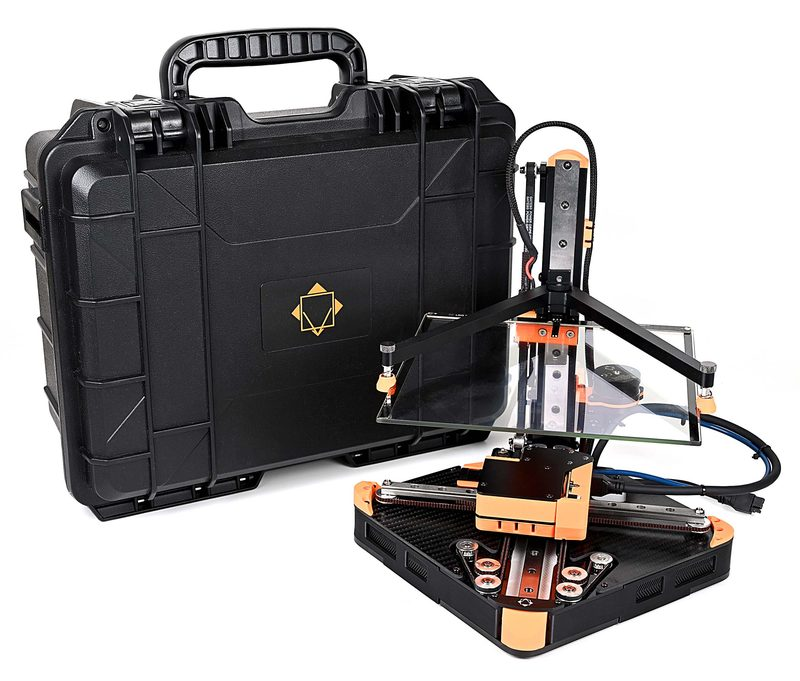
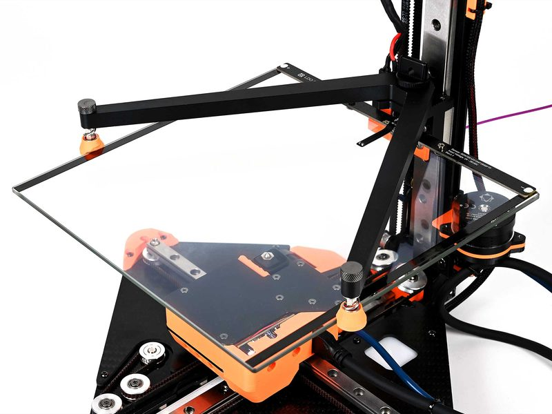
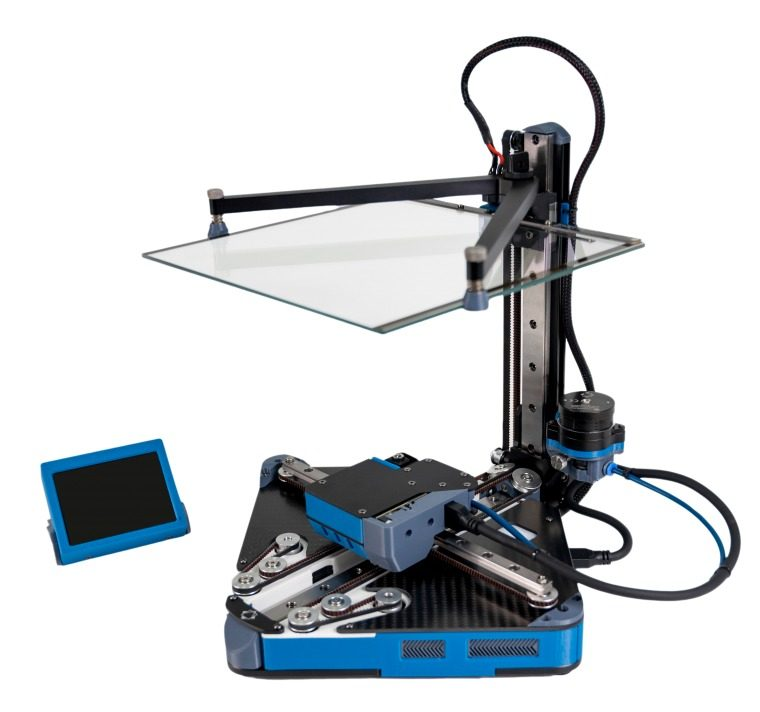
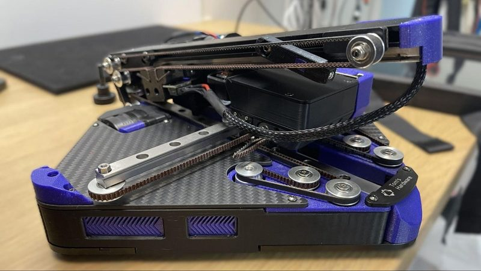

# Positron V3.2

[Catalog row](../../README.md#positron-v3) · [Gallery](../../GALLERY.md)

| Field | Value |
| --- | --- |
| Section | Other motion systems |
| Project page | [https://github.com/Positron3D/Positron](https://github.com/Positron3D/Positron) |
| Author | Positron Team / Kralyn |
| About | Compact inverted printer that folds for transport. |
| Build type | Inverted folding portable |
| Build volume (X×Y×Z) | 180×180×165 |
| Exterior (W×D×H) | open: 200×200×270 folded: 200×200×80 |
| Latest version | V3.2.2 [2026-03](https://github.com/Positron3D/Positron/commit/84d9d0719a93b2cce2376f9aa11a1218c0fb71a8) |
| Stars Likes Views |  [🧡⁠70](https://www.printables.com/model/932474) [⏯️⁠785K](https://www.youtube.com/watch?v=X_QLxTVtyng) [❤️⁠32.2K](https://www.youtube.com/watch?v=X_QLxTVtyng) |
| Links | [Files](https://github.com/Positron3D/Positron/tree/main/Printed%20Parts%20%26%20CAD%20Models) [Original](https://github.com/KRALYN/PositronV3) |
| Groups | [Discord](https://discord.gg/positron) EN 2.9K |

## Pictures (6)

<table>
<tr><td align="center" width="33%"> Photo: <a href="https://github.com/erikbuild">Erik Reynolds</a></td><td align="center" width="33%"></td><td align="center" width="33%"> Photo: David Sun</td></tr>
<tr><td align="center" width="33%"> Photo: David Sun</td><td align="center" width="33%"> Photo: <a href="https://www.kb-3d.com/">kb-3d/LDO</a></td><td align="center" width="33%"> Photo: <a href="https://www.tomshardware.com/author/denise-bertacchi">Denise Bertacchi</a></td></tr>
</table>
