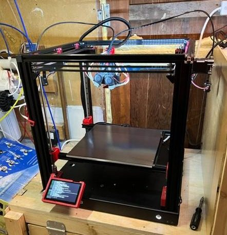
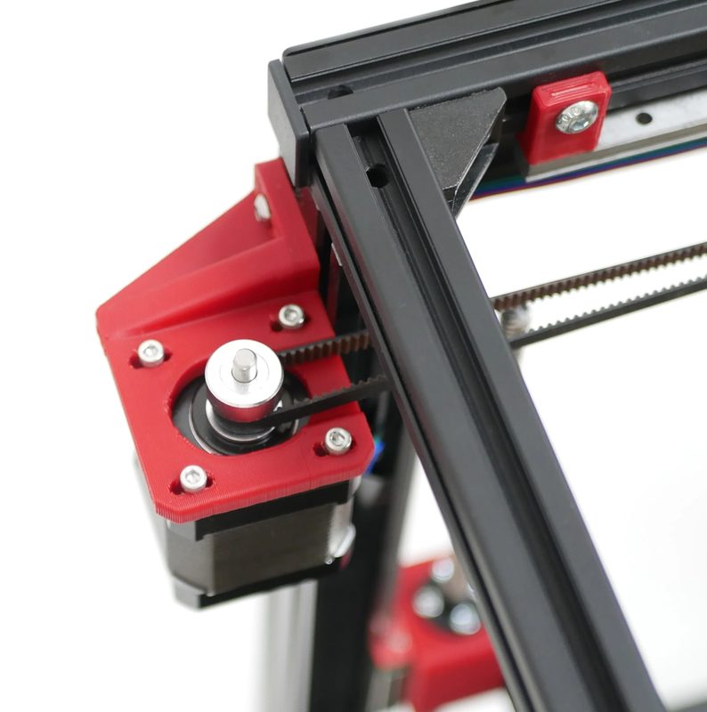
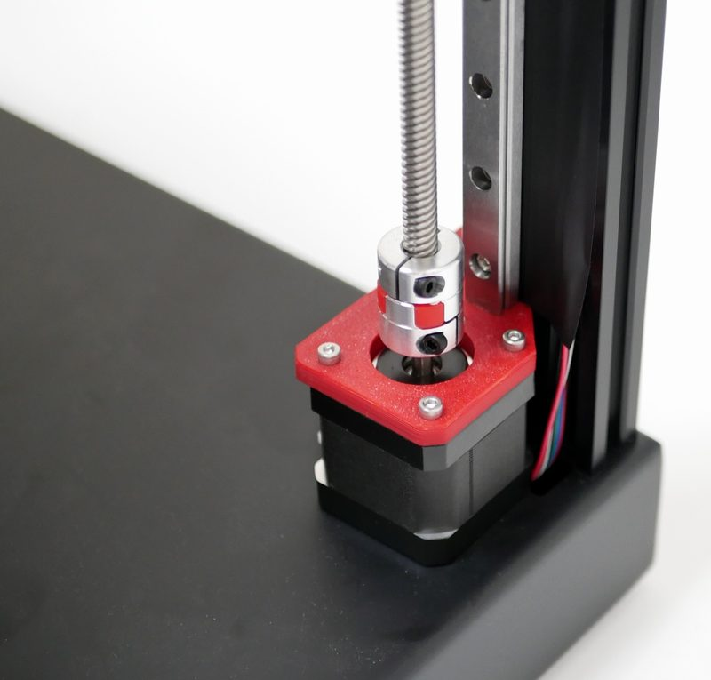
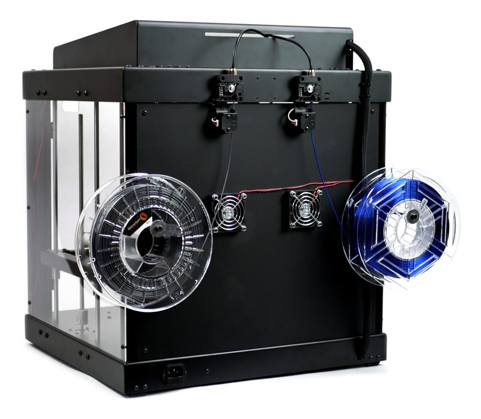
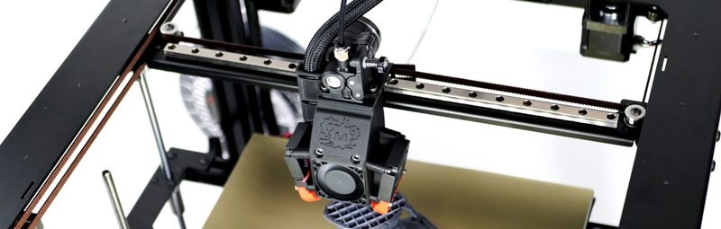

# ProForge 3 / 3.5

[Catalog row](../../README.md#proforge-3) · [Gallery](../../GALLERY.md)

| Field | Value |
| --- | --- |
| Section | Legacy designs |
| Project page | [https://github.com/Makertech3D/Proforge-3](https://github.com/Makertech3D/Proforge-3) |
| Author | Makertech3D |
| About | Kit CoreXY with 2 mm aluminum base and top plates on four 2040 posts. It replaced the Cartesian [ProForge 2S](https://github.com/Makertech3D/Proforge-2S) (2018). It has MGN9 rails on X and Y and stacked belts from two rear 0.9° motors. The optional Dual Switching Hotend v2 tilts a second hotend down with a servo. The 3.5 upgrade replaces the top plate with a 2020 frame and adds four Z motors on MGN12 rails and Klipper. No update since 2024-03. |
| Build volume (X×Y×Z) | 3: 300×300×300 3.5: 300×300×270 |
| Exterior (W×D×H) | 3: 500×480×520 |
| Latest version | 3.5 STEP [2024-03](https://github.com/Makertech3D/Proforge-3.5/commit/15678d614d7aac9faae35dee97f3fd2e1576641f) |
| Stars Likes Views |  [⏯️⁠25.7K](https://www.youtube.com/watch?v=WXsdUBg2upo) [❤️⁠325](https://www.youtube.com/watch?v=WXsdUBg2upo) |
| Links | [STEP](https://github.com/Makertech3D/Proforge-3.5/blob/main/Proforge%203.5%20-%20Final.STEP) 3.5 [STL](https://github.com/Makertech3D/Proforge-3.5/tree/main/3D%20Printed%20Part%20STL%27s) 3.5 [Files](https://github.com/Makertech3D/Proforge-3.5/tree/main/Panels) 3.5 panels [Config](https://github.com/Makertech3D/Proforge-3.5/tree/main/Klipper%20Config%20Files) 3.5 [STEP](https://github.com/Makertech3D/Proforge-3/tree/main/Part%20Drawings) 3 parts [STL](https://github.com/Makertech3D/Proforge-3/tree/main/3D%20Printed%20Parts%20STL%27s) 3 [BOM](https://makertech-3d.docutize.io/guides/proforge-3/docs/6a1ef374-38ff-4e11-9833-f9e2196e2a97) 3 [Manual](https://makertech-3d.docutize.io/kb/products/proforge-3/guides) [FW](https://github.com/Makertech3D/Proforge-3/tree/main/Proforge%203%20Marlin%20Firmware) 3 [Video](https://www.youtube.com/watch?v=MI6Zxk3_tSI) 3.5 [STEP](https://github.com/Makertech3D/Proforge-2S/blob/master/Proforge%202S.STEP) old 2S |
| Groups | [Discord](https://discord.com/invite/FwgXFUw4R4) EN 499 |
| License | [GPL-3.0](https://github.com/Makertech3D/Proforge-3/blob/main/LICENSE) |

## Pictures (9)

<table>
<tr><td align="center" width="33%"> Version: 3.5 Photo: <a href="https://www.reddit.com/user/Salty_Doug">u/Salty_Doug</a></td><td align="center" width="33%"> Version: 3.5 Photo: <a href="https://github.com/Makertech3D">Makertech3D</a></td><td align="center" width="33%"> Version: 3.5 Photo: <a href="https://github.com/Makertech3D">Makertech3D</a></td></tr>
<tr><td align="center" width="33%"> Version: 3.5 Photo: <a href="https://github.com/Makertech3D">Makertech3D</a></td><td align="center" width="33%"> Version: 3.5 Photo: <a href="https://github.com/Makertech3D">Makertech3D</a></td><td align="center" width="33%"> Version: 3 Photo: <a href="https://github.com/Makertech3D">Makertech3D</a></td></tr>
<tr><td align="center" width="33%"> Version: 3 Photo: <a href="https://github.com/Makertech3D">Makertech3D</a></td><td align="center" width="33%"> Version: 3 Photo: <a href="https://github.com/Makertech3D">Makertech3D</a></td><td align="center" width="33%"> Version: 3 Photo: <a href="https://github.com/Makertech3D">Makertech3D</a></td></tr>
</table>

## Other homes of the files

- [Makertech help center](https://makertech-3d.docutize.io/kb/products/proforge-3): build guides and the packing list for the 3 and the 3.5 upgrade. The old Dozuki guide site is offline, [archived](https://web.archive.org/web/20260117232953/https://makertech-3d.dozuki.com/c/Proforge_3).
- [GitHub](https://github.com/chernogorsky/Proforge-3): a full copy of Proforge-3 up to 2022-07, forked by chernogorsky.
- [Makertech shop page, archived](https://web.archive.org/web/20230325115539/https://www.makertech3d.com/products/proforge-3): the 3.5 kit, now offline. The [press pack, archived](https://web.archive.org/web/20210725152855/https://www.makertech3d.com/pages/proforge-3-press-pack) has photos and dimensions.
- [Kickstarter](https://www.kickstarter.com/projects/proforge-3d-printer/proforge-3): campaign page with specs.
- Wayback Machine: [latest snapshot](https://web.archive.org/web/20221225002002/https://github.com/Makertech3D/Proforge-3), 2022-12-25.
