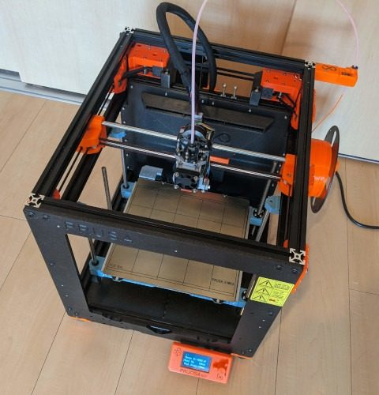
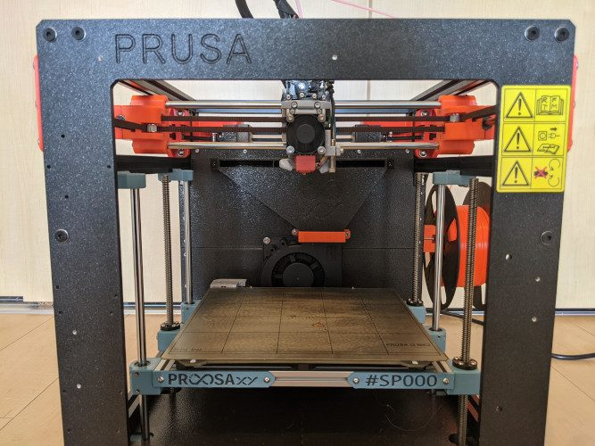
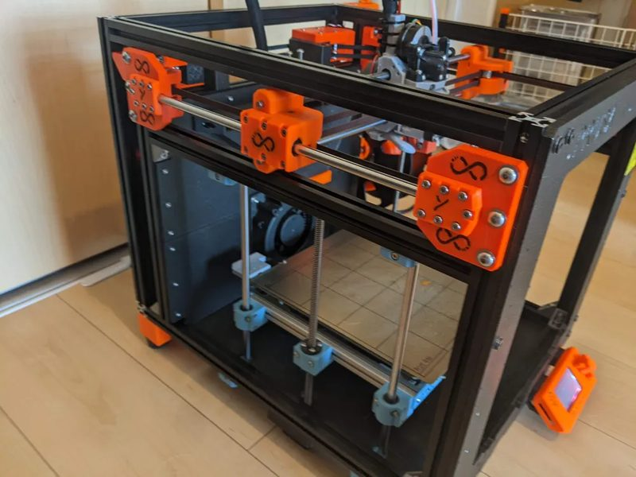
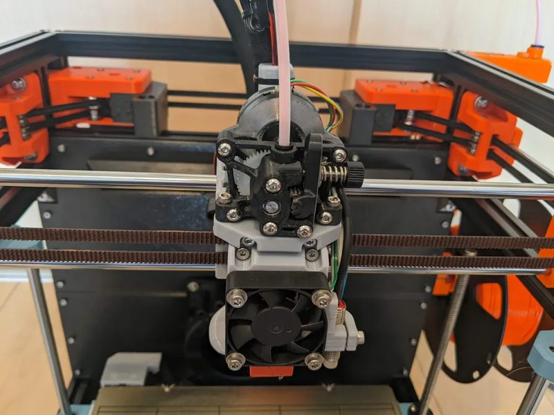
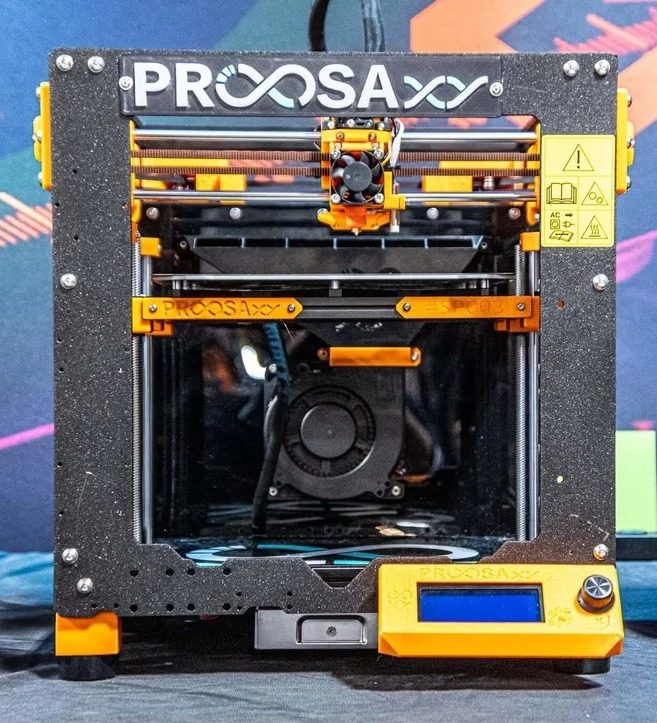

# ProosaXY

[Catalog row](../../README.md#proosaxy) · [Gallery](../../GALLERY.md)

| Field | Value |
| --- | --- |
| Section | Conversions |
| Project page | [https://github.com/SnakeOilXY/ProosaXY](https://github.com/SnakeOilXY/ProosaXY) |
| Author | SnakeOilXY |
| About | Prusa MK3/S CoreXY conversion that reuses donor parts; requires irreversible drilling and cutting. |
| Build volume (X×Y×Z) | — |
| Exterior (W×D×H) | — |
| Latest version | CAD [2026-07](https://github.com/SnakeOilXY/ProosaXY/commit/2044ed8e015997882eb6bf1c48cddba3956e670f) |
| Stars Likes Views |  [🧡⁠583](https://www.printables.com/model/518614-proosaxy-mk3s-to-corexy-conversion) [⏯️⁠9.2K](https://www.youtube.com/watch?v=Dink3JQ-bNY) [❤️⁠91](https://www.youtube.com/watch?v=Dink3JQ-bNY) |
| Links | [CAD](https://github.com/SnakeOilXY/ProosaXY/tree/master/src) [STL](https://github.com/SnakeOilXY/ProosaXY/tree/master/STLs) [BOM](https://github.com/SnakeOilXY/ProosaXY#bom) |
| Groups | [Discord](https://discord.gg/WZVP2HuAag) EN 1.3K |

## Pictures (6)

<table>
<tr><td align="center" width="33%"></td><td align="center" width="33%"></td><td align="center" width="33%"></td></tr>
<tr><td align="center" width="33%"></td><td align="center" width="33%"></td><td align="center" width="33%"></td></tr>
</table>
