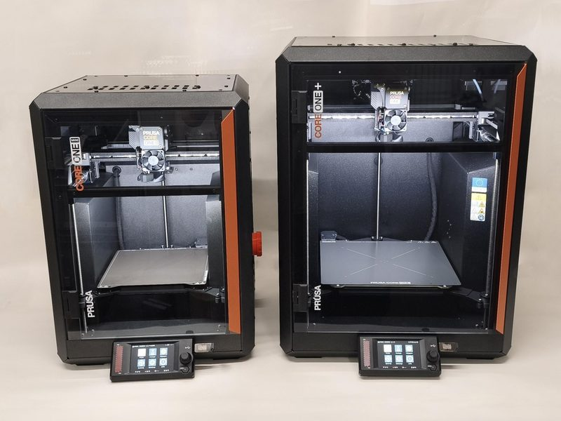
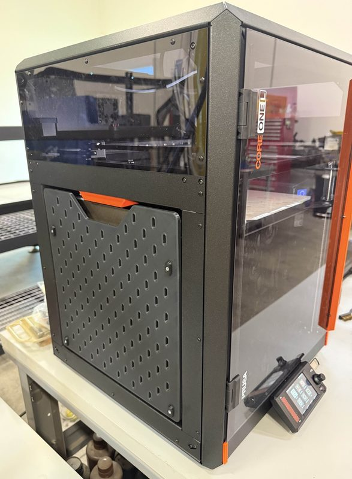
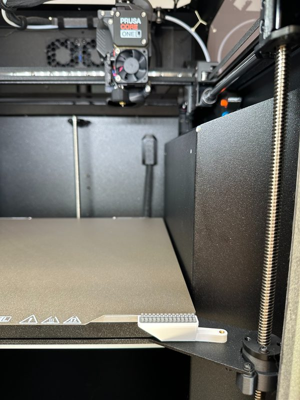

# Prusa CORE One L

[Catalog row](../../README.md#prusa-core-one-l) · [Gallery](../../GALLERY.md)

| Field | Value |
| --- | --- |
| Section | CoreXY · Large (≥300 × 300 mm) |
| Project page | [https://www.printables.com/model/1520379-prusa-core-one-l-full-cad-assembly](https://www.printables.com/model/1520379-prusa-core-one-l-full-cad-assembly) |
| Author | Prusa family |
| About | Larger enclosed CORE One variant with a released STEP/Fusion assembly under the Open Community License. Full manufacturing data is not published. The CAD shows the CORE One L, and the printable parts cover the CORE One L and L+. |
| Build volume (X×Y×Z) | 300×300×330 |
| Exterior (W×D×H) | 469×521×635 |
| Latest version | Files [2026-09](https://www.printables.com/model/1460606-core-one-l-printable-parts) |
| Stars Likes Views | [🧡⁠1.8K](https://www.printables.com/model/1520379-prusa-core-one-l-full-cad-assembly) [⏯️⁠5M](https://www.youtube.com/watch?v=guS0BpeI0aQ) [❤️⁠917](https://www.youtube.com/watch?v=guS0BpeI0aQ) |
| Links | [CAD](https://www.printables.com/model/1520379-prusa-core-one-l-full-cad-assembly) L [STL](https://www.printables.com/model/1460606-core-one-l-printable-parts) L/L+ [Files](https://www.prusa3d.com/page/open-source-at-prusa-research_236812/) |
| Groups | [Forum](https://forum.prusa3d.com/forum/prusa-core-one-l/) EN 78.7K [Reddit](https://www.reddit.com/r/prusa3d/) EN 112K [Forum](https://forum.prusa3d.com/es/) ES 78.7K [Forum](https://forum.prusa3d.com/cs/) CS 78.7K [Facebook](https://www.facebook.com/groups/Prusai3users/) EN 47.5K [Discord](https://discord.gg/prusa3d) EN 13.6K |
| License | [OCL v1 (CAD assembly, Printables), GPL-2.0 (printable parts, Printables)](https://github.com/OpenCommunityLicence/OpenCommunityLicence) |

## Pictures (8)

<table>
<tr><td align="center" width="33%"> Photo: <a href="https://www.prusa3d.com">Prusa Research</a></td><td align="center" width="33%"> Photo: <a href="https://www.printables.com/@suit">suit</a></td><td align="center" width="33%"> Photo: <a href="https://www.prusa3d.com">Prusa Research</a></td></tr>
<tr><td align="center" width="33%"> Photo: <a href="https://www.cgmagonline.com/author/brendanfrye/">Brendan Frye</a></td><td align="center" width="33%"> Photo: <a href="https://www.printables.com/@lostintheslo_4319635">lostinthesloths</a></td><td align="center" width="33%"> Photo: <a href="https://www.printables.com/@lostintheslo_4319635">lostinthesloths</a></td></tr>
<tr><td align="center" width="33%"> Photo: <a href="https://www.printables.com/@lostintheslo_4319635">lostinthesloths</a></td><td align="center" width="33%"> Photo: <a href="https://www.printables.com/@jaydenseric">Jayden Seric</a></td></tr>
</table>

## Other homes of the files

- Wayback Machine: [latest snapshot](https://web.archive.org/web/20260715210403/https://www.printables.com/model/1520379-prusa-core-one-l-full-cad-assembly), 2026-07-15.
