# Prusa CORE One / CORE One L

[Catalog row](../../README.md#prusa-core-one) · [Gallery](../../GALLERY.md)

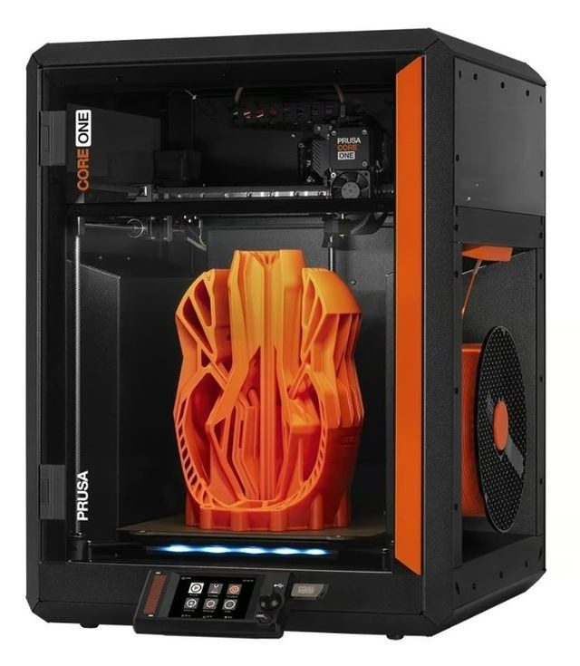

| Field | Value |
| --- | --- |
| Section | CoreXY · Medium (181–299 mm representative X/Y size) |
| Project page | [https://www.printables.com/model/1520471-prusa-core-one-full-cad-assembly](https://www.printables.com/model/1520471-prusa-core-one-full-cad-assembly) |
| Author | Prusa family |
| About | Enclosed commercial CoreXY with released STEP/Fusion assemblies under the Open Community License. Full manufacturing data is not published. The row covers the CORE One and the larger [CORE One L](https://www.printables.com/model/1520379-prusa-core-one-l-full-cad-assembly), which adds a solid aluminium heatbed and active chamber heating. The printable parts cover the CORE One, CORE One+ (Gen 2), CORE One L and L+, and a separate set adds the INDX tool changer. |
| Build volume (X×Y×Z) | CORE One: 250×220×270 CORE One L: 300×300×330 |
| Exterior (W×D×H) | CORE One: 415×444×555 CORE One L: 469×521×635 |
| Latest version | Files [2026-09](https://www.printables.com/model/1167816-core-onegen-2-printable-parts) |
| Stars Likes Views | [🧡⁠2.5K](https://www.printables.com/model/1520471-prusa-core-one-full-cad-assembly) [⏯️⁠5M](https://www.youtube.com/watch?v=guS0BpeI0aQ) [❤️⁠917](https://www.youtube.com/watch?v=guS0BpeI0aQ) |
| Links | [CAD](https://www.printables.com/model/1520471-prusa-core-one-full-cad-assembly) CORE One [STL](https://www.printables.com/model/1167816-core-onegen-2-printable-parts) CORE One/+ [STL](https://www.printables.com/model/1758233-core-one-indx-printed-parts) INDX [CAD](https://www.printables.com/model/1520379-prusa-core-one-l-full-cad-assembly) CORE One L [STL](https://www.printables.com/model/1460606-core-one-l-printable-parts) L/L+ [Files](https://www.prusa3d.com/page/open-source-at-prusa-research_236812/) [Manual](https://help.prusa3d.com/manual/prusa-core-one-kit-assembly_2321) |
| Groups | [Forum](https://forum.prusa3d.com/forum/prusa-core-one/) EN 78.7K [Forum](https://forum.prusa3d.com/forum/prusa-core-one-l/) EN 78.7K [Reddit](https://www.reddit.com/r/prusa3d/) EN 112K [Forum](https://forum.prusa3d.com/es/) ES 78.7K [Forum](https://forum.prusa3d.com/cs/) CS 78.7K [Facebook](https://www.facebook.com/groups/Prusai3users/) EN 47.5K [Discord](https://discord.gg/prusa3d) EN 13.6K |
| License | [OCL v1 (CAD assembly, Printables), GPL-2.0 (printable parts, Printables), OCL v1.1 (INDX parts, Printables)](https://github.com/OpenCommunityLicence/OpenCommunityLicence) |

## Pictures (14)

<table>
<tr><td align="center" width="33%"> Version: CORE One Photo: <a href="https://www.prusa3d.com">Prusa Research</a></td><td align="center" width="33%"><a href="1-prusa-core-one.jpg">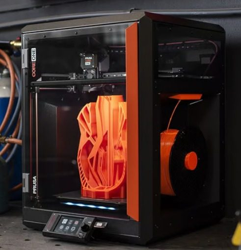</a> Version: CORE One Photo: <a href="https://www.prusa3d.com">Prusa Research</a></td><td align="center" width="33%"><a href="2-prusa-core-one.jpg">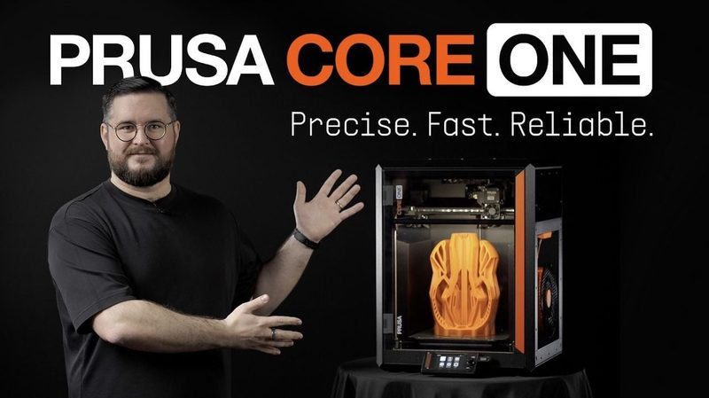</a> Version: CORE One Photo: <a href="https://www.prusa3d.com">Prusa Research</a></td></tr>
<tr><td align="center" width="33%"><a href="3-prusa-core-one.jpg">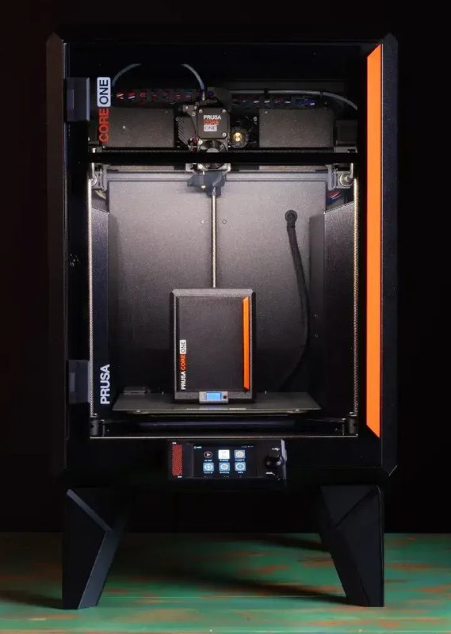</a> Version: CORE One Photo: <a href="https://www.prusa3d.com">Prusa Research</a></td><td align="center" width="33%"><a href="4-prusa-core-one.jpg">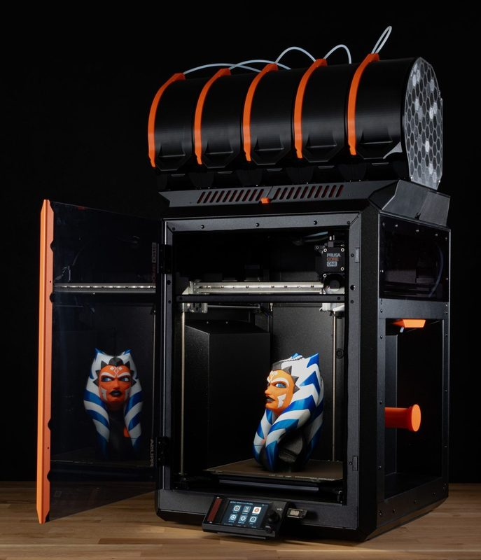</a> Version: CORE One Photo: <a href="https://www.prusa3d.com">Prusa Research</a></td><td align="center" width="33%"><a href="5-prusa-core-one.jpg">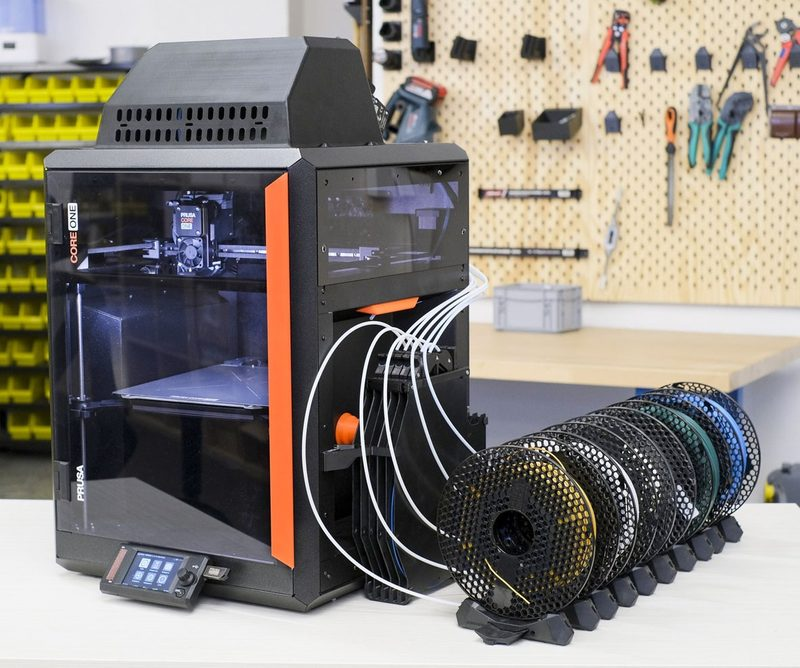</a> Version: CORE One Photo: <a href="https://www.prusa3d.com">Prusa Research</a></td></tr>
<tr><td align="center" width="33%"><a href="6-prusa-core-one.jpg">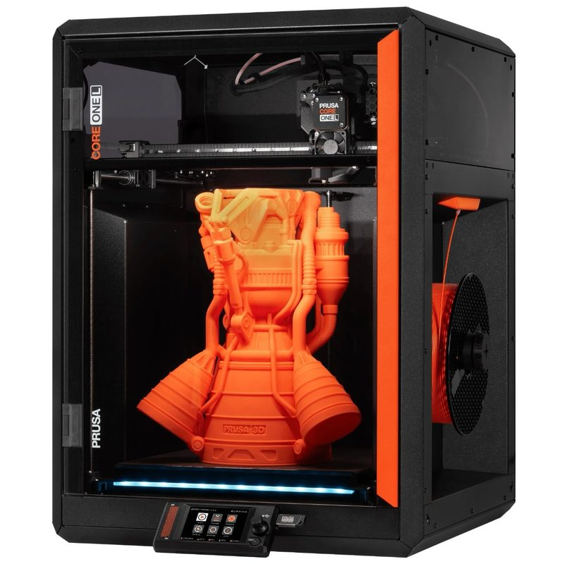</a> Version: CORE One L Photo: <a href="https://www.prusa3d.com">Prusa Research</a></td><td align="center" width="33%"> Version: CORE One L Photo: <a href="https://www.printables.com/@suit">suit</a></td><td align="center" width="33%"><a href="8-prusa-core-one.jpg">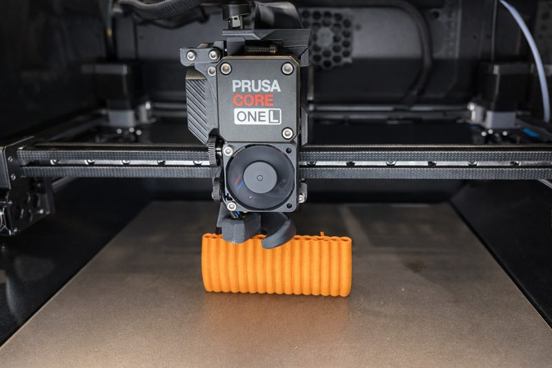</a> Version: CORE One L Photo: <a href="https://www.prusa3d.com">Prusa Research</a></td></tr>
<tr><td align="center" width="33%"><a href="9-prusa-core-one.jpg">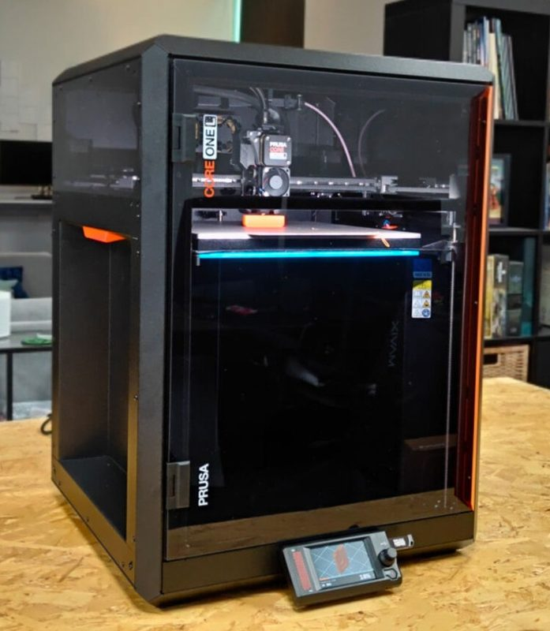</a> Version: CORE One L Photo: <a href="https://www.cgmagonline.com/author/brendanfrye/">Brendan Frye</a></td><td align="center" width="33%"> Version: CORE One L Photo: <a href="https://www.printables.com/@lostintheslo_4319635">lostinthesloths</a></td><td align="center" width="33%"><a href="11-prusa-core-one.jpg">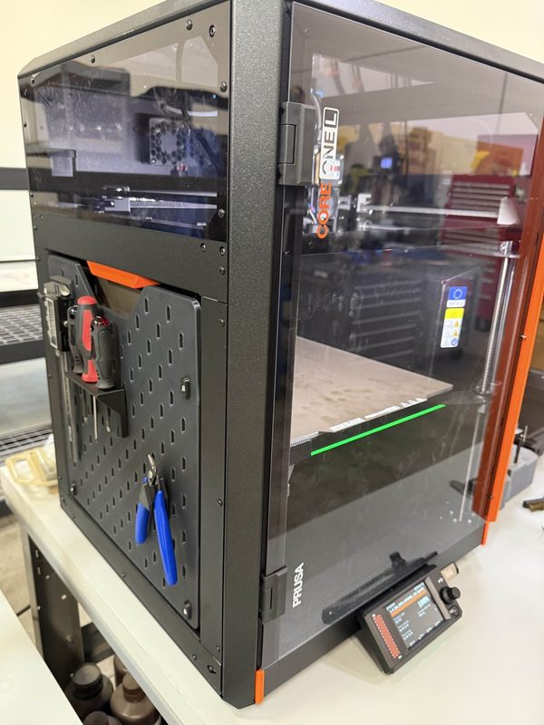</a> Version: CORE One L Photo: <a href="https://www.printables.com/@lostintheslo_4319635">lostinthesloths</a></td></tr>
<tr><td align="center" width="33%"><a href="12-prusa-core-one.jpg">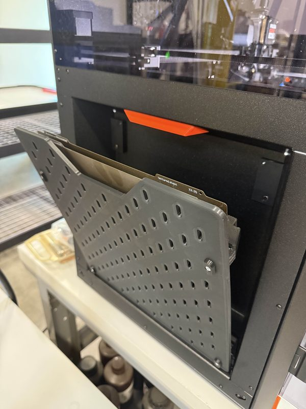</a> Version: CORE One L Photo: <a href="https://www.printables.com/@lostintheslo_4319635">lostinthesloths</a></td><td align="center" width="33%"> Version: CORE One L Photo: <a href="https://www.printables.com/@jaydenseric">Jayden Seric</a></td></tr>
</table>

## Other homes of the files

- Wayback Machine, latest snapshot of each CAD page:
  - [CORE One](https://web.archive.org/web/20260715210328/https://www.printables.com/model/1520471-prusa-core-one-full-cad-assembly) 2026-07-15
  - [CORE One L](https://web.archive.org/web/20260715210403/https://www.printables.com/model/1520379-prusa-core-one-l-full-cad-assembly) 2026-07-15
