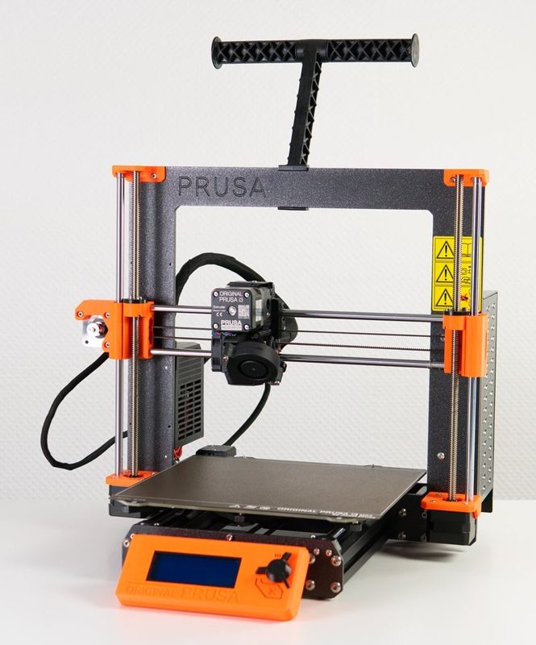
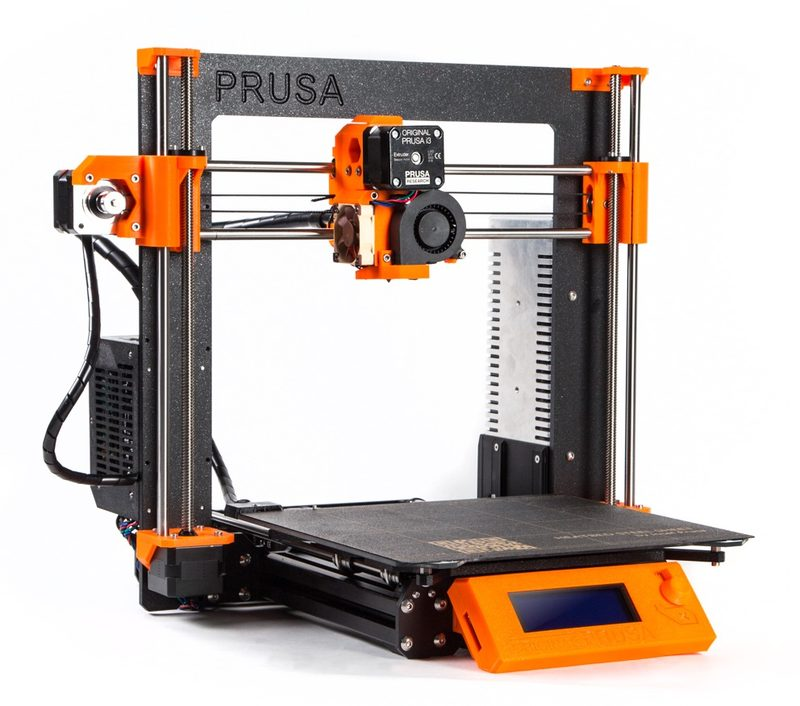
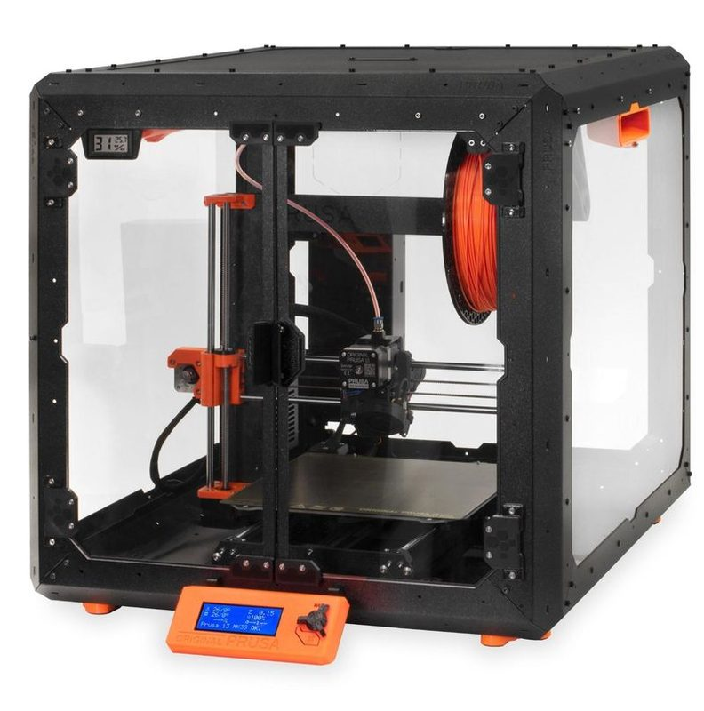
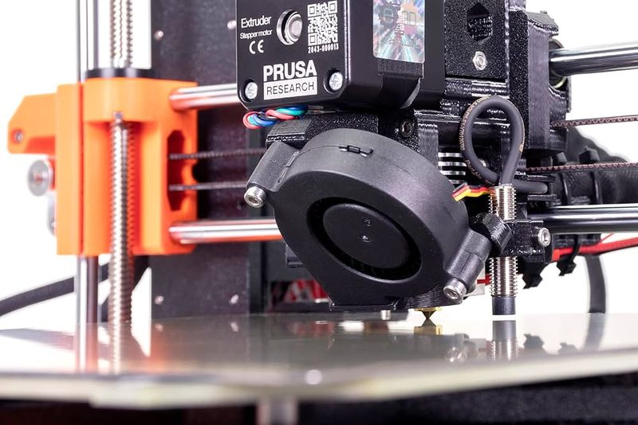
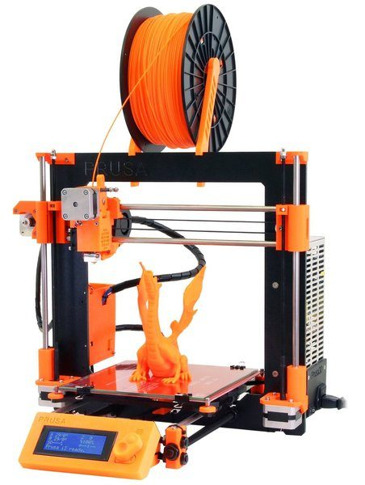
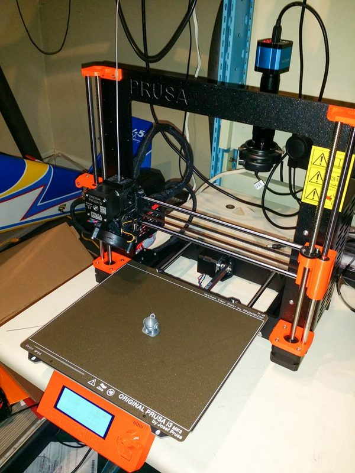
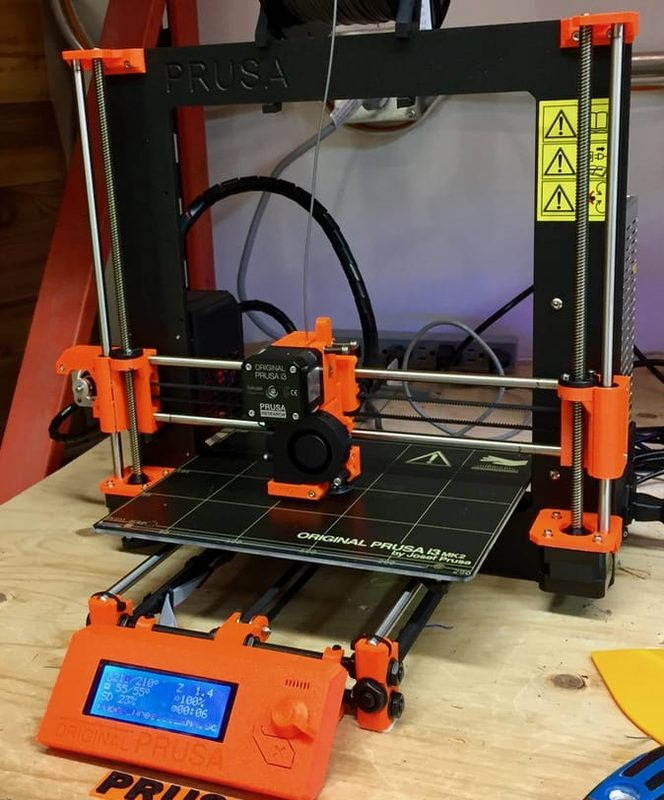
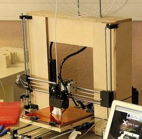
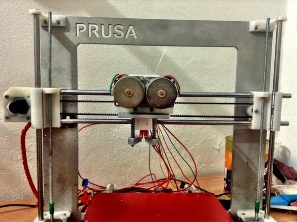

# Prusa i3 (early to MK4S)

[Catalog row](../../README.md#prusa-i3) · [Gallery](../../GALLERY.md)

| Field | Value |
| --- | --- |
| Section | Cartesian · Medium and large (>180 mm on either X/Y axis) |
| Project page | [https://github.com/prusa3d/Original-Prusa-i3](https://github.com/prusa3d/Original-Prusa-i3) |
| Author | Prusa family |
| About | The most copied desktop layout, followed by many commercial clones. It started in 2012 as the RepRap [Prusa i3](https://reprap.org/wiki/Prusa_i3) and grew through MK2, MK3, MK3S+ and MK3.5 to the MK4 and MK4S with a new frame and Nextruder. The MK3.9 and MK3.9S upgrade an MK3S+ to MK4 parts. |
| Build volume (X×Y×Z) | early: 200×200×200 MK3S+: 250×210×210 MK4S: 250×210×220 |
| Exterior (W×D×H) | — |
| Latest version | MK4S [2026-08](https://www.printables.com/model/451500-mk4smk39s-printable-parts) |
| Stars Likes Views |  [🧡⁠5.2K](https://www.printables.com/model/57217) [🤍⁠397](https://www.myminifactory.com/object/3d-print-original-prusa-i3-mk3-57403) [⏯️⁠1.4M](https://www.youtube.com/watch?v=GE-lrRbU124) [❤️⁠11.7K](https://www.youtube.com/watch?v=GE-lrRbU124) |
| Links | [STEP](https://www.printables.com/model/451500-mk4smk39s-printable-parts) MK4S [STEP](https://www.printables.com/model/451501-mk4mk39-printable-parts) MK4 [STL](https://www.printables.com/model/706515-mk35s-printable-parts) MK3.5 [Files](https://github.com/prusa3d/Original-Prusa-i3) MK3S+ [CAD](https://github.com/josefprusa/Prusa3) early [CAD](https://github.com/josefprusa/Prusa3-vanilla) vanilla [Wiki](https://reprap.org/wiki/Prusa_i3) |
| Groups | [Forum](https://forum.prusa3d.com/forum/english-forum-original-prusa-i3-mk3s-mk3/) EN 78.7K [Reddit](https://www.reddit.com/r/prusa3d/) EN 112K [Forum](https://forum.prusa3d.com/es/) ES 78.7K [Forum](https://forum.prusa3d.com/cs/) CS 78.7K [Facebook](https://www.facebook.com/groups/Prusai3users/) EN 47.5K [Discord](https://discord.gg/prusa3d) EN 13.6K [Forum](https://reprap.org/forum/list.php?406) EN |
| License | [Mixed](https://github.com/prusa3d/Original-Prusa-i3/blob/MK3S/LICENSE) |

## Pictures (10)

<table>
<tr><td align="center" width="33%"> Photo: <a href="https://www.prusa3d.com/">Prusa Research</a></td><td align="center" width="33%"> Photo: Matthew Mensley</td><td align="center" width="33%"> Photo: <a href="https://www.prusa3d.com/">Prusa Research</a></td></tr>
<tr><td align="center" width="33%"> Photo: <a href="https://www.prusa3d.com/">Prusa Research</a></td><td align="center" width="33%"> Photo: <a href="https://www.prusa3d.com">Prusa Research</a></td><td align="center" width="33%"> Photo: <a href="https://www.prusa3d.com/">Prusa Research</a></td></tr>
<tr><td align="center" width="33%"> Photo: <a href="https://www.jonshobbies.com/">Jon</a></td><td align="center" width="33%"> Photo: <a href="https://www.fabbaloo.com/">Kerry Stevenson</a></td><td align="center" width="33%"> Photo: <a href="https://www.flickr.com/photos/prusajr/">Josef Prusa</a></td></tr>
<tr><td align="center" width="33%"> Photo: <a href="https://twitter.com/josefprusa">Josef Prusa</a></td></tr>
</table>

## Other homes of the files

- [Printables](https://www.printables.com/model/57217-i3-mk3s-printable-parts): MK3S+ STL and PDF, GPL-2.0.
- [Printables](https://www.printables.com/model/88272-i3-mk3s-printable-parts): MK3S STL, GPL-2.0.
- [Printables](https://www.printables.com/model/88240-i3-mk3-printable-parts): MK3 STL, GPL-2.0.
- [Printables](https://www.printables.com/model/88231-i3-mk2s-printable-parts): MK2S STL, GPL-2.0.
- [Printables](https://www.printables.com/model/88236-i3-mk2-printable-parts): MK2 STL, GPL-2.0.
- [MyMiniFactory](https://www.myminifactory.com/object/3d-print-original-prusa-i3-mk3-57403): MK3 SCAD, STL, and PDF, MyMiniFactory noncommercial terms.
- [MyMiniFactory](https://www.myminifactory.com/object/3d-print-prusa-i3-printable-parts-22479): i3 and MK2 STL, GPL-3.0 in the description.
- Wayback Machine: [latest snapshot](https://web.archive.org/web/20260307095612/https://github.com/prusa3d/Original-Prusa-i3), 2026-03-07.

## Mods and variants

- [P3steel toolson edition MK1](https://www.thingiverse.com/thing:1054909) by toolson: reworked printed parts for the P3Steel steel frame. CC BY-NC.
- [P3steel toolson edition MK2](https://github.com/toolson/P3sTE_MK2) by toolson: second rework on an unmodified P3Steel v2 frame, with sintered-bronze bushings. CC BY-NC 3.0.
- [RotBot](https://www.printables.com/model/288723-4-axis-modification-for-mk3s-with-rotational-print) by Mich (ZHAW): a toolhead with a 45° nozzle that rotates without limit for conical slicing, base Original Prusa i3 MK3S. GPL-3.0.

## Popular mods

- [Prusa Enclosure V2 - MMU2S](https://www.printables.com/model/3673-prusa-enclosure-v2-mmu2s) by Ondřej Stříteský: ikea Lack enclosure with a top section for the MMU2S and its spool buffer. CC BY-NC-SA 4.0.
- [Original Prusa i3 MK3 Enclosure (Ikea Lack)](https://www.printables.com/model/17-original-prusa-i3-mk3-enclosure-ikea-lack-table-pr) by Dom  Cis: prusa Research's official enclosure built from two Ikea Lack tables, printed corners and acrylic panels. CC BY-SA 4.0.
- [Anti-vibration feet for Prusa MK3/S/S+, MK4 and Prusa Mini/+](https://www.printables.com/model/1727-anti-vibration-feet-for-prusa-mk3ss-mk4-and-prusa-) by schuetzi99: printed vibration-damping feet that replace the stock rubber feet. CC BY-NC-ND 4.0.
- [Ultimate Prusa Casing](https://www.printables.com/model/50022-ultimate-prusa-casing) by Extrutim: printed body kit with wide side boxes that covers the frame and electronics. CC BY-NC-SA 4.0.
- [MMU3 printable parts](https://www.printables.com/model/531604-mmu3-printable-parts) by Prusa Research: official MMU3 multi-material unit and its MMU extruder upgrade parts. GPL-2.0.
- [LED Light Bar Prusa i3 MK2/MK3](https://www.printables.com/model/3267-led-light-bar-prusa-i3-mk2mk3) by In3DSpace: LED strip bar mounted on the frame to light the print area. CC BY-NC 4.0.
- [Delta-P fan duct V2-R2 for MK3S(+) extruder](https://www.printables.com/model/62523-delta-p-fan-duct-v2-r2-for-mk3s-extruder) by teookie: alternative part-cooling fan duct for the stock extruder, with more even airflow. GPL-3.0.
- [MK3 or MINI Heatbed Cable Support (Easy Clip On)](https://www.printables.com/model/1107-mk3-or-mini-heatbed-cable-support-easy-clip-on) by INeedOneDesigns: clip-on strain relief for the heatbed cable. CC BY-NC-SA 4.0.
- [Prusa MK3 / MK4 X-motor cable protection](https://www.printables.com/model/22360-prusa-mk3-mk4-x-motor-cable-protection) by argoroots: cover that protects the X-motor cables. CC BY-NC 4.0.
- [Prusa MK4/MK4S Z-Axis Dust Cover](https://www.printables.com/model/452724-prusa-mk4mk4s-z-axis-dust-cover) by Foppemoa: dust cover for the Z-axis lead screws and motors. CC BY-NC-SA 4.0.
- [X2 Delta-P Duct V2R2.2 remix](https://www.printables.com/model/155387-0017-remix-x2-delta-p-duct-v2r22-for-the-mk3s-new) by BuildX: remix of the Delta-P part-cooling duct with a new flow splitter. GPL-3.0.
- [Prusa Mk3 / Mk3s LCD cable clips](https://www.printables.com/model/1683-prusa-mk3-mk3s-lcd-cable-clips) by Martin_au: clips that route the LCD cables along the frame. CC BY 4.0.
- [LED Light Bar Prusa MK4](https://www.printables.com/model/493459-led-light-bar-prusa-mk4) by In3DSpace: LED light bar for the print area. CC BY-NC 4.0.
- [Transport handle for Original Prusa Enclosure](https://www.printables.com/model/252904-transport-handle-for-original-prusa-enclosure) by Prusa Research: transport handle for the Original Prusa Enclosure. GPL-2.0.
- [Hinged lid for adding MMU2S to Original Prusa Enclosure](https://www.printables.com/model/273426-hinged-lid-for-adding-mmu2s-to-original-prusa-encl) by Prusa Research: hinged top lid that makes room for an MMU2S in the Original Prusa Enclosure. GPL-3.0.
- [Fan Guard for Prusa i3 MK3s - snapable](https://www.printables.com/model/16518-fan-guard-for-prusa-i3-mk3s-snapable) by Der Peiner: snap-on guard for the extruder fan. CC BY-NC-SA 4.0.
- [Prusa i3 Bear Upgrade](https://github.com/gregsaun/prusa_i3_bear_upgrade) by gregsaun: replaces the threaded-rod frame with a 2040 aluminium extrusion frame for higher rigidity. GPL-3.0.
- [Prusa MK3/MK3S/MK3S+ Y-Axis Linear Rail Upgrade](https://www.printables.com/model/5620-prusa-mk3-mk3s-mk3s-y-axis-linear-rail-guide-upgra) by KalleKnall: replaces the Y-axis smooth rods and LM8UU bearings with a linear rail carriage. CC BY-NC-SA 4.0.
- [Improved MK4 Fan Duct](https://www.printables.com/model/621536-improved-mk4-fan-duct) by Juan Puchol: redesigned part-cooling fan duct for the Nextruder. CC BY-NC 4.0.
- [Prusa MK3/MK3S/MK3S+ X-Axis Linear Rail Upgrade](https://www.printables.com/model/16838-prusa-mk3-mk3s-mk3s-x-axis-linear-rail-guide-upgra) by KalleKnall: replaces the X-axis smooth rods with a linear rail, with a Bondtech extruder version and MK3S+ tensioner. CC BY-NC-SA 4.0.
