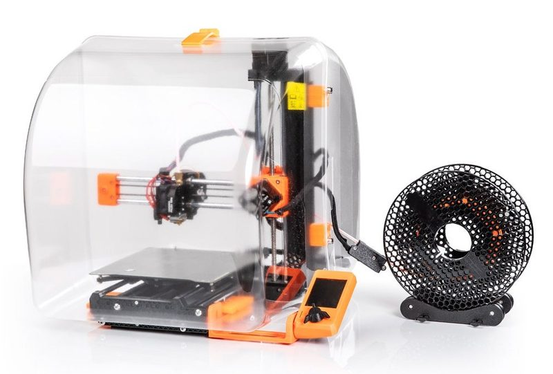
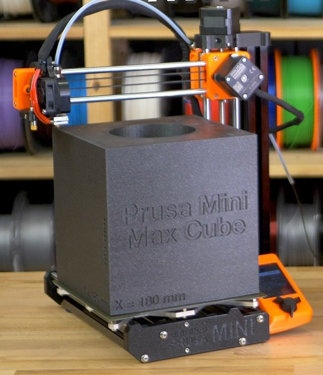
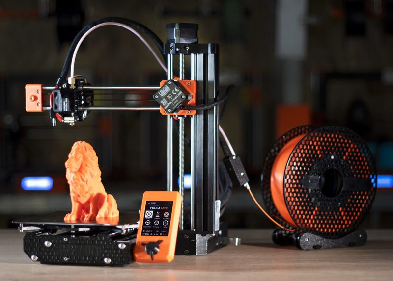
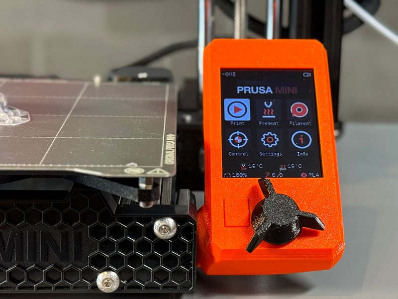

# Original Prusa MINI / MINI+

[Catalog row](../../README.md#prusa-mini) · [Gallery](../../GALLERY.md)

| Field | Value |
| --- | --- |
| Section | Cartesian · Small (≤180 mm on both X/Y axes) |
| Project page | [https://github.com/prusa3d/Original-Prusa-MINI](https://github.com/prusa3d/Original-Prusa-MINI) |
| Author | Prusa family |
| About | Cantilevered 180 mm machine with released STEP, printed parts, BOM, and assembly guide. |
| Build volume (X×Y×Z) | 180×180×180 |
| Exterior (W×D×H) | 380×330×380 |
| Latest version | R8 [2021-02](https://github.com/prusa3d/Original-Prusa-MINI/releases/tag/R8) |
| Stars Likes Views |  [🧡⁠2.7K](https://www.printables.com/model/57214) [⏯️⁠1.8M](https://www.youtube.com/watch?v=ipulB4_Xdm8) [❤️⁠5.6K](https://www.youtube.com/watch?v=ipulB4_Xdm8) |
| Links | [STEP](https://github.com/prusa3d/Original-Prusa-MINI/tree/master/STEP) [BOM](https://github.com/prusa3d/Original-Prusa-MINI/tree/master/BOM) [Manual](https://help.prusa3d.com/en/tag/mini-2/) |
| Groups | [Forum](https://forum.prusa3d.com/forum/original-prusa-mini/) EN 78.7K [Reddit](https://www.reddit.com/r/prusa3d/) EN 112K [Forum](https://forum.prusa3d.com/es/) ES 78.7K [Forum](https://forum.prusa3d.com/cs/) CS 78.7K [Facebook](https://www.facebook.com/groups/Prusai3users/) EN 47.5K [Discord](https://discord.gg/prusa3d) EN 13.6K |
| License | [GPL-3.0 (GitHub), GPL-2.0 (Printables)](https://github.com/prusa3d/Original-Prusa-MINI/blob/master/LICENSE) |

## Pictures (6)

<table>
<tr><td align="center" width="33%"> Photo: <a href="https://www.printables.com/@PrusaResearch">Prusa Research</a></td><td align="center" width="33%"> Photo: <a href="https://www.3dprinterenclosures.com/">3dprinterenclosures</a></td><td align="center" width="33%"> Photo: <a href="https://www.3dsaga.com/">3DSAGA</a></td></tr>
<tr><td align="center" width="33%"> Photo: <a href="https://www.printables.com/@PrusaResearch">Prusa Research</a></td><td align="center" width="33%"></td><td align="center" width="33%"> Photo: <a href="https://alphaplay.ca/">alphaplay</a></td></tr>
</table>

## Other homes of the files

- [Printables](https://www.printables.com/model/57214-mini-printable-parts): STL parts for the MINI+ and a print guide PDF. GPL-2.0.
- Wayback Machine: [latest snapshot](https://web.archive.org/web/20260912164210/https://github.com/prusa3d/Original-Prusa-MINI), 2026-09-12.
