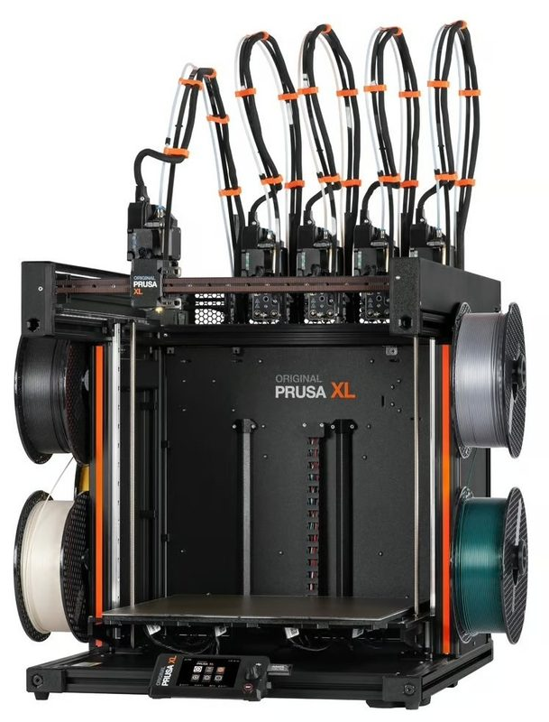
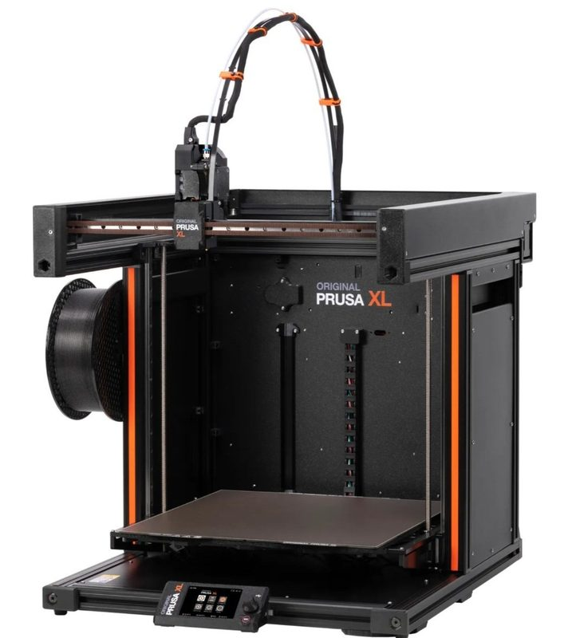
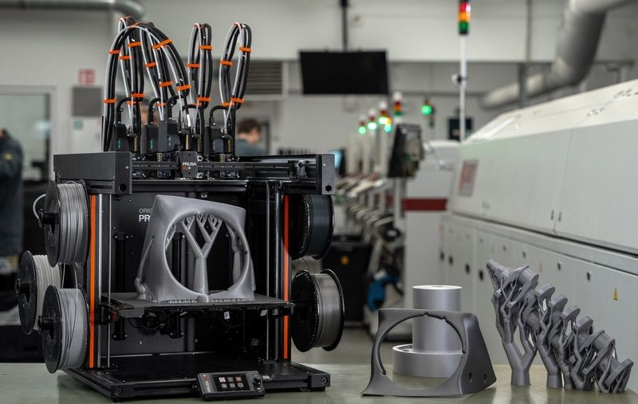
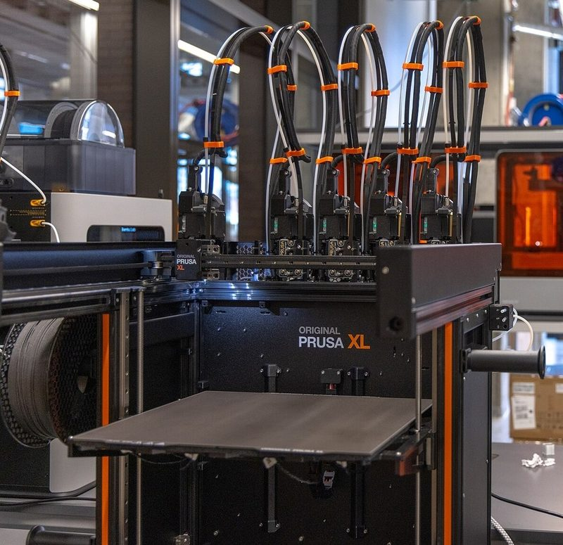
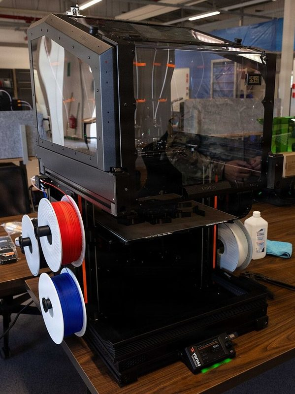
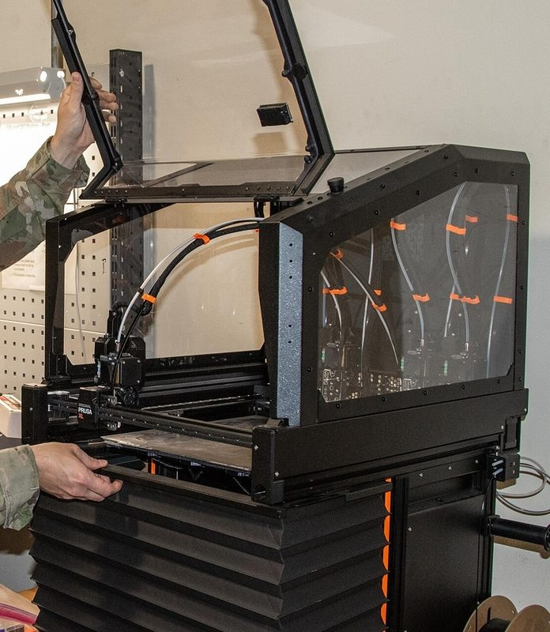
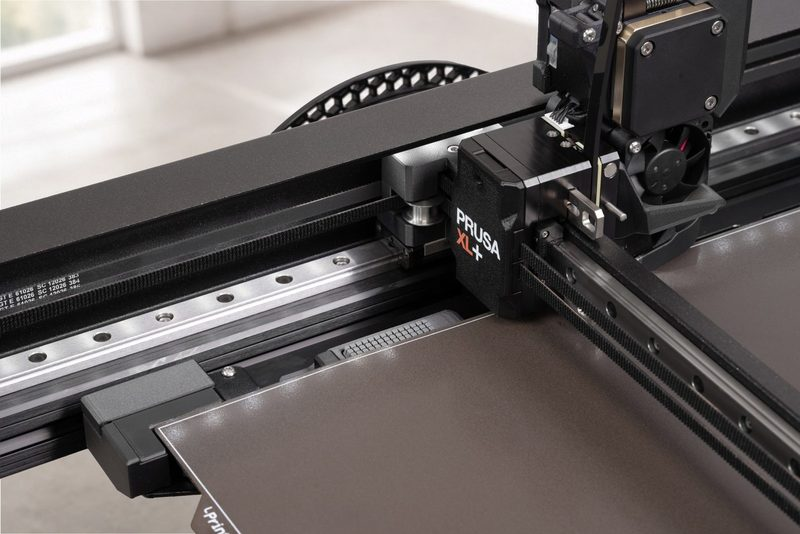

# Prusa XL / XL+

[Catalog row](../../README.md#prusa-xl) · [Gallery](../../GALLERY.md)

| Field | Value |
| --- | --- |
| Section | CoreXY · Large (≥300 × 300 mm) |
| Project page | [https://www.printables.com/model/1814173-xl-printable-parts](https://www.printables.com/model/1814173-xl-printable-parts) |
| Author | Prusa family |
| About | Large CoreXY tool changer with up to five independent toolheads and a modular heatbed. The row covers the Original Prusa XL (2023) and the XL+ (2026), which adds a nozzle wiper, high-flow nozzles and a 60 °C chamber rating. |
| Build volume (X×Y×Z) | 360×360×360 |
| Exterior (W×D×H) | 700×720×900 |
| Latest version | XL+ [2026-08](https://www.printables.com/model/1814173-xl-printable-parts) |
| Stars Likes Views | [🧡⁠1.2K](https://www.printables.com/model/449554-xl-printable-parts) [⏯️⁠804K](https://www.youtube.com/watch?v=6OAAnuEdXWE) [❤️⁠3K](https://www.youtube.com/watch?v=6OAAnuEdXWE) |
| Links | [STEP](https://www.printables.com/model/449554-xl-printable-parts/files) XL [STL](https://www.printables.com/model/1814173-xl-printable-parts/files) XL+ [Manual](https://help.prusa3d.com/product/xl) [Firmware](https://github.com/prusa3d/Prusa-Firmware-Buddy) |
| Groups | [Forum](https://forum.prusa3d.com/forum/original-prusa-xl/) EN 78.7K [Reddit](https://www.reddit.com/r/prusa3d/) EN 112K [Forum](https://forum.prusa3d.com/es/) ES 78.7K [Forum](https://forum.prusa3d.com/cs/) CS 78.7K [Facebook](https://www.facebook.com/groups/Prusai3users/) EN 47.5K [Discord](https://discord.gg/prusa3d) EN 13.6K |
| License | [GPL-2.0 (XL, Printables), Open Community License v1.1 (XL+, Printables)](https://www.printables.com/model/1814173-xl-printable-parts) |

## Pictures (8)

<table>
<tr><td align="center" width="33%"> Version: XL+ five-toolhead Photo: <a href="https://www.printables.com/@Prusa3D">Prusa Research</a></td><td align="center" width="33%"> Version: XL five-toolhead Photo: <a href="https://www.printables.com/@Prusa3D">Prusa Research</a></td><td align="center" width="33%"> Version: XL single-toolhead Photo: <a href="https://www.printables.com/@Prusa3D">Prusa Research</a></td></tr>
<tr><td align="center" width="33%"> Version: XL+ five-toolhead Photo: <a href="https://www.prusa3d.com">Prusa Research</a></td><td align="center" width="33%"> Version: XL five-toolhead Photo: <a href="https://www.flickr.com/people/52030408@N05">Mario Rodriguez</a></td><td align="center" width="33%"> Version: XL with enclosure Photo: <a href="https://www.dvidshub.net/portfolio/1854027">Kaleb Lampkin</a></td></tr>
<tr><td align="center" width="33%"> Version: XL multi-toolhead with enclosure Photo: <a href="https://www.dvidshub.net/portfolio/1450213">Joe Legros</a></td><td align="center" width="33%"> Version: XL+ toolhead Photo: <a href="https://www.prusa3d.com">Prusa Research</a></td></tr>
</table>
