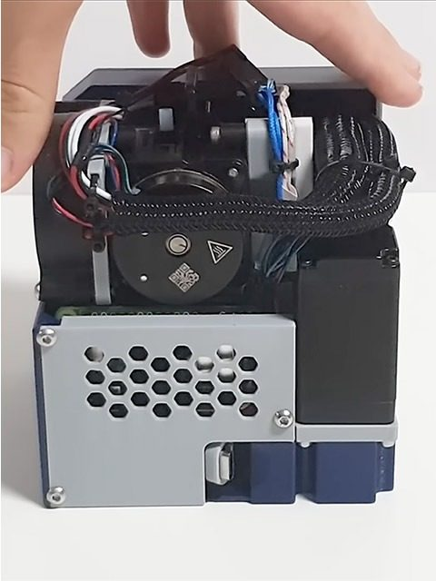
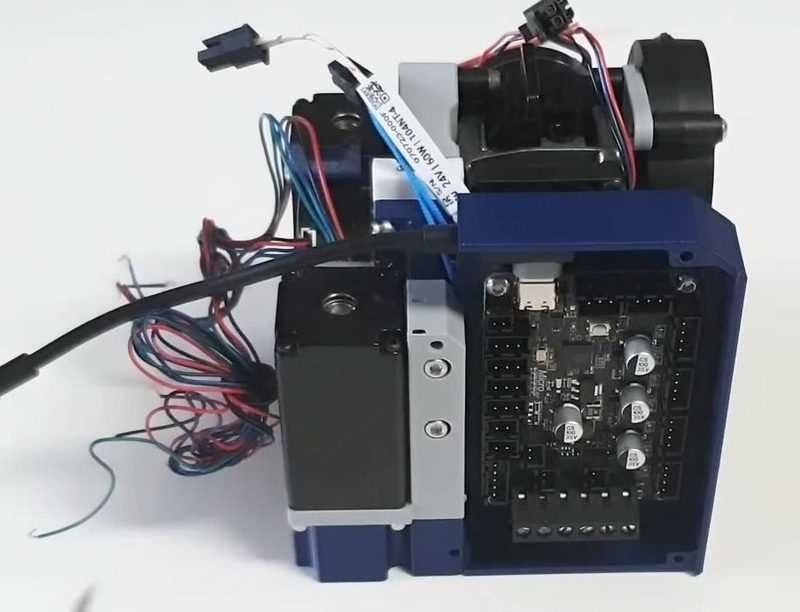
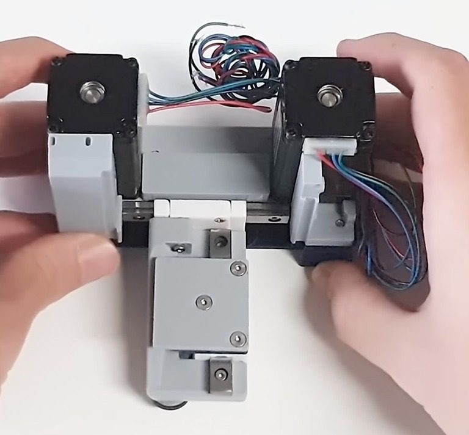
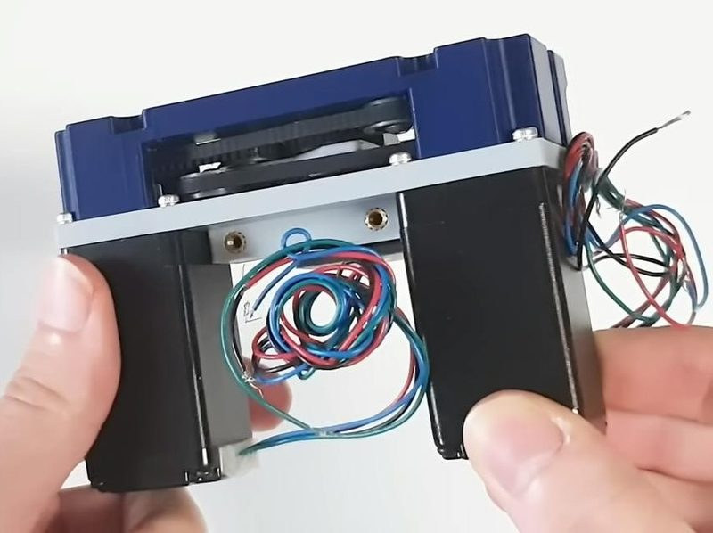
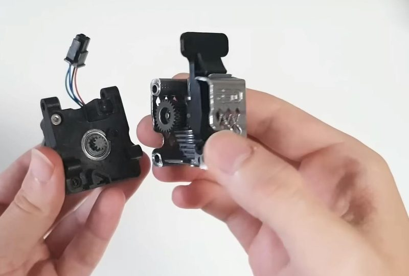
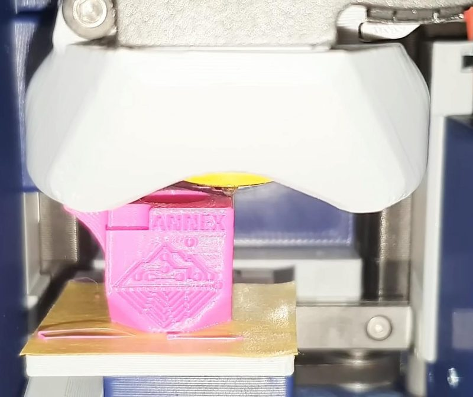

# Quark

[Catalog row](../../README.md#quark) · [Gallery](../../GALLERY.md)

| Field | Value |
| --- | --- |
| Section | Concepts and prototypes |
| Project page | [https://www.youtube.com/watch?v=JCcKdnAFfds](https://www.youtube.com/watch?v=JCcKdnAFfds) |
| Author | RobertGcode |
| About | Palm-sized Cartesian bedslinger and functional design exercise with a 24 mm print cube; no public build package was located. |
| Build type | Cartesian bedslinger |
| Build volume (X×Y×Z) | 24×24×24 |
| Exterior (W×D×H) | 100×100×100 |
| Latest version | First release [2025-10](https://www.youtube.com/watch?v=JCcKdnAFfds) |
| Stars Likes Views | [⏯️⁠55.4K](https://www.youtube.com/watch?v=JCcKdnAFfds) [❤️⁠2.3K](https://www.youtube.com/watch?v=JCcKdnAFfds) |
| Links | [Video](https://www.youtube.com/watch?v=JCcKdnAFfds) |
| Groups | — |

## Pictures (11)

<table>
<tr><td align="center" width="33%"> Photo: <a href="https://www.youtube.com/@robertgcode965">RobertGcode</a></td><td align="center" width="33%"> Photo: <a href="https://www.youtube.com/@robertgcode965">RobertGcode</a></td><td align="center" width="33%"> Photo: <a href="https://www.youtube.com/@robertgcode965">RobertGcode</a></td></tr>
<tr><td align="center" width="33%"> Photo: <a href="https://www.youtube.com/@robertgcode965">RobertGcode</a></td><td align="center" width="33%"> Photo: <a href="https://www.youtube.com/@robertgcode965">RobertGcode</a></td><td align="center" width="33%"> Photo: <a href="https://www.youtube.com/@robertgcode965">RobertGcode</a></td></tr>
<tr><td align="center" width="33%"> Photo: <a href="https://www.youtube.com/@robertgcode965">RobertGcode</a></td><td align="center" width="33%"> Photo: <a href="https://www.youtube.com/@robertgcode965">RobertGcode</a></td><td align="center" width="33%"> Photo: <a href="https://www.youtube.com/@robertgcode965">RobertGcode</a></td></tr>
<tr><td align="center" width="33%"> Photo: <a href="https://www.youtube.com/@robertgcode965">RobertGcode</a></td><td align="center" width="33%"> Photo: <a href="https://www.youtube.com/@robertgcode965">RobertGcode</a></td></tr>
</table>
