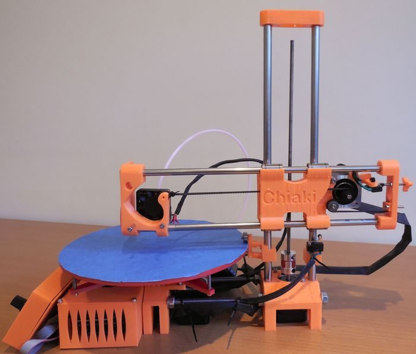
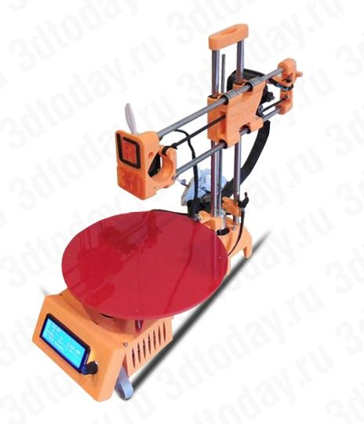

# R-360 Polar

[Catalog row](../../README.md#r360-polar) · [Gallery](../../GALLERY.md)

| Field | Value |
| --- | --- |
| Section | Historical designs |
| Project page | [https://reprap.org/wiki/R_360](https://reprap.org/wiki/R_360) |
| Author | RepRap |
| About | Radial polar motion experiment. One of the few documented open polar printers. |
| Build volume (X×Y×Z) | Ø210×200 |
| Exterior (W×D×H) | — |
| Latest version | CAD [2016-12](https://github.com/kory75/R-360-3D-Printer/commit/bb1308cb728c34756b5bd67819abd588ab218c91) |
| Stars Likes Views | [⏯️⁠33.3K](https://www.youtube.com/watch?v=lvcS7TT98mA) [❤️⁠178](https://www.youtube.com/watch?v=lvcS7TT98mA) |
| Links | — |
| Groups | [Forum](https://reprap.org/forum/list.php?185) EN |

## Pictures (3)

<table>
<tr><td align="center" width="33%"> Photo: <a href="https://reprap.org/wiki/User:Replicator_Warehouse">Replicator Warehouse</a></td><td align="center" width="33%"> Photo: <a href="https://reprap.org/wiki/User:Replicator_Warehouse">Replicator Warehouse</a></td><td align="center" width="33%"> Photo: <a href="https://reprap.org/wiki/User:Replicator_Warehouse">Replicator Warehouse</a></td></tr>
</table>
