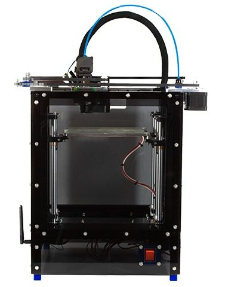
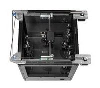
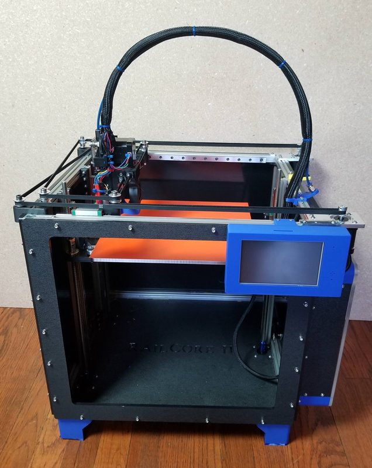

# RailCore Mini

[Catalog row](../../README.md#railcore-mini) · [Gallery](../../GALLERY.md)

| Field | Value |
| --- | --- |
| Section | CoreXY · Small (≤180 mm representative X/Y size) |
| Project page | [https://github.com/railcore/railcore-mini](https://github.com/railcore/railcore-mini) |
| Author | RailCore family |
| About | 1515-extrusion compact CoreXY with three leadscrews for Z. |
| Build volume (X×Y×Z) | 150×150×150 |
| Exterior (W×D×H) | 400×312×470 |
| Latest version | CAD [2022-04](https://github.com/railcore/railcore-mini/commit/7126633b332f44c494e80ee9b0425f59cfda134c) |
| Stars Likes Views |  [🧡⁠17](https://www.printables.com/model/160583-railcore-mini) [⏯️⁠4.4K](https://www.youtube.com/watch?v=IbsZTz1a8SA) [❤️⁠42](https://www.youtube.com/watch?v=IbsZTz1a8SA) |
| Links | [BOM](https://docs.google.com/spreadsheets/d/1TM1vca-hA29apzcBjQ2FyvvZ5D19cWTZl7NxzBflSlU) [Manual](https://railcore.dozuki.com/c/RailCore%C2%AE_Mini_Kit) [Files](https://github.com/railcore/railcore-mini/tree/main/parts) |
| Groups | [Facebook](https://www.facebook.com/groups/RailCore/) EN 2.6K [Discord](https://discord.gg/Sy569Hq) EN 742 [Reddit](https://www.reddit.com/r/railcore/) EN 206 |

## Pictures (4)

<table>
<tr><td align="center" width="33%"></td><td align="center" width="33%"></td><td align="center" width="33%"></td></tr>
<tr><td align="center" width="33%"></td></tr>
</table>
