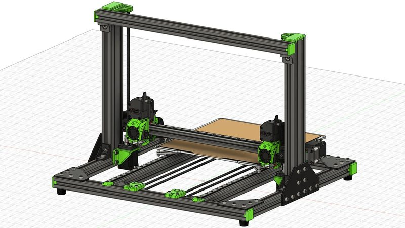
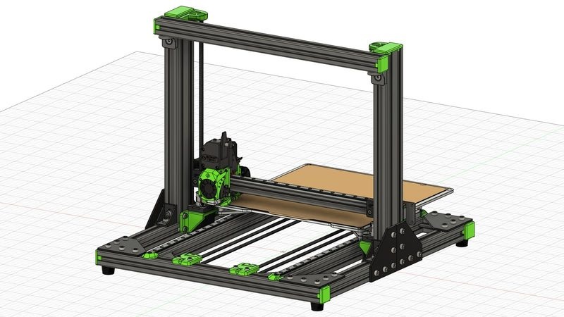
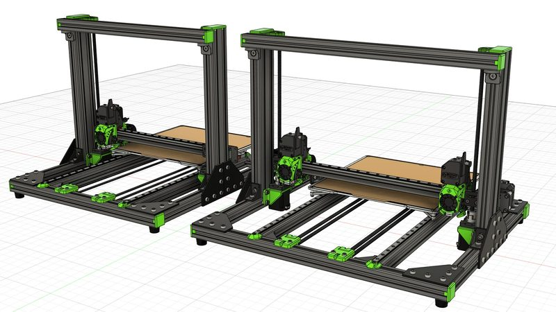
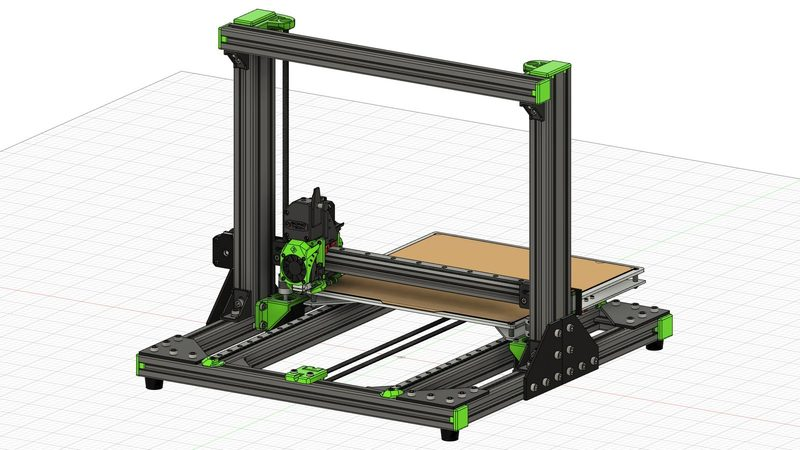
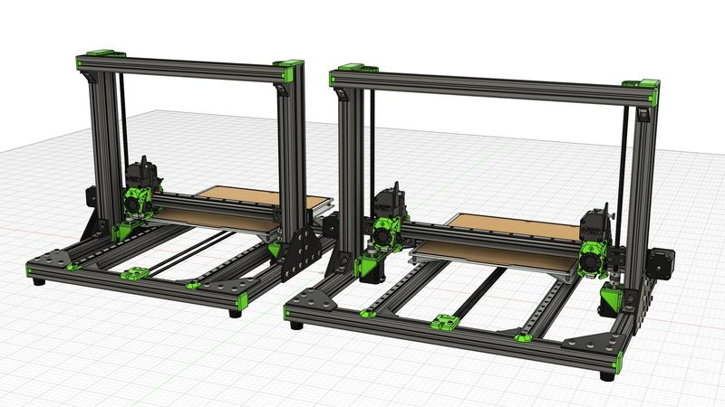
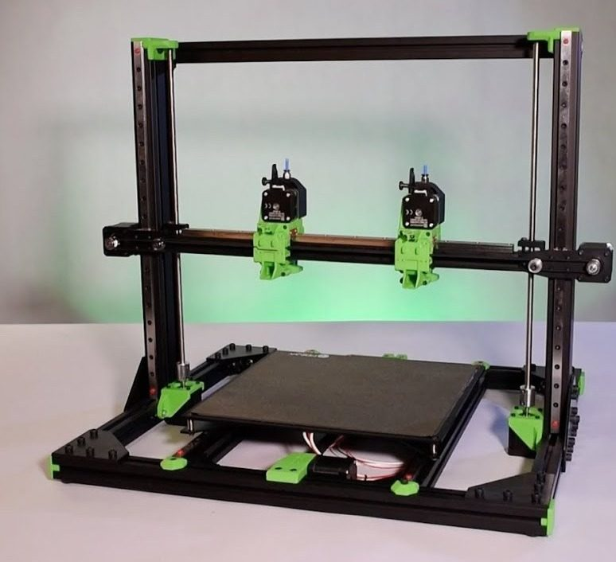
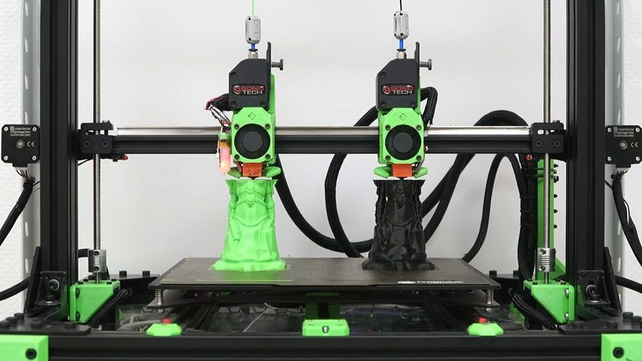
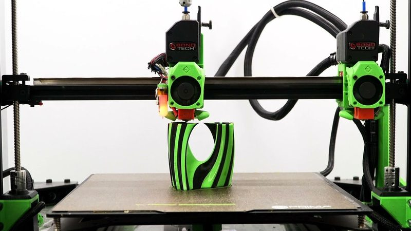
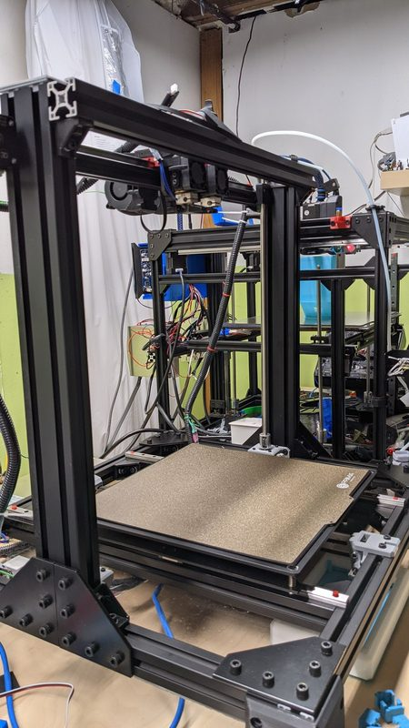

# Rat Rig V-Cast

[Catalog row](../../README.md#ratrig-v-cast) · [Gallery](../../GALLERY.md)

| Field | Value |
| --- | --- |
| Section | Legacy designs |
| Project page | [https://lab.ratrig.com/vcast_1_5/](https://lab.ratrig.com/vcast_1_5/) |
| Author | Rat Rig family |
| About | Cartesian bed slinger on 3030 extrusion with single or IDEX toolheads and an optional wider "Wide Boy" frame for full IDEX travel. Versions: 1.0 sold as a kit from 2020 to 2022, and 1.5 is an unsold prototype update with a reworked X drive and dual Y motors. No update since 2022-10. |
| Build volume (X×Y×Z) | 300×300×? |
| Exterior (W×D×H) | — |
| Latest version | 1.5 [2022-10](https://lab.ratrig.com/vcast_1_5/) |
| Stars Likes Views | [⏯️⁠33.4K](https://www.youtube.com/watch?v=3iKGS-H3x1g) [❤️⁠377](https://www.youtube.com/watch?v=3iKGS-H3x1g) |
| Links | [CAD](https://a360.co/3S9SQY0) [CAD](https://a360.co/3ySI41x) Wide Boy [BOM](https://lab.ratrig.com/vcast_1_5/#bill-of-materials) [CAD](https://a360.co/3TbjzVw) old 1.0 [CAD](https://a360.co/3Tpx1Vi) old 1.0 Wide Boy [BOM](https://lab.ratrig.com/vcast_1_0/#bill-of-materials) old 1.0 [Video](https://www.youtube.com/watch?v=3iKGS-H3x1g) old 1.0 |
| Groups | [Facebook](https://www.facebook.com/groups/ratrig3dprintercommunity) EN 19.9K [Discord](https://discord.gg/ratrig) EN 13.8K [Reddit](https://www.reddit.com/r/RatRig/) EN 3K |
| License | [CC BY-NC-SA 4.0](https://lab.ratrig.com/vcast_1_5/#license) |

## Pictures (9)

<table>
<tr><td align="center" width="33%"> Version: V-Cast 1.5 IDEX Photo: <a href="https://ratrig.com">Rat Rig</a></td><td align="center" width="33%"> Version: V-Cast 1.5 Photo: <a href="https://ratrig.com">Rat Rig</a></td><td align="center" width="33%"> Version: V-Cast 1.5, standard and Wide Boy Photo: <a href="https://ratrig.com">Rat Rig</a></td></tr>
<tr><td align="center" width="33%"> Version: V-Cast 1.0 Photo: <a href="https://ratrig.com">Rat Rig</a></td><td align="center" width="33%"> Version: V-Cast 1.0, standard and Wide Boy Photo: <a href="https://ratrig.com">Rat Rig</a></td><td align="center" width="33%"> Version: V-Cast 1.0 IDEX Photo: <a href="https://ratrig.com">Rat Rig</a></td></tr>
<tr><td align="center" width="33%"> Version: IDEX Photo: <a href="https://ratrig.com">Rat Rig</a></td><td align="center" width="33%"> Version: IDEX Photo: <a href="https://ratrig.com">Rat Rig</a></td><td align="center" width="33%"> Version: V-Cast 1.0 IDEX (mid-build, 2020) Photo: <a href="https://forum.duet3d.com/user/bluedust">BlueDust</a></td></tr>
</table>

## Mods and variants

- [Rat Rig V-Cast 1.5 IDEX 6WD](https://www.printables.com/model/714330) by NecroDavid: builds the V-Cast 1.5 from a CR-10 donor with IDEX and four Y motors. CC BY-NC.
