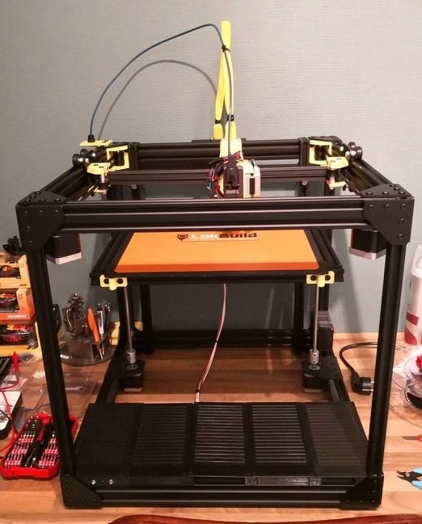
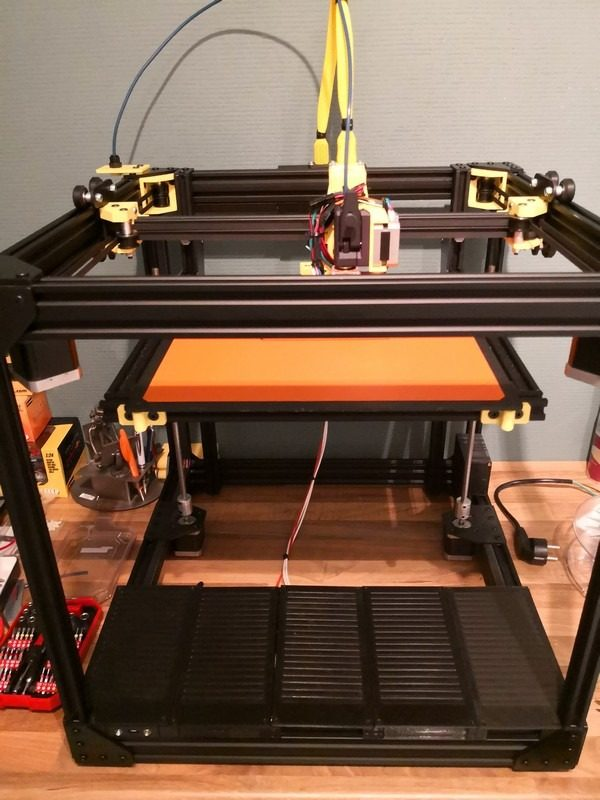
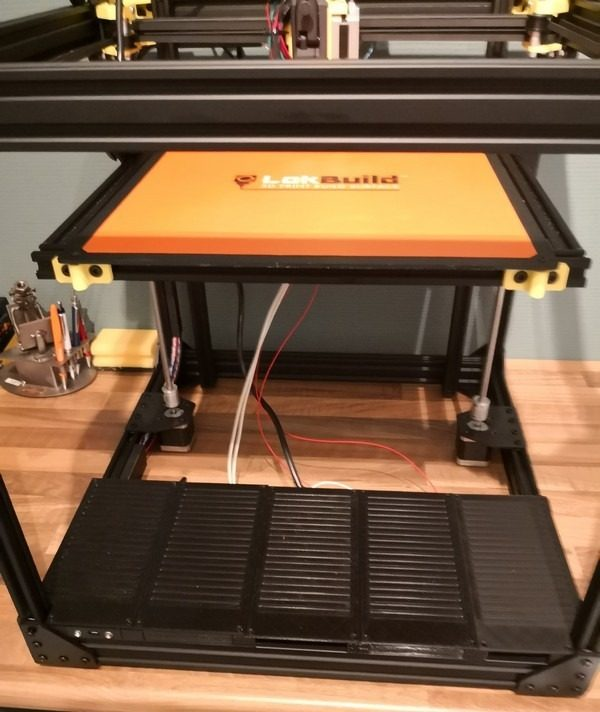
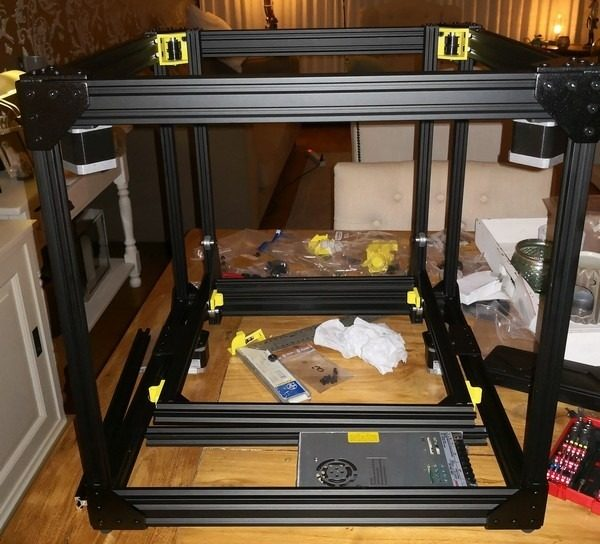
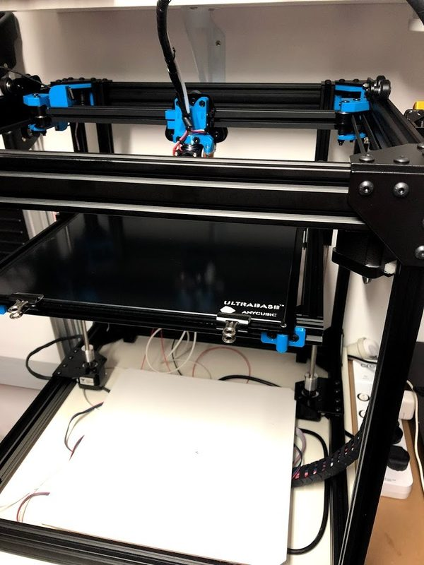
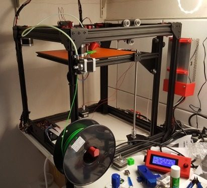
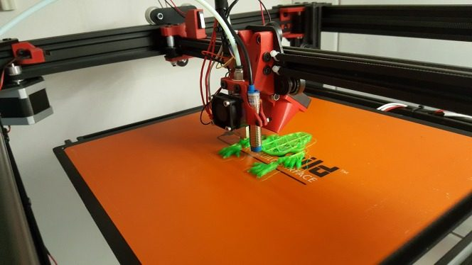
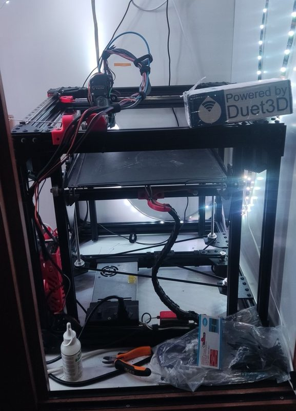
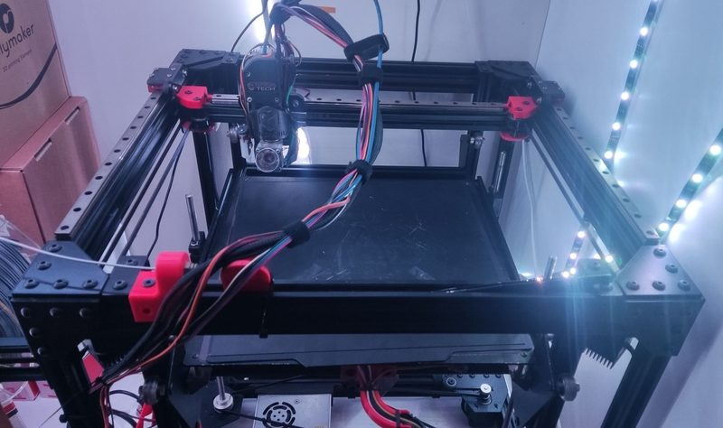

# Rat Rig V-Core 2

[Catalog row](../../README.md#ratrig-v-core-2) · [Gallery](../../GALLERY.md)

| Field | Value |
| --- | --- |
| Section | Historical designs |
| Project page | [https://www.thingiverse.com/thing:2970162](https://www.thingiverse.com/thing:2970162) |
| Author | Rat Rig family |
| About | Early Rat Rig CoreXY kit, a plate-heavy cube of OpenBuilds 20-series V-slot with V-wheels instead of rails and a moving bed on two lead screws. It led to the V-Core Pro. |
| Build volume (X×Y×Z) | 300×300×300 |
| Exterior (W×D×H) | — |
| Latest version | First release [2018-06](https://www.thingiverse.com/thing:2970162) |
| Stars Likes Views | — |
| Links | [Files](https://www.thingiverse.com/thing:2970162/files) |
| Groups | [Facebook](https://www.facebook.com/groups/ratrig3dprintercommunity) EN 19.9K [Discord](https://discord.gg/ratrig) EN 13.8K [Reddit](https://www.reddit.com/r/RatRig/) EN 3K |

## Pictures (9)

<table>
<tr><td align="center" width="33%"> Photo: <a href="https://www.thingiverse.com/CeeKaa">CeeKaa</a></td><td align="center" width="33%"> Photo: <a href="https://www.thingiverse.com/CeeKaa">CeeKaa</a></td><td align="center" width="33%"> Photo: <a href="https://www.thingiverse.com/CeeKaa">CeeKaa</a></td></tr>
<tr><td align="center" width="33%"> Version: during assembly Photo: <a href="https://www.thingiverse.com/CeeKaa">CeeKaa</a></td><td align="center" width="33%"> Photo: <a href="https://www.thingiverse.com/inztigator">inztigator</a></td><td align="center" width="33%"> Photo: <a href="https://www.thingiverse.com/Bengelen">Bengelen</a></td></tr>
<tr><td align="center" width="33%"> Photo: <a href="https://www.thingiverse.com/Bengelen">Bengelen</a></td><td align="center" width="33%"> Version: heavily modified: linear rails, belted Z Photo: <a href="https://forum.duet3d.com/user/gpetropoulos">GPetropoulos</a></td><td align="center" width="33%"> Version: heavily modified: linear rails, belted Z Photo: <a href="https://forum.duet3d.com/user/gpetropoulos">GPetropoulos</a></td></tr>
</table>
