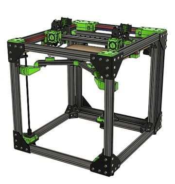
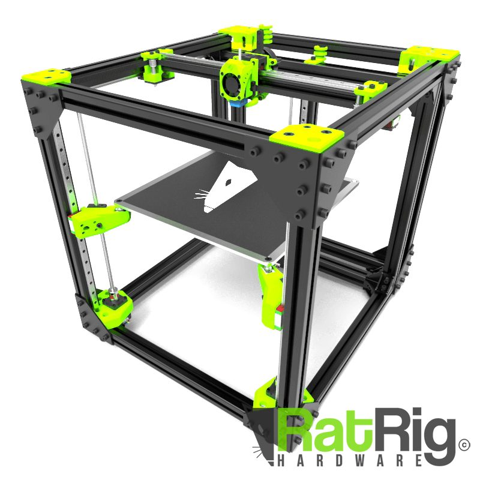
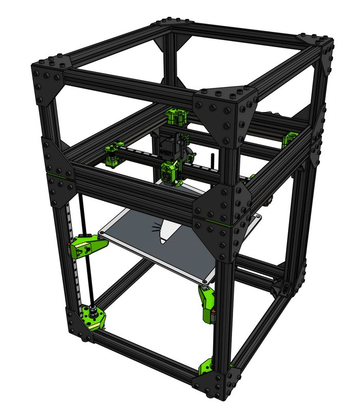
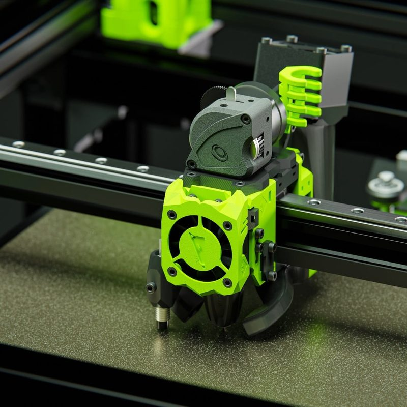
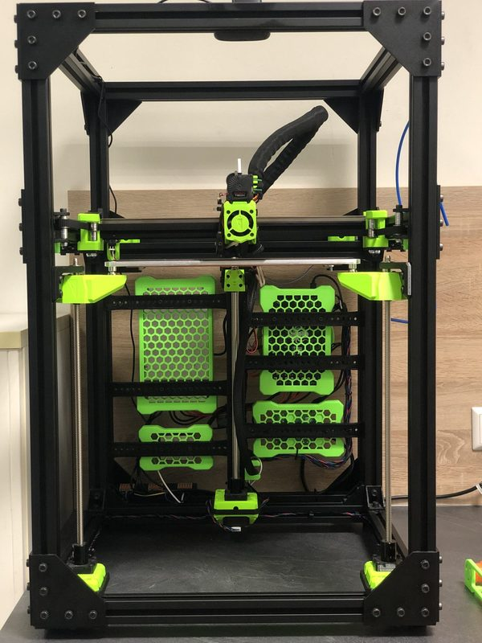
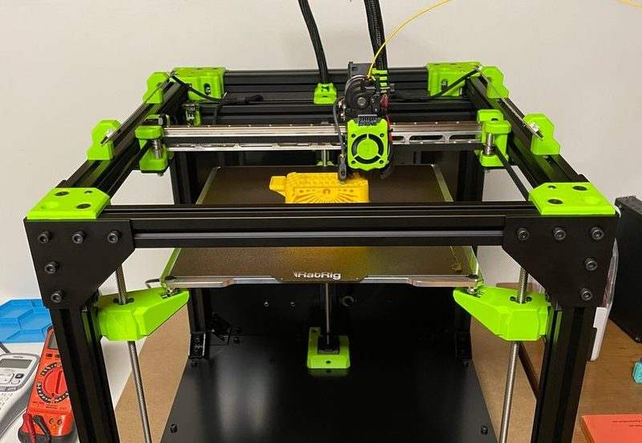
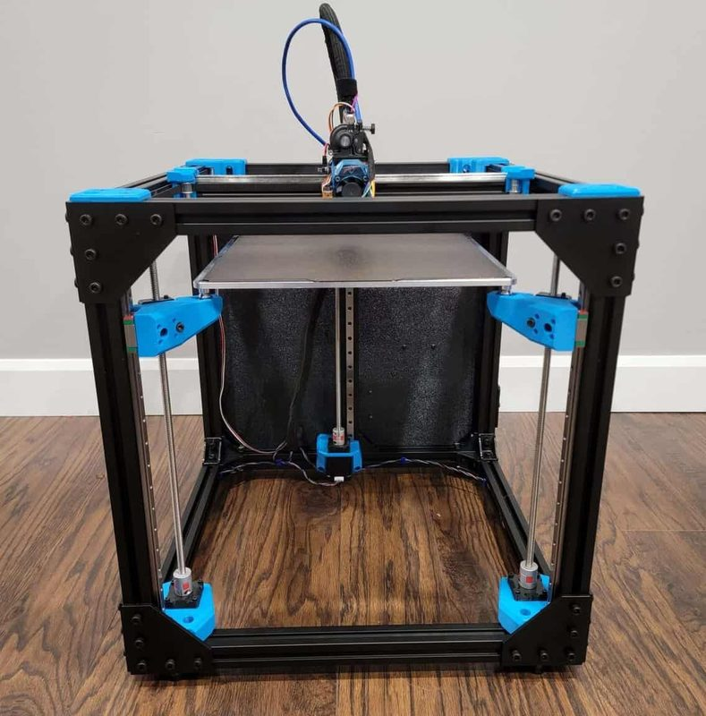

# Rat Rig V-Core 3

[Catalog row](../../README.md#ratrig-v-core-3) · [Gallery](../../GALLERY.md)

| Field | Value |
| --- | --- |
| Section | Legacy designs |
| Project page | [https://github.com/Rat-Rig/V-core-3](https://github.com/Rat-Rig/V-core-3) |
| Author | Rat Rig family |
| About | Scalable CoreXY on a 3030 T-slot frame with MGN12 rails on all axes, stacked 9 mm belts, three Z lead screws under a kinematic bed, and the EVA 3 carriage. The row covers the 3.1 and the 3.2H upgrade kit (2025), which adds two Y motors for a hybrid gantry and needs the Enclosure 2.0. Replaced by the Rat Rig V-Core 4.1. |
| Build volume (X×Y×Z) | 300: 300×300×300 400: 400×400×400 500: 500×500×500 |
| Exterior (W×D×H) | 300: 518×583×560 400: 618×683×660 500: 718×783×760 |
| Latest version | 3.2H [2025-07](https://github.com/Rat-Rig/RatRig-PrintedParts/commit/fb8e395696ec78e6ae29a135dae008f4754d30c4) |
| Stars Likes Views |  [💙⁠340](https://www.thingiverse.com/thing:5430377) [🧡⁠227](https://www.printables.com/model/240707) [⏯️⁠131K](https://www.youtube.com/watch?v=bZ3ZrTCEBIw) [❤️⁠1.5K](https://www.youtube.com/watch?v=bZ3ZrTCEBIw) |
| Links | [Files](https://wiki.ratrig.com/products/v-core-3-2h/files) 3.2H [CAD](https://github.com/Rat-Rig/V-core-3/tree/HEAD/cad) 3.1 [Manual](https://github.com/Rat-Rig/V-core-3/tree/HEAD/docs) 3.1 |
| Groups | [Facebook](https://www.facebook.com/groups/ratrig3dprintercommunity) EN 19.9K [Discord](https://discord.gg/ratrig) EN 13.8K [Reddit](https://www.reddit.com/r/RatRig/) EN 3K |
| License | [CC BY-NC-SA 4.0 (GitHub, Printables, Rat Rig Wiki, later Thingiverse uploads), CC BY-SA (first Thingiverse upload)](https://github.com/Rat-Rig/V-core-3/blob/main/LICENSE) |

## Pictures (7)

<table>
<tr><td align="center" width="33%"> Photo: <a href="https://github.com/Rat-Rig">Rat Rig</a></td><td align="center" width="33%"> Photo: <a href="https://github.com/Rat-Rig">Rat Rig</a></td><td align="center" width="33%"> Photo: <a href="https://github.com/Rat-Rig">Rat Rig</a></td></tr>
<tr><td align="center" width="33%"> Photo: <a href="https://github.com/Rat-Rig">Rat Rig</a></td><td align="center" width="33%"> Photo: <a href="https://www.printables.com/@StepanBandera_653862">Maxim Shchetynin</a></td><td align="center" width="33%"> Photo: <a href="https://www.printables.com/@JanTec">JanTec</a></td></tr>
<tr><td align="center" width="33%"> Photo: Mark Kuhlmann</td></tr>
</table>

## Other homes of the files

- [Printables](https://www.printables.com/model/240707): V-Core 3.1, 246 files, STL, STEP, and DXF, CC BY-NC-SA.
- [Thingiverse](https://www.thingiverse.com/thing:5430377): V-Core 3.1 STL, CC BY-NC-SA 4.0.
- [Thingiverse](https://www.thingiverse.com/thing:5258271): V-Core 3.0 STL, CC BY-NC-SA 4.0.
- [Thingiverse](https://www.thingiverse.com/thing:4893003): first V-Core 3.0 upload, STL, CC BY-SA.
- [GitHub](https://github.com/Rat-Rig/RatRig-PrintedParts/tree/main/V-Core-3.1): V-Core 3.1 printed parts, CC BY-NC-SA 4.0.
- [GitHub](https://github.com/Rat-Rig/RatRig-Panels/tree/main/V-Core-3.1): V-Core 3.1 panels, DXF and STEP, CC BY-NC-SA 4.0.
- [Rat Rig Wiki](https://wiki.ratrig.com/products/v-core-3-1/files): V-Core 3.1 Fusion viewer and BOM, CC BY-NC-SA 4.0.
- Wayback Machine: [latest snapshot](https://web.archive.org/web/20260216044652/https://github.com/Rat-Rig/V-core-3), 2026-02-16.

## Mods and variants

- [V-Core 3.1 IDEX](https://lab.ratrig.com/vc31_idex/) by Rat Rig: prototype IDEX with dual Markforged kinematics, also as a [wide](https://lab.ratrig.com/vc31_idex_wide/) version. CC BY-NC-SA 4.0.
