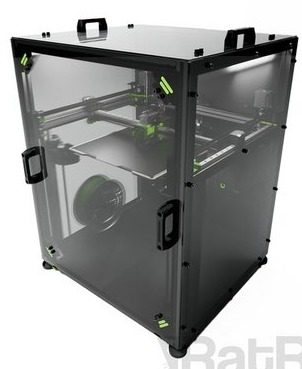
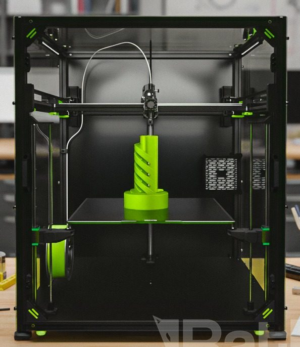
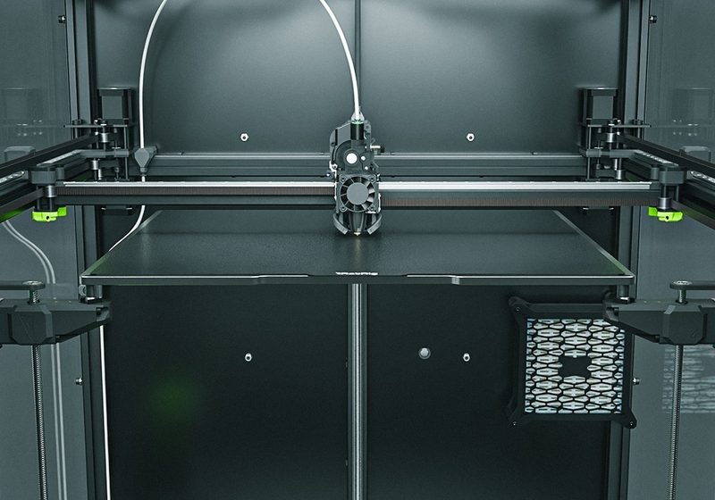
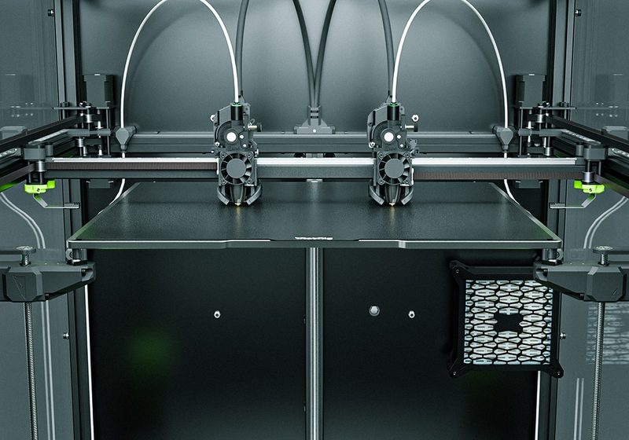
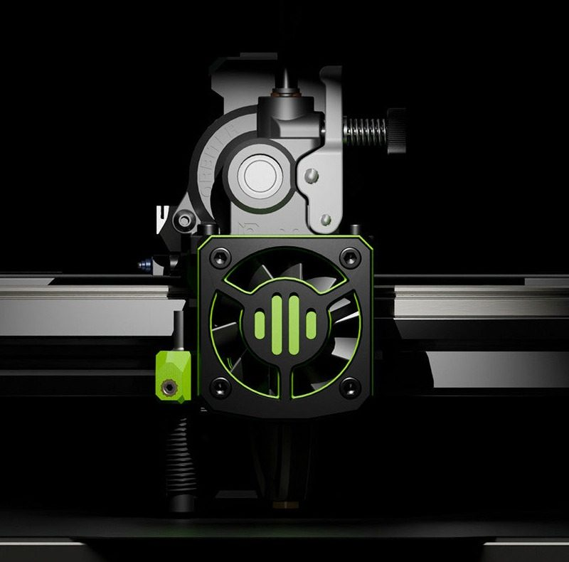

# Rat Rig V-Core 4.1

[Catalog row](../../README.md#ratrig-v-core-4-1) · [Gallery](../../GALLERY.md)

| Field | Value |
| --- | --- |
| Section | CoreXY · Large (≥300 × 300 mm) |
| Project page | [https://ratrig.com/products/rat-rig-v-core-4-1](https://ratrig.com/products/rat-rig-v-core-4-1) |
| Author | Rat Rig family |
| About | Current large-format platform with optional Hybrid and IDEX upgrades. |
| Build volume (X×Y×Z) | 300: 300×300×300 400: 400×400×400 500: 500×500×500 |
| Exterior (W×D×H) | 300: 623×583×785 400: 723×683×885 500: 823×783×985 |
| Latest version | 4.1 [2026-01](https://www.youtube.com/watch?v=R555xlsRq3E) |
| Stars Likes Views | [🧡⁠50](https://www.printables.com/model/1142398) [⏯️⁠29.7K](https://www.youtube.com/watch?v=qzcF4g1z9MI) [❤️⁠794](https://www.youtube.com/watch?v=qzcF4g1z9MI) |
| Links | [CAD](https://a360.co/49FDeXb) [Files](https://wiki.ratrig.com/products/v-core-4-1/files) [Manual](https://wiki.ratrig.com/products/v-core-4-1/build-guide) [BOM](https://docs.google.com/spreadsheets/d/1lGxKfwd0G22HPD6DDV5jK_a0T9UC1q8YWn3PXyn1YvQ/edit) |
| Groups | [Facebook](https://www.facebook.com/groups/ratrig3dprintercommunity) EN 19.9K [Discord](https://discord.gg/ratrig) EN 13.8K [Reddit](https://www.reddit.com/r/RatRig/) EN 3K |
| License | [CC BY-NC-SA 4.0](https://ratrig.com/products/rat-rig-v-core-4-1) |

## Pictures (6)

<table>
<tr><td align="center" width="33%"> Photo: <a href="https://ratrig.com">Rat Rig</a></td><td align="center" width="33%"> Photo: <a href="https://ratrig.com">Rat Rig</a></td><td align="center" width="33%"> Photo: <a href="https://ratrig.com">Rat Rig</a></td></tr>
<tr><td align="center" width="33%"> Photo: <a href="https://ratrig.com">Rat Rig</a></td><td align="center" width="33%"> Photo: <a href="https://ratrig.com">Rat Rig</a></td><td align="center" width="33%"> Photo: <a href="https://ratrig.com">Rat Rig</a></td></tr>
</table>
