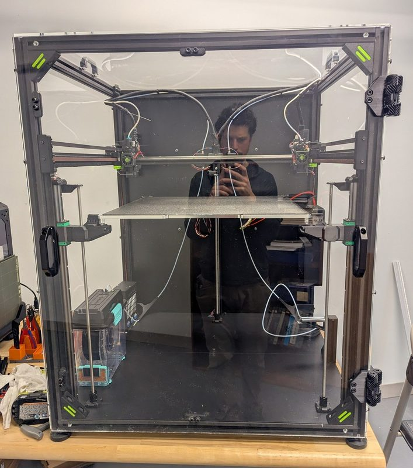
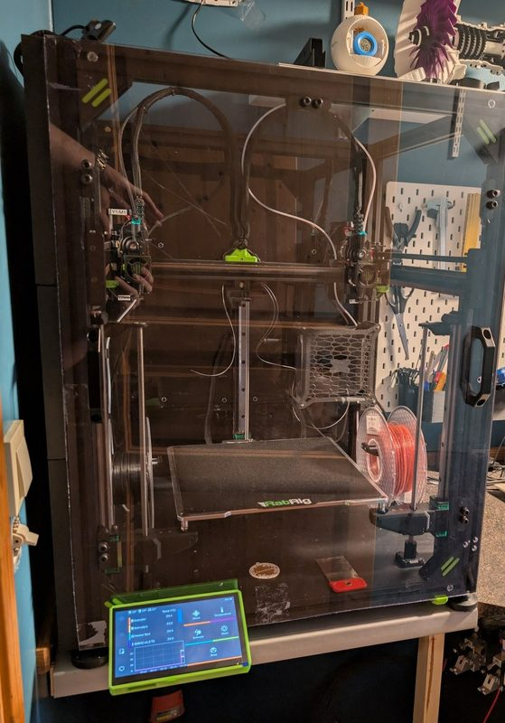
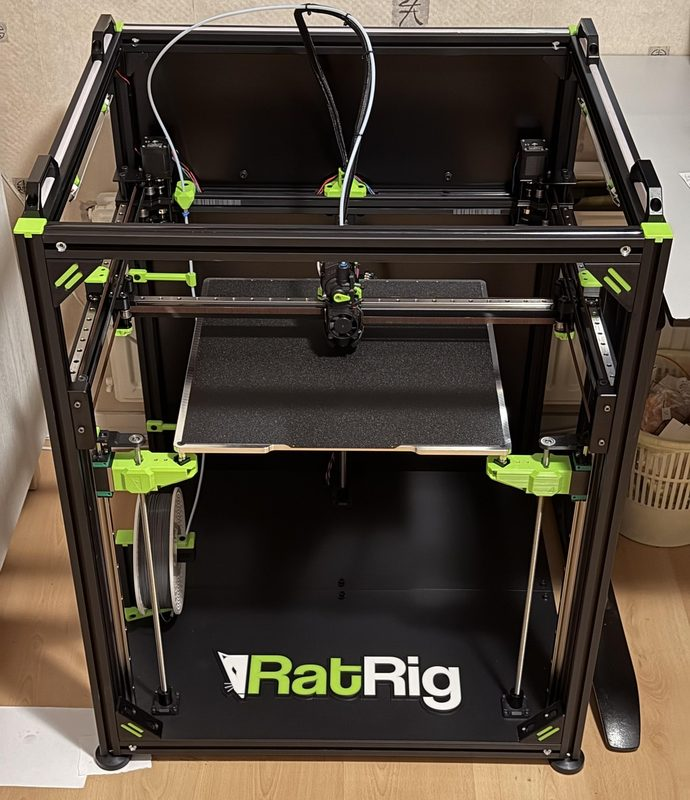
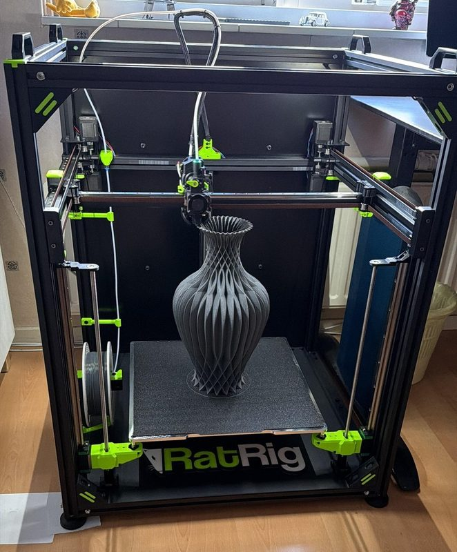

# Rat Rig V-Core 4.1

[Catalog row](../../README.md#ratrig-v-core-4-1) · [Gallery](../../GALLERY.md)

| Field | Value |
| --- | --- |
| Section | CoreXY · Large (≥300 × 300 mm) |
| Project page | [https://ratrig.com/products/rat-rig-v-core-4-1](https://ratrig.com/products/rat-rig-v-core-4-1) |
| Author | Rat Rig family |
| About | Current large-format platform with optional Hybrid and IDEX upgrades. |
| Build volume (X×Y×Z) | 300: 300×300×300 400: 400×400×400 500: 500×500×500 |
| Exterior (W×D×H) | 300: 623×583×785 400: 723×683×885 500: 823×783×985 |
| Latest version | 4.1 [2026-01](https://www.youtube.com/watch?v=R555xlsRq3E) |
| Stars Likes Views | [🧡⁠50](https://www.printables.com/model/1142398) [⏯️⁠29.7K](https://www.youtube.com/watch?v=qzcF4g1z9MI) [❤️⁠794](https://www.youtube.com/watch?v=qzcF4g1z9MI) |
| Links | [CAD](https://a360.co/49FDeXb) [Files](https://wiki.ratrig.com/products/v-core-4-1/files) [Manual](https://wiki.ratrig.com/products/v-core-4-1/build-guide) [BOM](https://docs.google.com/spreadsheets/d/1lGxKfwd0G22HPD6DDV5jK_a0T9UC1q8YWn3PXyn1YvQ/edit) |
| Groups | [Facebook](https://www.facebook.com/groups/ratrig3dprintercommunity) EN 19.9K [Discord](https://discord.gg/ratrig) EN 13.8K [Reddit](https://www.reddit.com/r/RatRig/) EN 3K |
| License | [CC BY-NC-SA 4.0](https://ratrig.com/products/rat-rig-v-core-4-1) |

## Pictures (10)

<table>
<tr><td align="center" width="33%"> Photo: <a href="https://ratrig.com">Rat Rig</a></td><td align="center" width="33%"> Photo: <a href="https://ratrig.com">Rat Rig</a></td><td align="center" width="33%"> Photo: <a href="https://ratrig.com">Rat Rig</a></td></tr>
<tr><td align="center" width="33%"> Photo: <a href="https://ratrig.com">Rat Rig</a></td><td align="center" width="33%"> Photo: <a href="https://ratrig.com">Rat Rig</a></td><td align="center" width="33%"> Photo: <a href="https://ratrig.com">Rat Rig</a></td></tr>
<tr><td align="center" width="33%"> Version: V-Core 4 500 IDEX Photo: <a href="https://www.printables.com/@nnelsonwood_427374">NJNEER</a></td><td align="center" width="33%"> Version: V-Core 4 IDEX Photo: <a href="https://www.printables.com/@zzw11_362108">zzw11</a></td><td align="center" width="33%"> Version: V-Core 4.1 400 Photo: <a href="https://www.reddit.com/user/2021Mike">u/2021Mike</a></td></tr>
<tr><td align="center" width="33%"> Version: V-Core 4.1 400 Photo: <a href="https://www.reddit.com/user/2021Mike">u/2021Mike</a></td></tr>
</table>

## Other homes of the files

- [GitHub, printed parts](https://github.com/Rat-Rig/RatRig-PrintedParts/tree/main/V-Core-4.1): V-Core 4.1 STL. CC BY-NC-SA 4.0.
- [GitHub, panels](https://github.com/Rat-Rig/RatRig-Panels/tree/main/V-Core-4.0): V-Core 4.0 enclosure panels, DXF and STEP. The 4.1 wiki links the same 4.0 panel set. CC BY-NC-SA 4.0.
- [Printables](https://www.printables.com/model/1142398): V-Core 4.0 printed parts STL and panel DXF. CC BY-NC-SA.
- Wayback Machine: [latest snapshot](https://web.archive.org/web/20260226092756/https://ratrig.com/products/rat-rig-v-core-4-1), 2026-02-26.

## Popular mods

- [VzBot Frame Brace for 3030 Extrusions](https://www.printables.com/model/377984-vzbot-frame-brace-for-3030-extrusions) by D!nu: corner braces adapted from the VzBot design for 3030 frames, in short, medium and long versions. CC BY-NC 4.0.
- [CNC Milled Toolhead for the RatRig VCore 4/4.1](https://www.printables.com/model/1384111-cnc-milled-toolhead-for-the-ratrig-vcore-441) by Cristian I: printed parts for a CNC-milled toolhead with mounts for several extruders and toolboards. CC BY-NC-SA 4.0.
- [Full Frontal Gantry mod for Rat Rig V-Core](https://www.printables.com/model/1368881-full-frontal-gantry-mod-for-rat-rig-v-core) by MFBS Design: full Frontal X gantry with ultralight print heads such as Dragon Ace and Rapido. CC BY-NC-SA 4.0.
- [Auxiliary Cooling for the RatRig VCore 4](https://www.printables.com/model/1070795-auxiliary-cooling-for-the-ratrig-vcore-4) by Cristian I: auxiliary part-cooling fan duct, remixed from the Voron Trident auxiliary fan. GPL-3.0.
- [RatRoaster - Enclosure Heater for VCore 4 (unofficial)](https://www.printables.com/model/1148672-ratroaster-enclosure-heater-for-vcore-4-unofficial) by BackwoodsTinkerer: printed housing for a 1000 W enclosure heater core with a fan. CC BY-NC 4.0.
- [Headlamps nozzle lighting for RatRig V-Core 4 Toolhead](https://www.printables.com/model/956804-headlamps-nozzle-lighting-for-ratrig-v-core-4-tool) by tg73: part-fan duct extensions with RGB LEDs that light the nozzle. CC BY-NC-SA 4.0.
- [BTT HDMI7 Mount for Ratrig Vcore 4](https://www.printables.com/model/954381-btt-hdmi7-mount-for-ratrig-vcore-4) by sardonumsei: mount for the BTT HDMI7 screen, with or without the enclosure, for front panels up to 6 mm thick. GPL-3.0.
- [RR V-Core 4 Bed Fan Chamber Heater by PD3D](https://www.printables.com/model/978844-rr-v-core-4-bed-fan-chamber-heater-by-pd3d) by PD3Dmfg: ducts on the front arms that blow two 5015 fans over the bed heater to heat the chamber. CC BY-SA 4.0.
- [CPAP Mod for the RatRig Toolhead VC4](https://www.printables.com/model/1063136-cpap-mod-for-the-ratrig-toolhead-vc4) by Cristian I: toolhead backplate and mount for CPAP part cooling in place of the 4028 fan. CC BY-SA 4.0.
- [RatRig V-Core 4 Nozzle Wiper](https://www.printables.com/model/997567-ratrig-v-core-4-nozzle-wiper) by Scootworks: nozzle wiper using Bambu Lab A1 mini silicone wipers instead of the felt pad. CC BY-NC-SA 4.0.
- [RatRig V-Core 4 rigid toolhead belt clamp](https://www.printables.com/model/993378-ratrig-v-core-4-rigid-toolhead-belt-clamp) by Scootworks: stiffer front belt clamp for the toolhead. CC BY-NC-SA 4.0.
- [Door hinges RatRig VCore 4](https://www.printables.com/model/1019674-door-hinges-ratrig-vcore-4) by Rigattoni: hinges that split the front enclosure panel into two doors. CC BY-NC-SA 4.0.
- [RatRig VCore-4 Enclosure Hinge](https://www.printables.com/model/1258723-ratrig-vcore-4-enclosure-hinge) by NJNEER: geared print-in-place hinge for the enclosure doors, based on the E. Soderberg hinge. CC BY-SA 4.0.
